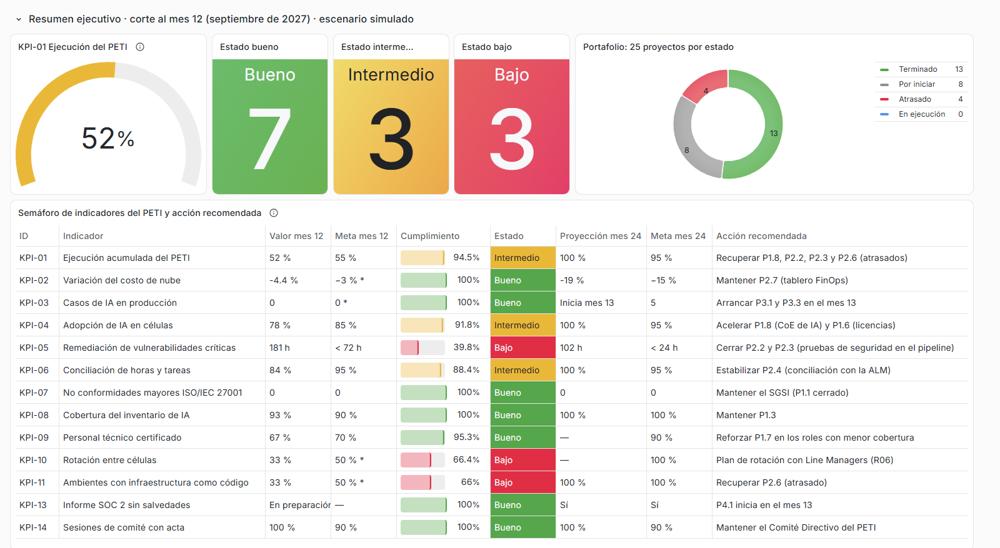
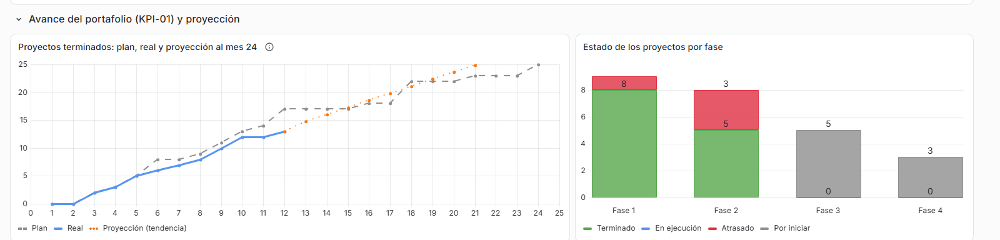
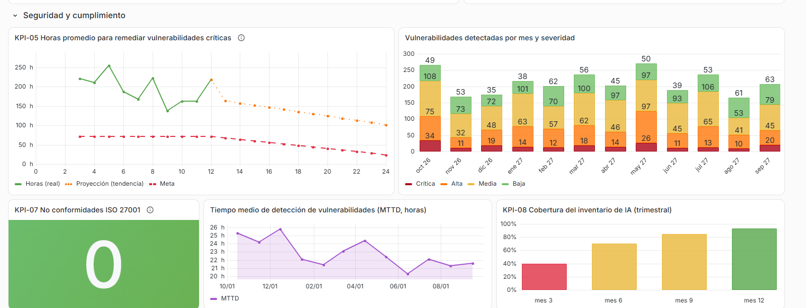
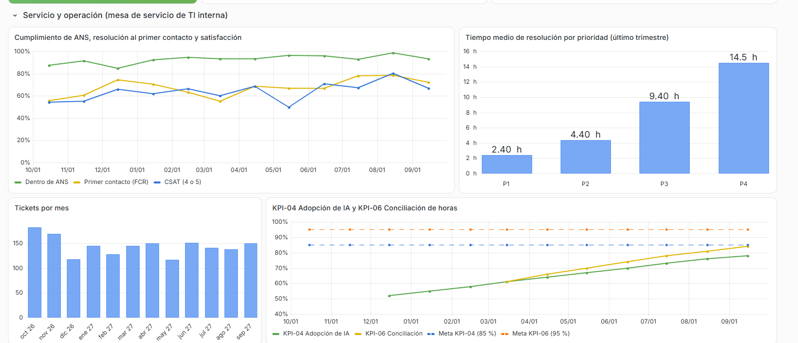
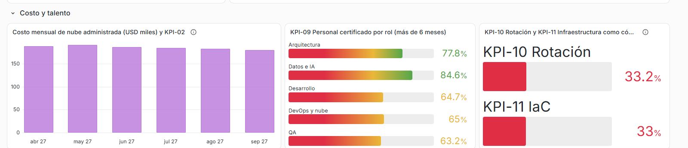

# Dashboard de CIO del PETI Colombia 2026-2028

Trabajo académico del curso Gobierno y Servicios de TI, Universidad Santiago de Cali. Docente: Jair Sanclemente Castro. Equipo Firmes por la Gobernanza. 4 de noviembre de 2026.

## Enlace y acceso

| Campo | Valor |
|---|---|
| Enlace al dashboard | https://snapshots.raintank.io/dashboard/snapshot/XuadxcseLJupiHbunv3ZXRV9u23xjfag |
| Credenciales | No se necesitan: el enlace es una instantánea pública de Grafana y abre sin usuario ni contraseña |
| Herramienta de visualización | Grafana OSS 13.3.0, instantánea publicada en snapshots.raintank.io (servicio de instantáneas de Grafana Labs) |
| Herramienta de datos sintéticos | MOSTLY AI Synthetic Data SDK (paquete `mostlyai`, modo local, código abierto) |
| Datos | Sintéticos. No son datos reales de Perficient ni de ningún cliente |

La instantánea guarda los datos dentro del tablero: se puede pasar el cursor por cada gráfico para ver los valores, ampliar un panel o abrir la descripción de cada indicador (icono "i" junto al título). Lo que no permite es editar el tablero ni cambiar la consulta.

## 1. Qué tipo de dashboard se hizo y por qué

El tablero es para el **Comité Directivo del PETI** (CTO, CISO, dirección de operaciones y de entrega), que según el §12 del PETI recibe cada trimestre el informe de indicadores y proyectos. La decisión que tiene que apoyar es concreta: qué proyectos del portafolio hay que recuperar o acelerar para llegar a las metas del mes 24. Por eso se tomó el corte del **mes 12 (septiembre de 2027)**, la mitad del horizonte del PETI, que es cuando el plan fija metas intermedias para la mayoría de los indicadores.

Las lecturas del curso clasifican los dashboards de dos maneras. CaixaBank Tech los divide por el tipo de análisis (descriptivo, predictivo y prescriptivo) y recomienda elegir según la decisión que se quiere tomar. ManageEngine y CAST los describen por audiencia: el dashboard de CIO reúne finanzas de TI, ciberseguridad, desempeño del servicio y satisfacción, y CAST insiste en que no basta con métricas reactivas (caídas, incidentes) sino que hacen falta tendencias que anticipen problemas y que conecten TI con el negocio. El tablero combina las tres capas:

| Capa | Qué muestra en el tablero | Lectura de referencia |
|---|---|---|
| Descriptiva | Valor del mes 12 de los 13 indicadores del PETI, con semáforo según los rangos del PETI (bueno, intermedio, bajo) | CaixaBank: visión general rápida |
| Predictiva | Proyección al mes 24 por tendencia lineal: avance del portafolio (KPI-01), remediación de vulnerabilidades (KPI-05), adopción de IA, conciliación de horas, IaC y costo de nube | CaixaBank: tendencias; CAST: métricas proactivas |
| Prescriptiva (sencilla) | Columna "Acción recomendada": para cada indicador, el proyecto del PETI que lo corrige o lo sostiene | CaixaBank: recomendar acciones concretas |

La parte prescriptiva no usa aprendizaje automático: es una regla que une cada indicador con su proyecto en el portafolio del PETI Colombia (§9, columna de indicador de cada proyecto). Se prefirió así porque el comité necesita saber a qué proyecto asignar recursos, y esa relación ya está aprobada en el plan.

El artículo de la Universitat Carlemany no trae un método para construir el dashboard; de él se tomaron dos criterios de diseño: que se entienda sin explicación (gráficos etiquetados, resumen arriba y detalle abajo) y que se pueda ajustar a los objetivos del usuario.

## 2. Método seguido

Como la actividad no fija un método, se siguieron siete pasos, armados a partir de las buenas prácticas de las lecturas:

1. **Usuario y decisión.** Comité Directivo del PETI; decidir qué proyectos recuperar.
2. **Tipo de dashboard.** Estratégico de CIO, descriptivo con capa predictiva y prescriptiva (sección 1).
3. **Indicadores.** Los 13 indicadores del PETI Colombia (§10) más los indicadores operativos de mesa de servicio y seguridad que proponen ManageEngine y CAST (cumplimiento de ANS, resolución al primer contacto, satisfacción, tiempo de resolución, MTTD).
4. **Datos.** Tablas semilla por reglas, sintetizadas con MOSTLY AI (sección 4).
5. **Cálculo.** Indicadores del mes 12, semáforo y proyecciones, con un script en Python.
6. **Diseño en Grafana.** Cinco filas que van de lo general a lo específico (sección 3).
7. **Publicación y revisión.** Instantánea pública y revisión de que no aparezca información restringida del proyecto.

## 3. Estructura del tablero

| Fila | Paneles | Pregunta que responde |
|---|---|---|
| Resumen ejecutivo | Medidor de KPI-01, conteo de indicadores por estado, anillo del portafolio por estado, tabla semáforo con proyección y acción recomendada | ¿Cómo va el plan y qué hay que corregir? |
| Avance del portafolio | Proyectos terminados (plan, real y proyección al mes 24); estado de los proyectos por fase | ¿Se llega al 95 % de ejecución en el mes 24? |
| Seguridad y cumplimiento | KPI-05 con meta y proyección; vulnerabilidades por severidad; KPI-07; MTTD; KPI-08 | ¿Se cierra a tiempo lo crítico y se sostiene la certificación? |
| Servicio y operación | ANS, primer contacto y satisfacción; tiempo de resolución por prioridad; tickets por mes; KPI-04 y KPI-06 | ¿La mesa de servicio de TI interna mejora y se adopta la IA? |
| Costo y talento | Costo mensual de nube y KPI-02; KPI-09 por rol; KPI-10 y KPI-11 | ¿Baja el costo de nube y se forma al personal? |

## 4. Datos sintéticos

La actividad pide usar datos sintéticos. El PETI todavía no tiene mediciones reales (está en su segundo mes y varias líneas base están "por medir"), y los datos operativos de Perficient no son públicos. Los datos se construyeron en dos niveles:

**Registros detallados sintetizados con MOSTLY AI.** Se generaron por reglas tres tablas semilla que imitan lo que exportaría una mesa de servicio, una herramienta de pruebas de seguridad y el sistema de talento humano, con una mejora gradual mes a mes por efecto de los proyectos del PETI. MOSTLY AI entrenó un generador por tabla en modo local (el SDK de código abierto no pide cuenta ni clave y los datos no salen del equipo) y produjo una tabla sintética del mismo tamaño. El dashboard usa las tablas sintéticas. En un caso real, el generador se entrenaría con las exportaciones reales de la ALM y de la mesa de servicio, y el tablero se podría compartir sin exponer registros de personas ni de clientes.

| Tabla | Contenido | Filas semilla | Filas sintéticas |
|---|---|---|---|
| Tickets | Mesa de servicio de TI interna: fecha, célula, categoría, prioridad, horas de resolución, cumplimiento del ANS, resolución al primer contacto y satisfacción | 1734 | 1734 |
| Vulnerabilidades | Hallazgos de seguridad: fecha, célula, severidad, origen (SAST, SCA, DAST, pentest), horas de detección y de remediación | 2531 | 2531 |
| Personas | Personal técnico: rol, célula, antigüedad, certificaciones y rotación entre células | 220 | 220 |

Cada generador se entrenó durante un máximo de dos minutos en CPU (entre 75 y 145 segundos por tabla, porque el entrenamiento se detiene solo cuando deja de mejorar). Para revisar si los datos sintéticos conservan lo que dicen los originales, se compararon métricas de ambas versiones:

| Tabla | Métrica | Semilla | Sintética |
|---|---|---|---|
| Tickets | Horas promedio de resolución | 11,8 | 11,6 |
| Tickets | Dentro del ANS | 90,3 % | 92,8 % |
| Tickets | Resueltos al primer contacto | 60,3 % | 67,0 % |
| Tickets | Satisfacción promedio (1 a 5) | 3,76 | 3,79 |
| Tickets | Prioridad P1 | 6,4 % | 5,5 % |
| Vulnerabilidades | Proporción de críticas | 8,8 % | 8,0 % |
| Vulnerabilidades | Horas promedio para remediar una crítica | 126 | 228 |
| Vulnerabilidades | Horas promedio de detección | 23,0 | 22,9 |
| Personas | Con al menos una certificación | 65,0 % | 66,8 % |
| Personas | Antigüedad promedio (meses) | 26,3 | 25,1 |
| Personas | Rotadas en el último año | 37,7 % | 33,2 % |

Las proporciones y los promedios generales se conservan. La excepción es la relación entre severidad y horas de remediación: el generador casi duplicó el tiempo de las vulnerabilidades críticas, porque mezcla en parte su comportamiento con el de las medias y bajas, que tardan mucho más. Con la primera versión de la semilla (669 hallazgos, unos 70 críticos) la diferencia era de casi cuatro veces; al aumentar la tabla a 2531 hallazgos bajó a menos de dos, y alargar el entrenamiento no cambió nada. El efecto llega al tablero: con la semilla, KPI-05 del último trimestre daría unas 98 horas (estado intermedio) y con los datos sintéticos da 181 horas (estado bajo). La lección para un uso real es que el informe de calidad de los datos sintéticos se revisa antes de decidir con ellos, sobre todo en los indicadores que dependen de una relación entre columnas y no de un promedio general.

**Series de escenario.** Los indicadores que no salen de registros detallados (avance del portafolio, adopción de IA, conciliación de horas, inventario de IA, IaC y costo de nube) se escribieron como series mensuales de un escenario: el portafolio avanza con cuatro proyectos atrasados (P1.8, P2.2, P2.3 y P2.6) y el resto en plazo. Son supuestos del equipo y están en `scripts/dashboard_construir.py`.

Otros supuestos que conviene tener presentes al leer el tablero:

- Cuando el PETI solo fija meta al mes 24 (KPI-02, KPI-03, KPI-10 y KPI-11), la meta del mes 12 es una interpolación lineal; en el tablero lleva asterisco.
- El cumplimiento se calcula como valor sobre meta (o meta sobre valor cuando menos es mejor, como en KPI-05) y se clasifica con los rangos del PETI: bueno, 95 % o más; intermedio, entre 71 % y 94 %; bajo, 70 % o menos.
- KPI-07 supone que la auditoría de recertificación ISO/IEC 27001 (P1.1) se hizo en el mes 5 sin no conformidades mayores. Es un supuesto del escenario, no un hecho: no hay evidencia pública de la recertificación.
- Las 12 células de entrega y las 220 personas técnicas son cifras del escenario, no de Perficient.

## 5. Plataformas evaluadas

El profesor propuso Tableau, n8n, Zapier, UiPath, Looker Studio, Datapad, Grafana y MOSTLY AI. La condición del equipo fue entregar un enlace que el profesor pudiera abrir sin que el equipo tuviera que crear cuentas nuevas.

| Plataforma | Para qué sirve | Decisión |
|---|---|---|
| **Grafana** | Dashboards de monitoreo y de indicadores | **Usada.** La versión OSS corre en el equipo sin instalación ni cuenta, el tablero se define como archivo JSON (se puede regenerar con un script) y la instantánea pública da un enlace sin credenciales |
| **MOSTLY AI** | Datos sintéticos | **Usada.** El SDK en modo local entrena y genera sin cuenta |
| Tableau Public | Visualización y publicación | Descartada: publicar exige cuenta de Tableau Public |
| Looker Studio | Informes conectados a Google | Descartada: exige cuenta de Google y armar el informe a mano en el navegador |
| Datapad | Indicadores en el celular | Descartada: aplicación móvil con registro |
| n8n | Automatización de flujos | No usada en esta entrega. Puede correr en el equipo sin cuenta y serviría para refrescar los datos y enviar alertas cuando un indicador pase a "bajo" |
| Zapier, UiPath | Automatización en la nube y RPA | Descartadas: exigen cuenta |

## 6. Lectura del tablero al mes 12

En el escenario simulado, a mitad del plan hay 7 indicadores en estado bueno, 3 en intermedio y 3 en bajo. El portafolio lleva 13 de 25 proyectos terminados (52 % contra una meta de 55 %), con cuatro proyectos de las fases 1 y 2 atrasados: P1.8, P2.2, P2.3 y P2.6.

Los tres indicadores en estado bajo se explican por esos atrasos:

| Indicador | Mes 12 | Meta | Proyección mes 24 | Lectura |
|---|---|---|---|---|
| KPI-05 Remediación de vulnerabilidades críticas | 181 h | < 72 h | 102 h (meta < 24 h) | Baja, pero a este ritmo no llega a la meta. Depende de P2.2 y P2.3, que llevan las pruebas de seguridad al pipeline y están atrasados |
| KPI-11 Ambientes con infraestructura como código | 33 % | 50 % (supuesta) | 100 % | La tendencia lineal llega a la meta del mes 24, siempre que se cierre P2.6, que está atrasado |
| KPI-10 Rotación entre células | 33 % | 50 % (supuesta) | Sin proyección (semestral) | No tiene proyecto propio en el portafolio; el tratamiento está en el riesgo R06 |

Los intermedios son la adopción de IA (78 % contra 85 %), que depende del centro de excelencia de IA (P1.8, atrasado); la conciliación de horas (84 % contra 95 %), que mejora cada mes desde que arrancó P2.4; y la propia ejecución del PETI.

La recomendación que saldría del tablero para el Comité Directivo es recuperar P2.2, P2.3 y P2.6 antes de abrir la fase 3 en el mes 13. Los proyectos de esa fase (RAG en producción, agente conversacional, plataforma de datos) son de complejidad alta (§9 del PETI) y van a desplegarse sobre el pipeline y los ambientes que dejan esos tres proyectos. La proyección lineal de KPI-01 llega al 100 % antes del mes 24, pero es optimista: supone que los proyectos de la fase 3 avanzan al ritmo de los de las fases 1 y 2, que eran más pequeños.

La mesa de servicio mejora en el año: el cumplimiento del ANS pasa de 87 % a 93 % y la resolución al primer contacto de 56 % a 72 %. El tiempo medio de detección de vulnerabilidades baja de 25 a 22 horas.

## 7. Capturas

## 8. Cómo se reproduce

Los scripts están en la carpeta `scripts/` del repositorio del equipo:

| Paso | Comando |
|---|---|
| Tablas semilla | `python scripts/dashboard_semilla.py docs/entregas-2026-11-04/dashboard/datos` |
| Datos sintéticos (Python 3.12 con `mostlyai[local]`) | `python scripts/dashboard_sintetizar.py docs/entregas-2026-11-04/dashboard/datos 1.5` |
| Indicadores y tablero de Grafana | `python scripts/dashboard_construir.py docs/entregas-2026-11-04/dashboard` |
| Capturas | `python scripts/dashboard_capturas.py <enlace> docs/entregas-2026-11-04/dashboard/capturas docs/entregas-2026-11-04/dashboard/grafana/dashboard.json` |

El tablero también se puede importar en cualquier Grafana desde `grafana/dashboard.json`. Antes hay que crear una fuente de datos TestData con uid `peti-testdata`; cada panel trae sus datos en CSV.

## Referencias

- CaixaBank Tech. *Dashboards: qué tipos hay y cómo escoger el más adecuado a tus necesidades*. https://www.caixabanktech.com/es/blogs/dashboards-que-tipos-hay-y-como-escoger-el-mas-adecuado-tus-necesidades/
- Universitat Carlemany. *Cómo hacer un dashboard*. https://www.universitatcarlemany.com/actualidad/blog/como-hacer-un-dashboard-cp
- ManageEngine. *5 dashboards de ITSM para que los CIO alcancen el éxito basado en datos*. https://www.manageengine.com/latam/service-desk/itsm/5-dashboards-de-itsm-para-que-los-cio-alcancen-el-exito-basado-en-datos.html
- CAST Software. *CIO Dashboard*. https://www.castsoftware.com/glossary/cio-dashboard
- MOSTLY AI. *Synthetic Data SDK*. https://mostly.ai/docs/python-sdk
- Equipo Firmes por la Gobernanza. *PETI Perficient Colombia 2026-2028*, v1.0 (§9, §10 y §12).
