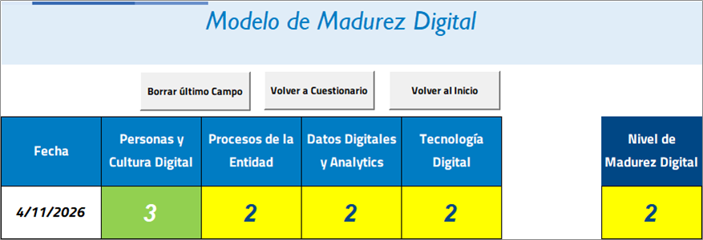
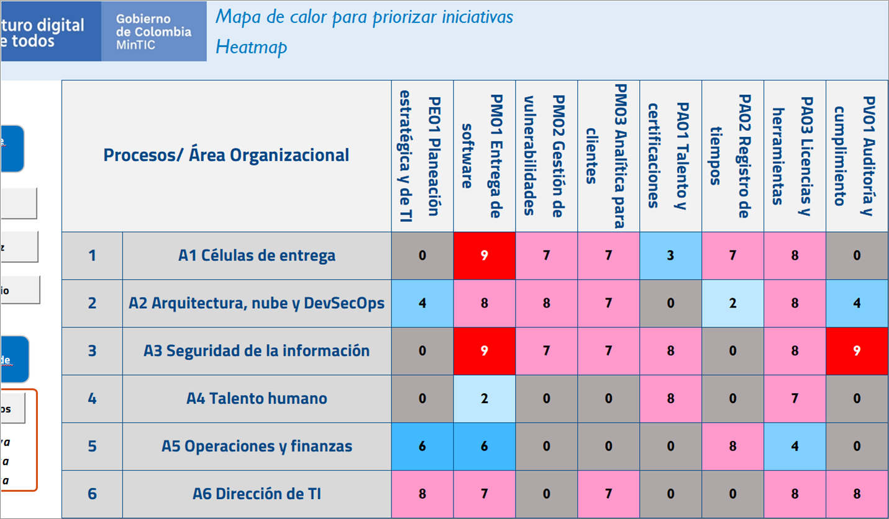
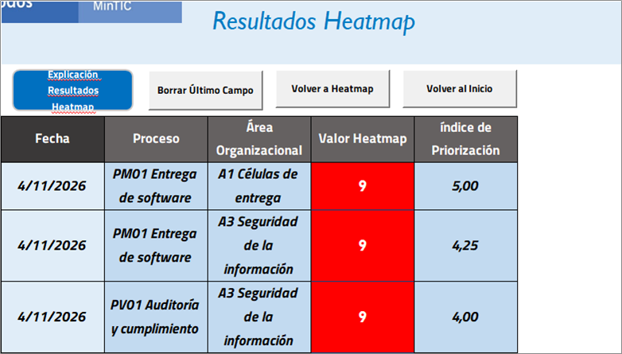

# Modelo de madurez digital y mapa de calor: Perficient, operación en Colombia

<!--
Fuente de la herramienta diligenciada Herramienta_Medicion_MD_Perficient_Colombia.xlsm y del documento
Analisis_Madurez_Digital_Perficient_Colombia.docx. El script scripts/generar_madurez_digital.py toma de aquí
cuatro bloques marcados con comentarios: respuestas, procesos, areas y cruces. Los comentarios no pasan al Word.
-->

**Organización evaluada:** Perficient Inc., operación en Colombia. **Rol de quien evalúa:** equipo de arquitectura y gobernanza de TI del PETI 2026-2028 (trabajo académico). **Evaluadores:** Equipo Firmes por la Gobernanza: Juan Mateo Salas Arturo, Luis Alberto De Avila Mosquera, Nicolás Chávez Oliveros, Juan Pablo Sotelo Mejía y Juan Esteban Aldana. **Fecha:** 4 de noviembre de 2026.

## La herramienta

La *Herramienta para la Transformación Digital de las entidades públicas* es parte del kit del *Marco de la Transformación Digital para el Estado Colombiano* (MinTIC, junio de 2020, elaborado con Arthur D. Little y EY), numeral 2.3. Tiene dos usos que se aplican en orden. El modelo de madurez es el "termómetro": un cuestionario de 17 preguntas, calificadas de 0 a 4, mide la brecha digital en cuatro dimensiones. El mapa de calor es el "médico": cruza los procesos clave con las áreas de la organización y señala dónde una iniciativa digital tendría más impacto.

Lo que hacen las macros del archivo, leído en su código VBA:

| Paso | Cálculo |
|---|---|
| Personas y cultura digital | Promedio de las preguntas 1 a 4 |
| Procesos de la entidad | Promedio de las preguntas 5 a 7 |
| Datos digitales y analítica | Promedio de las preguntas 8 a 11 |
| Tecnología digital | Promedio de las preguntas 12 a 17 |
| Redondeo | Cada promedio se redondea después de restarle 0,01. Un promedio de 2,5 queda en 2 y uno de 2,75 en 3 |
| Nivel de madurez | Promedio de los cuatro niveles redondeados, con la misma regla. Las cuatro dimensiones pesan igual |
| Celda del mapa de calor | Factibilidad, potencial y urgencia, de 1 a 3 cada una, se convierten en un valor de 1 a 9 con la tabla de priorización. El 0 marca un cruce sin interacción o sin mejora digital posible (gris en el marco) |
| Priorización | La macro `vecinos` toma las celdas de valor máximo y desempata con el promedio de las celdas vecinas (arriba, abajo, izquierda y derecha), porque una iniciativa en un cruce también afecta a los procesos y áreas contiguos. Devuelve 1, 2 o 3 puntos calientes |

Tabla de priorización (MinTIC, figura 41 del marco):

| Factibilidad | Potencial | Urgencia 1 | Urgencia 2 | Urgencia 3 |
|---|---|---|---|---|
| 1 | 1 | 1 | 1 | 2 |
| 1 | 2 | 1 | 3 | 5 |
| 1 | 3 | 3 | 4 | 6 |
| 2 | 1 | 1 | 2 | 3 |
| 2 | 2 | 4 | 6 | 7 |
| 2 | 3 | 7 | 8 | 9 |
| 3 | 1 | 3 | 4 | 7 |
| 3 | 2 | 6 | 7 | 8 |
| 3 | 3 | 9 | 9 | 9 |

La herramienta está escrita para entidades públicas. Se adaptó así: "entidad" es la operación de Perficient en Colombia; "ciudadanía" son los clientes que reciben los servicios (preguntas 4 y 13); "tecnologías de la cuarta revolución industrial" son IA generativa, agentes, plataformas de datos en la nube, DevSecOps e infraestructura como código, las tendencias del PETI (§6.3).

## Criterio de calificación

La herramienta describe los niveles 0 a 4 de la organización ("no existente", "exploratorio", "iniciando", "implementando la visión digital", "mejora continua"), pero no da una regla para cada pregunta. El equipo usó esta, coherente con la del diagnóstico BSC del 22 de octubre:

| Puntaje | Criterio |
|---|---|
| 0 | No existe y no hay ningún indicio |
| 1 | Indicios aislados, sin documento ni uso sistemático |
| 2 | Existe en parte: cubre algunos procesos o solo se observó en la cuenta analizada, con flujos manuales |
| 3 | Existe y se usa en la operación, con brechas puntuales identificadas en el PETI |
| 4 | Existe, se mide y se mejora de forma sistemática |

Cada respuesta se apoya en el PETI Colombia v1.0, las entregas de octubre y el registro de evidencias. PUB- son fuentes públicas; PRV-001 son entrevistas de una cuenta de cliente, que describen esa cuenta y no una política de Perficient; INT-001 es análisis del equipo. Lo que no se puede demostrar no recibe puntaje alto.

## Respuestas del cuestionario

<!-- respuestas -->

| N.º | Dimensión | Pregunta (resumida) | Puntaje | Sustento |
|---|---|---|---|---|
| 1 | Personas y cultura | Brecha en habilidades duras | 3 | La operación entrega ingeniería de software, seguridad y analítica a clientes internacionales (PETI §1). En la cuenta analizada hay formación en línea y patrocinio de certificaciones (PRV-001), y desde Medellín se apoya la certificación en Databricks (PUB-022). Falta el plan de certificaciones por rol (BRE-009) y la línea base de personal certificado (KPI-09, por medir) |
| 2 | Personas y cultura | Brecha en habilidades blandas | 3 | En la cuenta analizada se trabaja con Scrum, reunión diaria, roles definidos y rotación entre células (PRV-001), y el talento colombiano está integrado a proyectos internacionales (PETI §6.2). No hay medición de clima ni de gestión del cambio |
| 3 | Personas y cultura | Preparación de la cultura | 3 | La compañía declaró su evolución hacia servicios "AI-native" (PUB-003) y en la cuenta hay lineamientos de uso de IA y formación por perfil (PRV-001). El canal para pedir licencias de IA no está estandarizado y el currículo de IA no llega a todo el personal (BRE-005, BRE-009) |
| 4 | Personas y cultura | Preparación de los usuarios (clientes) para el cambio | 2 | Los clientes piden IA gobernada y controles certificados (DOFA, INT-001), pero aprueban cada licencia y cada cambio en su infraestructura (PRV-001; riesgo R08). El cambio avanza al ritmo de cada cliente |
| 5 | Procesos | Brecha digital en los procesos clave | 2 | De los ocho procesos del mapa, dos tienen cobertura total de TI, cuatro parcial y dos ninguna (PE01 y PV01) (PETI §5.3). Los hallazgos de seguridad y la conciliación de horas se pasan a mano entre herramientas (§6.1) |
| 6 | Procesos | Mejora de los procesos core por proyectos digitales | 2 | La entrega de software ya se apoya en una plataforma ALM, pruebas de seguridad y observabilidad (PRV-001). Ninguno de los 25 proyectos del PETI ha empezado (KPI-01 en 0 %) |
| 7 | Procesos | Esquema organizacional para la transformación digital | 1 | No hay comité de TI con actas, matriz RACI ni centro de excelencia de IA (§6.1); el CoE es una propuesta (P1.8). El Comité Directivo debía constituirse en octubre de 2026 y no hay evidencia del acta. Solo los roles de proyecto están claros (PRV-001) |
| 8 | Datos y analítica | Tecnología que incentiva soluciones basadas en datos | 2 | Hay alianzas con Databricks y Snowflake (PUB-006 a PUB-008) y un proceso de analítica para clientes (PM03), pero no hay plataforma de datos unificada en la operación (BRE-010) |
| 9 | Datos y analítica | Calidad y confiabilidad de los datos | 2 | El registro de tiempos es un sistema corporativo (PA02), pero la conciliación de horas y tareas es manual (BRE-012). No hay catálogo de datos ni inventario de los sistemas de IA en uso (BRE-002) |
| 10 | Datos y analítica | Protección de las bases de datos | 3 | SGSI certificado en ISO/IEC 27001:2022 (PUB-002). Las transferencias internacionales de datos no se registran por proyecto (BRE-016), no hay evidencia pública del alcance de un informe SOC 2 y no se encontró evidencia pública de la recertificación, cuya fecha publicada cae entre el 11 de octubre y el 10 de noviembre de 2026 |
| 11 | Datos y analítica | Uso de los datos para decidir | 1 | No hay tablero de indicadores de TI (§6.1), las licencias se deciden caso por caso (PRV-001) y seis de los trece indicadores del PETI tienen línea base "por medir" (§10) |
| 12 | Tecnología | Tecnología suficiente para los usuarios internos | 3 | ALM, pruebas de seguridad, observabilidad, registro de tiempos y ambientes separados en nube pública (PRV-001; §6.1) cubren la entrega. Las brechas están identificadas: integración manual (BRE-003, BRE-012) y sin infraestructura como código (BRE-007) |
| 13 | Tecnología | Tecnología suficiente para la interacción con los clientes | 2 | El trabajo con el cliente ocurre en herramientas y ambientes que el cliente controla (R08), sin infraestructura como código ni observabilidad estándar (BRE-007, BRE-013). La evidencia de controles que piden los clientes, un informe SOC 2 y la recertificación ISO, no está confirmada (KPI-13 por confirmar) |
| 14 | Tecnología | Conocimiento de las tecnologías de los procesos core | 3 | El PETI documenta el soporte de TI de cada proceso (§5.3) y las herramientas por categoría (§6.1). Falta el inventario de sistemas de IA (BRE-002) |
| 15 | Tecnología | Conocimiento de tecnologías de la cuarta revolución industrial | 3 | La oferta de Perficient incluye IA generativa, agentes y plataformas de datos (PUB-003, PUB-019, PUB-020) y el PETI analiza tendencias (§6.3). No hay vigilancia tecnológica periódica ni CoE que evalúe herramientas nuevas (P1.8, propuesto) |
| 16 | Tecnología | Brecha frente a tecnologías 4.0 en los procesos core | 2 | No hay casos de IA en producción con clientes medidos (KPI-03 en 0), ni permisos para agentes, infraestructura como código o plataforma de datos (BRE-007, BRE-008, BRE-010) |
| 17 | Tecnología | Tiempos, riesgos y costos para adoptar tecnologías 4.0 | 2 | El PETI estima meses, costos por orden de magnitud y riesgos para cada proyecto (§9, §11; INT-001), pero son propuestas sin caso de negocio ni aprobación |

<!-- fin-respuestas -->

## Resultado del modelo de madurez

| Dimensión | Preguntas | Promedio | Nivel en la herramienta |
|---|---|---|---|
| Personas y cultura digital | 1 a 4 | 2,75 | 3. Implementando la visión digital |
| Procesos | 5 a 7 | 1,67 | 2. Iniciando |
| Datos digitales y analítica | 8 a 11 | 2,00 | 2. Iniciando |
| Tecnología digital | 12 a 17 | 2,50 | 2. Iniciando |
| **Nivel de madurez digital** | 1 a 17 | 2,23 | **2. Iniciando** |

El nivel 2 lo define la herramienta así: "se ha iniciado la transformación digital, se cuenta con iniciativas y un enfoque proactivo". Describe bien a la operación: tiene las herramientas de ingeniería, gente formada y una compañía que declaró su rumbo hacia la IA, pero no tiene todavía la estructura que convierta eso en un programa de transformación propio.

La dimensión más fuerte es la de personas. La más débil es la de procesos, y la arrastra una sola pregunta: el esquema organizacional (pregunta 7, con 1 punto). La otra calificación de 1 está en datos: los datos no se usan para decidir (pregunta 11). Las dos apuntan al mismo vacío, que es de gobierno y no de tecnología: no hay una instancia que decida sobre la transformación ni un tablero con el cual decidir. Es la misma conclusión del diagnóstico BSC del 22 de octubre, donde "sincronización y despliegue" fue el único elemento en nivel bloqueador.

Tecnología promedia 2,5 y la herramienta la deja en 2, porque resta 0,01 antes de redondear. El resultado no cambia el nivel global, pero muestra dónde está la brecha tecnológica: las herramientas internas aprueban (preguntas 12, 14 y 15 con 3) y lo que baja el promedio es la tecnología frente al cliente y la adopción de tecnologías 4.0 (preguntas 13, 16 y 17 con 2).

Para el PETI esto significa que la madurez no sube comprando herramientas. Las preguntas con puntaje más bajo se mueven con proyectos de gobierno que ya están en el portafolio: el centro de excelencia de IA (P1.8) y la formalización del gobierno y la estrategia de TI con su tablero de indicadores (P2.8). El marco del MinTIC pide repetir la medición de forma periódica; se propone hacerlo cada año con la misma regla de calificación, para que el nivel 2 de noviembre de 2026 funcione como línea base.

## Mapa de calor

### Ejes

El marco pide empezar por pocos procesos de alto impacto ("core processes"). Se usaron los ocho procesos del mapa del PETI (§5.3) para no dejar fuera los dos que no tienen soporte de TI. Las áreas son agrupaciones funcionales tomadas de los responsables del portafolio (§9) y de las instancias de gobierno (§12) del PETI: el organigrama de la operación en Colombia no es público, así que son una propuesta del equipo (INT-001).

<!-- procesos -->

| ID | Proceso (eje X) |
|---|---|
| PE01 | Planeación estratégica y de TI |
| PM01 | Entrega de software |
| PM02 | Gestión de vulnerabilidades |
| PM03 | Analítica para clientes |
| PA01 | Talento y certificaciones |
| PA02 | Registro de tiempos |
| PA03 | Licencias y herramientas |
| PV01 | Auditoría y cumplimiento |

<!-- fin-procesos -->

<!-- areas -->

| ID | Área (eje Y) | Quién la compone |
|---|---|---|
| A1 | Células de entrega | PM, Technical Lead y desarrolladores |
| A2 | Arquitectura, nube y DevSecOps | Arquitectura, arquitectura de nube y de datos, DevSecOps, SRE |
| A3 | Seguridad de la información | CISO |
| A4 | Talento humano | Talento humano y Line Managers |
| A5 | Operaciones y finanzas | Operaciones, FinOps |
| A6 | Dirección de TI | CTO, con Legal |

<!-- fin-areas -->

### Calificación de los cruces

Factibilidad (F): ¿existe la tecnología y hay voluntad de aplicarla? Se calificó 2, y no 3, cuando el cambio depende de la aprobación del cliente (R08). Potencial (P): ¿cuánto movería los indicadores del PETI? Urgencia (U): ¿qué tan pronto lo pide el plan o un plazo externo? Fase 1 del PETI es 3, fase 2 es 2 y fase 3 o 4 es 1. Los cruces que no aparecen en la tabla valen 0: el área no participa en el proceso o no hay mejora digital posible.

La valoración se revisó con una validación simulada de los tres perfiles que pide el marco (documento aparte). Esa revisión encontró cinco cruces cuya urgencia no seguía la regla de fases, y se corrigieron aquí: evidencia de controles para auditoría (A2 × PV01, fase 4), datos personales en analítica (A3 × PM03), revisión de herramientas de IA (A3 × PA03), plan de certificaciones (A4 × PA01) y aprobación del Line Manager (A4 × PA03), los cuatro últimos de fase 1.

<!-- cruces -->

| Área | Proceso | F | P | U | Valor | Iniciativa digital en el cruce |
|---|---|---|---|---|---|---|
| A1 | PM01 | 2 | 3 | 3 | 9 | IA en el ciclo de desarrollo con licencia aprobada y plantillas ALM homologadas (P1.6, P2.1) |
| A1 | PM02 | 3 | 2 | 2 | 7 | Hallazgos de seguridad convertidos en tickets de forma automática (P2.2) |
| A1 | PM03 | 2 | 3 | 1 | 7 | Soluciones RAG y agentes en producción para clientes (P3.1, P3.3) |
| A1 | PA01 | 3 | 1 | 1 | 3 | Rotación entre células apoyada en la plataforma de formación (KPI-10) |
| A1 | PA02 | 3 | 2 | 2 | 7 | Horas registradas desde la tarea de la ALM (P2.4) |
| A1 | PA03 | 3 | 2 | 3 | 8 | Solicitud digital de licencias de IA con justificación ante el cliente (P1.6) |
| A2 | PE01 | 2 | 2 | 1 | 4 | Arquitectura objetivo 2028-2030 (P4.3) |
| A2 | PM01 | 2 | 3 | 2 | 8 | Infraestructura como código, pipeline estándar y observabilidad (P2.3, P2.5, P2.6) |
| A2 | PM02 | 2 | 3 | 2 | 8 | Pruebas SAST, DAST y SCA dentro del pipeline (P2.3) |
| A2 | PM03 | 2 | 3 | 1 | 7 | Plataforma y catálogo de datos (P3.5) |
| A2 | PA02 | 2 | 1 | 2 | 2 | Integración técnica entre la ALM y el registro de tiempos, como apoyo a Operaciones (P2.4) |
| A2 | PA03 | 3 | 2 | 3 | 8 | Inventario de sistemas de IA: modelo, proveedor, datos y responsable (P1.3) |
| A2 | PV01 | 2 | 2 | 1 | 4 | Evidencia de controles generada por el pipeline para auditorías (P4.1) |
| A3 | PM01 | 2 | 3 | 3 | 9 | Sistema de gestión de IA y permisos como código para agentes (P1.2, P1.4) |
| A3 | PM02 | 3 | 2 | 2 | 7 | Tablero de tiempos de remediación de vulnerabilidades (KPI-05) |
| A3 | PM03 | 2 | 2 | 3 | 7 | Controles de protección de datos personales en los proyectos de analítica (BRE-016, P1.9) |
| A3 | PA01 | 3 | 2 | 3 | 8 | Capacitación en seguridad, IA y protección de datos (P1.5) |
| A3 | PA03 | 3 | 2 | 3 | 8 | Revisión de seguridad de cada herramienta de IA antes de aprobarla (P1.6) |
| A3 | PV01 | 3 | 3 | 3 | 9 | Recertificación ISO/IEC 27001 con gestión digital de evidencias del SGSI (P1.1) |
| A4 | PM01 | 2 | 1 | 2 | 2 | Documentación y rotación para no perder conocimiento (R06) |
| A4 | PA01 | 3 | 2 | 3 | 8 | Plan de certificaciones por rol con seguimiento (P1.7, P3.4) |
| A4 | PA03 | 3 | 1 | 3 | 7 | Aprobación del Line Manager en el flujo de licencias (P1.6) |
| A5 | PE01 | 2 | 2 | 2 | 6 | Guía de presupuesto de TI (P2.8) |
| A5 | PM01 | 2 | 2 | 2 | 6 | Tablero de costos de nube (P2.7) |
| A5 | PA02 | 2 | 3 | 2 | 8 | Conciliación automática de horas y tareas (P2.4) |
| A5 | PA03 | 2 | 2 | 1 | 4 | Costo de licencias por proyecto |
| A6 | PE01 | 2 | 3 | 2 | 8 | Tablero de indicadores y estrategia de TI documentada (P2.8) |
| A6 | PM01 | 2 | 2 | 3 | 7 | Centro de excelencia de IA en Colombia (P1.8) |
| A6 | PM03 | 2 | 3 | 1 | 7 | Casos de IA con clientes liderados por el CoE (P3.1 a P3.3) |
| A6 | PA03 | 3 | 2 | 3 | 8 | Procedimiento de licencias de IA (P1.6) |
| A6 | PV01 | 3 | 2 | 3 | 8 | Concepto legal y registro de obligaciones (P1.9) |

<!-- fin-cruces -->

### Mapa resultante

| Área | PE01 | PM01 | PM02 | PM03 | PA01 | PA02 | PA03 | PV01 |
|---|---|---|---|---|---|---|---|---|
| A1 Células de entrega | 0 | **9** | 7 | 7 | 3 | 7 | 8 | 0 |
| A2 Arquitectura, nube y DevSecOps | 4 | 8 | 8 | 7 | 0 | 2 | 8 | 4 |
| A3 Seguridad de la información | 0 | **9** | 7 | 7 | 8 | 0 | 8 | **9** |
| A4 Talento humano | 0 | 2 | 0 | 0 | 8 | 0 | 7 | 0 |
| A5 Operaciones y finanzas | 6 | 6 | 0 | 0 | 0 | 8 | 4 | 0 |
| A6 Dirección de TI | 8 | 7 | 0 | 7 | 0 | 0 | 8 | 8 |

### Iniciativas priorizadas

Con la opción de tres iniciativas, la macro de la herramienta devolvió:

| Puesto | Proceso | Área | Valor | Índice de priorización | Iniciativa | Proyectos del PETI |
|---|---|---|---|---|---|---|
| 1 | PM01 Entrega de software | A1 Células de entrega | 9 | 5,00 | IA en el ciclo de desarrollo, con licencia aprobada y plantillas ALM homologadas | P1.6, P2.1, sobre los controles de P1.2 a P1.4 |
| 2 | PM01 Entrega de software | A3 Seguridad de la información | 9 | 4,25 | Sistema de gestión de IA y permisos para agentes | P1.2, P1.4 |
| 3 | PV01 Auditoría y cumplimiento | A3 Seguridad de la información | 9 | 4,00 | Recertificación ISO/IEC 27001 con gestión digital de evidencias | P1.1 |

### Lectura del mapa

Solo tres cruces llegaron a 9, y la herramienta los devolvió los tres, ordenados por el promedio de sus vecinos. El primero gana porque está rodeado de cruces calientes: debajo, la infraestructura y el pipeline (8); a la derecha, la integración de hallazgos de seguridad (7). Una iniciativa ahí empuja también a esos vecinos. El sistema de gestión de IA queda segundo con 4,25 y la recertificación ISO tercera con 4,00: la diferencia entre los dos es mínima, y la ISO pierde porque a su lado está el informe SOC 2, de fase 4 (valor 4).

La columna de entrega de software (PM01) es la más caliente del mapa. Tiene dos de los tres puntos priorizados y un 8 en arquitectura. Tiene sentido: es el proceso misional que produce el ingreso, y la IA generativa cambia sobre todo la forma de escribir y revisar código. La fila de talento humano es la más fría, con cinco cruces en 0: sus procesos se mejoran con planes y gestión del cambio más que con tecnología nueva.

Los tres puntos priorizados son proyectos de la fase 1 del PETI. La coincidencia no es independiente, porque la urgencia se calificó con las fases del plan. Lo que aporta la herramienta es el orden dentro de la fase 1 y una advertencia sobre la planeación.

En cuanto al orden, la herramienta pone primero la IA en las células y deja la recertificación ISO en tercer lugar, pero la ISO tiene un plazo externo: la fecha publicada del certificado cae entre el 11 de octubre y el 10 de noviembre de 2026 (PUB-002), y no se encontró evidencia pública de la renovación. El propio marco dice que el resultado es un "consejo analítico" y no una garantía. Se recomienda mantener P1.1 como el primer proyecto en ejecución y tratar la IA en las células como la primera iniciativa de transformación.

La advertencia es que el tablero de indicadores de la Dirección de TI (PE01, valor 8) no sale caliente, aunque el modelo de madurez y el diagnóstico BSC señalan el gobierno como la brecha más grave. El mapa mide dónde rinde la tecnología 4.0; el gobierno es un problema de organización. Por eso la priorización del mapa no reemplaza a P2.8: los dos instrumentos miran cosas distintas y el PETI necesita los dos.

### Limitaciones

- El marco pide que el mapa lo califique un equipo con tres perfiles: quien conoce el proceso de principio a fin, quien conoce el área y quien lidera la transformación. Aquí lo calificó el equipo académico con la evidencia disponible (INT-001), y los tres perfiles se simularon con un criterio escrito. La simulación además propone tres cambios de criterio que no se aplicaron porque necesitan a las personas reales: subir el gobierno de TI (A6 × PE01) a 9, ver más potencial en el plan de certificaciones (A4 × PA01) y reconocer la participación de la Dirección de TI en ese plan (A6 × PA01). Con ellos, el gobierno de TI pasaría al primer lugar. Hay que validar el mapa con esos perfiles antes de usarlo para decidir.
- Las áreas son agrupaciones propuestas y los responsables del PETI son roles propuestos. Si el organigrama real de la operación es otro, el mapa cambia.
- Lo que viene de PRV-001 describe una cuenta de cliente y no toda la operación.
