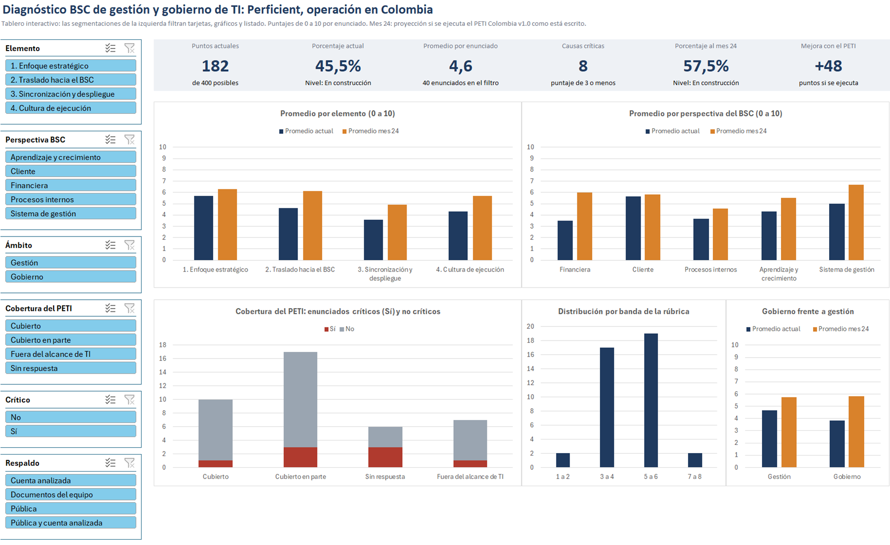
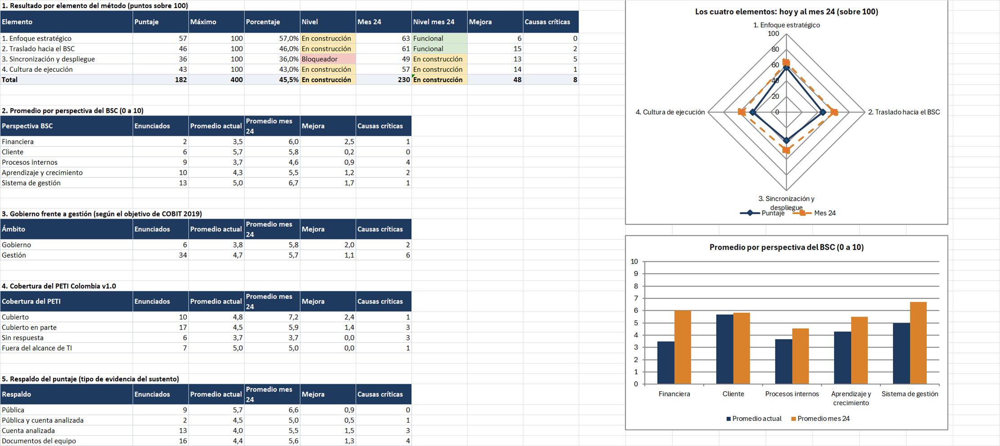
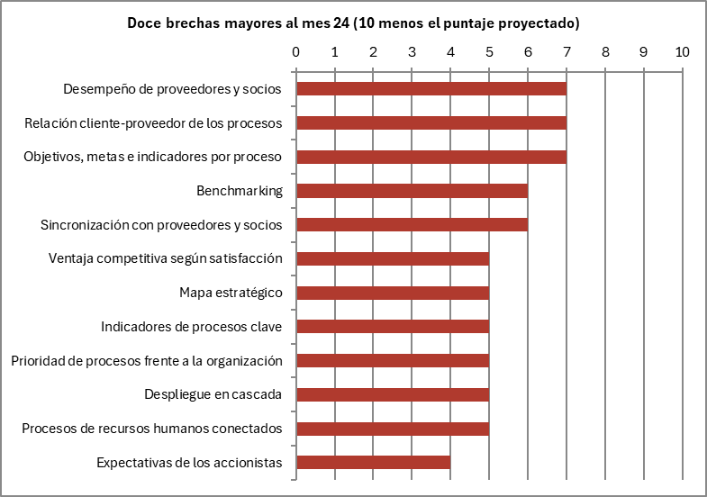

# Análisis del diagnóstico BSC de gestión y gobierno de TI con una herramienta de analítica de datos

**Organización:** Perficient Inc., operación en Colombia. **Equipo:** Firmes por la Gobernanza (trabajo académico del curso Gobierno y Servicios de TI, Universidad Santiago de Cali). **Fecha:** 16 de noviembre de 2026. **Archivo de análisis:** `Analisis_BSC_Perficient_Colombia.xlsx`.

## 1. Qué cambia en el proceso de análisis

El diagnóstico situacional de los cuatro elementos de la gestión basada en BSC se había leído como un formulario: 40 puntajes, cuatro totales y un radar. Esa lectura responde qué elemento falla, pero no por qué ni qué tan seguro es el puntaje, ni si el PETI lo corrige. El ajuste consiste en tratar el diagnóstico como un conjunto de datos y analizarlo en Excel con una tabla estructurada, fórmulas, tablas dinámicas y segmentaciones.

Los puntajes no cambian. Siguen siendo la valoración del equipo con la rúbrica de 0 a 10 (INT-001): 182 de 400 puntos. Lo que cambia es lo que se puede preguntar a esos datos.

El proceso tiene cinco pasos, cada uno con su hoja en el libro:

| Paso | Qué se hace | Hoja |
|---|---|---|
| 1. Captura | Un registro por enunciado: elemento, texto, puntaje y sustento con sus IDs de evidencia | Datos |
| 2. Clasificación | Se agregan cinco dimensiones a cada enunciado (tabla siguiente) | Datos |
| 3. Cálculo | Fórmulas de la tabla para banda de la rúbrica, causa crítica, ámbito y brechas; resumen con SUMIFS y AVERAGEIFS | Datos, Resumen |
| 4. Exploración | Seis segmentaciones conectadas a siete tablas dinámicas; las tarjetas leen las tablas con GETPIVOTDATA y cambian con cada filtro | Tablero |
| 5. Priorización | Listas con FILTER y SORTBY: causas críticas y brechas que quedan después del PETI | Prioridades |

| Dimensión | Valores | Para qué sirve |
|---|---|---|
| Perspectiva del BSC | Financiera, cliente, procesos internos, aprendizaje y crecimiento, y "sistema de gestión" para los enunciados sobre el propio ciclo de planeación y seguimiento | Saber en qué perspectiva se concentra la debilidad, no solo en qué elemento del método |
| Objetivo de COBIT 2019 y ámbito | El objetivo más cercano (EDM, APO, BAI, DSS o MEA); EDM es gobierno y el resto es gestión | Separar lo que decide la dirección de lo que ejecuta TI |
| Cobertura del PETI Colombia v1.0 | Cubierto, cubierto en parte, sin respuesta, fuera del alcance de TI | Ver qué causas ya tienen proyecto y cuáles no |
| Respaldo | Pública, pública y cuenta analizada, cuenta analizada, documentos del equipo; se calcula con los IDs del sustento | Medir qué tan sólido es cada puntaje |
| Puntaje al mes 24 | El puntaje que tendría el enunciado si los 25 proyectos se ejecutan como están escritos, con la misma rúbrica | Medir el efecto esperado del PETI |

La clasificación es criterio del equipo y está escrita enunciado por enunciado en la hoja Datos, con la razón de cada proyección. El umbral de causa crítica (3 puntos o menos) está en la hoja Parámetros: si se cambia, el libro se recalcula.

## 2. Tablero

Las segmentaciones de la izquierda filtran las tarjetas, los cinco gráficos y la lista de enunciados que está a la derecha de los gráficos. Por ejemplo, al elegir "3. Sincronización y despliegue" las tarjetas muestran 36 puntos, nivel bloqueador, 5 causas críticas y 49 puntos al mes 24.

## 3. Resultados

### 3.1 Por elemento: la lectura del formato se mantiene

| Elemento | Puntaje | Nivel | Mes 24 | Nivel al mes 24 | Causas críticas |
|---|---|---|---|---|---|
| 1. Enfoque estratégico | 57 | En construcción | 63 | Funcional | 0 |
| 2. Traslado hacia el BSC | 46 | En construcción | 61 | Funcional | 2 |
| 3. Sincronización y despliegue | 36 | Bloqueador | 49 | En construcción | 5 |
| 4. Cultura de ejecución | 43 | En construcción | 57 | En construcción | 1 |
| Total | 182 (45,5 %) | En construcción | 230 (57,5 %) | En construcción | 8 |

Sincronización y despliegue sigue siendo el elemento que causa los problemas: es el único bloqueador y reúne cinco de las ocho causas críticas (22, 23, 24, 28 y 29). Las otras tres son el 12 (datos de proveedores), el 16 (mapa estratégico) y el 39 (desempeño y compensación).

### 3.2 Por perspectiva del BSC: la debilidad está en procesos y en la parte financiera

| Perspectiva | Enunciados | Promedio actual | Promedio al mes 24 | Causas críticas |
|---|---|---|---|---|
| Financiera | 2 | 3,5 | 6,0 | 1 |
| Cliente | 6 | 5,7 | 5,8 | 0 |
| Procesos internos | 9 | 3,7 | 4,6 | 4 |
| Aprendizaje y crecimiento | 10 | 4,3 | 5,5 | 2 |
| Sistema de gestión | 13 | 5,0 | 6,7 | 1 |

Esta es la lectura nueva. La operación conoce a sus clientes y su mercado (5,7), pero no puede mostrar el desempeño de sus procesos (3,7) ni ligar el presupuesto a los objetivos (3,5). La perspectiva de procesos internos tiene cuatro de las ocho causas críticas y sigue siendo la más baja al mes 24 (4,6). El PETI se organiza por objetivo de TI y no por proceso, y por eso no la corrige.

La perspectiva financiera sube de 3,5 a 6,0 por la guía de presupuesto de P2.8 y el tablero de costos de nube de P2.7. Solo tiene dos enunciados, así que el promedio se mueve mucho con un cambio pequeño.

### 3.3 Gobierno frente a gestión: el gobierno puntúa más bajo

Los seis enunciados que caen en el dominio EDM de COBIT 2019 (expectativas del accionista, misión y visión, prioridad de los procesos frente a la organización, presupuesto, despliegue en cascada y comunicación de la estrategia) promedian 3,8. Los 34 de gestión promedian 4,7. Es el mismo resultado de la autoevaluación de madurez del gobierno de TI con el formato de EIS, que quedó en nivel 1 (33,9 %): lo más débil de la operación es la instancia que decide y vigila, no la ejecución. El PETI cierra buena parte de esa distancia (gobierno sube a 5,8 y gestión a 5,7) porque crea los comités y formaliza el gobierno en P2.8.

### 3.4 Cobertura del PETI: seis enunciados no tienen respuesta

| Cobertura | Enunciados | Causas críticas | Promedio actual | Promedio al mes 24 |
|---|---|---|---|---|
| Cubierto | 10 | 1 | 4,8 | 7,2 |
| Cubierto en parte | 17 | 3 | 4,5 | 5,9 |
| Sin respuesta | 6 | 3 | 3,7 | 3,7 |
| Fuera del alcance de TI | 7 | 1 | 5,0 | 5,0 |

Los seis enunciados sin respuesta son el 3 (ventaja competitiva según la satisfacción del cliente), el 12 (desempeño de proveedores y socios), el 13 (benchmarking), el 22 (relación cliente-proveedor de los procesos), el 24 (objetivos, metas e indicadores por proceso) y el 27 (sincronización con proveedores y socios). Tienen el promedio más bajo y no mejoran nada al mes 24. Tres son causas críticas.

El enunciado 39 (desempeño y compensación conectados con el BSC), con 1 punto, queda fuera del alcance de TI: lo decide Talento humano.

### 3.5 Respaldo: la mayoría de los puntajes no se apoya en fuentes públicas

| Respaldo | Enunciados | Promedio actual |
|---|---|---|
| Pública | 9 | 5,7 |
| Pública y cuenta analizada | 2 | 4,5 |
| Cuenta analizada | 13 | 4,0 |
| Documentos del equipo | 16 | 4,4 |

Solo 11 de los 40 puntajes citan una fuente pública. Trece se apoyan solo en lo observado en la cuenta analizada (PRV-001), que describe una cuenta de cliente y no a toda la operación. Dieciséis se apoyan en documentos del propio equipo (PETI, DOFA, Canvas). Los enunciados con fuente pública puntúan más alto (5,7) porque tratan de lo que Perficient publica: foco por industria, alianzas y certificaciones. Lo interno, que es lo más débil, es también lo que menos se puede demostrar desde afuera. Antes de presentar estos puntajes como el estado de toda la operación habría que aplicar el formato a directivos y líderes de varias cuentas y promediar.

## 4. Prioridades

Si el PETI se ejecuta como está escrito, la operación pasa de 182 a 230 puntos y sale del nivel bloqueador, pero no llega a funcional en el total. Las brechas mayores que quedan en lo que depende de TI se agrupan en cuatro temas:

| Tema | Enunciados (puntaje al mes 24) | Recomendación para la siguiente versión del PETI |
|---|---|---|
| Proveedores y socios | 12 (3), 27 (4) | Incluir en P1.1 la evaluación periódica de los proveedores de pruebas de seguridad y de nube, que ISO/IEC 27001 pide controlar (Anexo A, 5.19 a 5.22), con un indicador de desempeño de proveedores |
| Procesos | 22 (3), 24 (3), 23 (5), 25 (5) | Ampliar P2.8 para caracterizar los ocho procesos y asignar a cada uno objetivo, meta e indicador |
| Mapa estratégico | 16 (5) | Agregar a §7 la perspectiva BSC de cada meta y el mapa estratégico de TI |
| Benchmarking | 13 (4) | Incluir en P4.3 la comparación de los indicadores del PETI con referencias del sector |

**Análisis de sensibilidad.** Si las recomendaciones llevaran a 6 puntos los seis enunciados que atacan directamente (12, 13, 16, 22, 24 y 27), que en la rúbrica es "definido o documentado, en uso parcial", el total subiría 14 puntos: de 230 a 244 (61 %). Con eso el total pasaría a nivel funcional y sincronización y despliegue llegaría a 57. Es un supuesto del equipo para dimensionar las recomendaciones, no una meta.

## 5. Conclusión

El ajuste confirma el diagnóstico (la estrategia se rompe al bajar a los procesos) y lo precisa en tres puntos. La debilidad está en las perspectivas de procesos internos y financiera, y en los enunciados de gobierno. El PETI corrige el traslado hacia el BSC y la cultura de ejecución, pero deja abiertos los procesos y los proveedores. Además, la mayoría de los puntajes se apoya en evidencia que no es pública, y eso limita lo que se puede afirmar sobre toda la operación.

## 6. Límites

- Los puntajes, la clasificación y la proyección al mes 24 son criterio del equipo (INT-001). No son una encuesta al personal de Perficient ni metas aprobadas.
- Lo que viene de PRV-001 describe una cuenta de cliente y no una política de Perficient.
- La proyección supone que los 25 proyectos se ejecutan completos y en el plazo del PETI.
