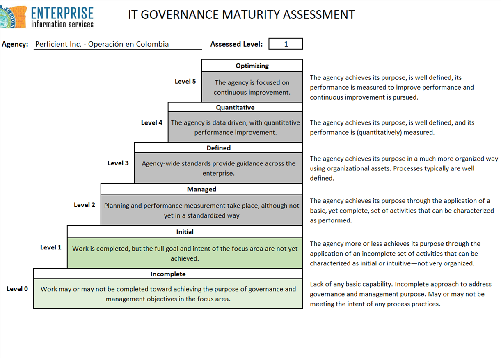

# Autoevaluación de la madurez del gobierno de TI: Perficient, operación en Colombia

<!-- Fuente del análisis Analisis_Autoevaluacion_Gobierno_TI_Perficient_Colombia.docx y de las respuestas del libro Autoevaluacion_Gobierno_TI_Perficient_Colombia.xlsx. El script scripts/generar_autoevaluacion_gobierno_ti.py toma de la tabla de respuestas la columna "Respuesta" (Yes, Partial o No, como pide la lista del formato) y el sustento, que va a la columna "Comments" del libro. Si cambias una respuesta, revisa las tablas de resultado y de proyección: el script se detiene si no cuadran con lo que calcula el libro. -->

**Organización evaluada:** Perficient Inc., operación en Colombia. **Rol de quien evalúa:** equipo de arquitectura y gobernanza de TI del PETI 2026-2028 (trabajo académico). **Evaluadores:** Equipo Firmes por la Gobernanza. **Fecha:** 16 de noviembre de 2026. **Herramienta:** *IT Governance Maturity Assessment* de Enterprise Information Services (EIS), entregada por el docente.

## Cómo funciona la herramienta

El libro tiene tres hojas visibles y una oculta:

| Hoja | Contenido |
|---|---|
| Instructions | Escala de respuesta y su significado |
| Assessment | 31 preguntas en cinco secciones; se responde Yes, Partial o No y se anota en "Comments" el control o el documento que lo demuestra |
| Results | Escalera de niveles de 0 (Incompleto) a 5 (Optimizando) y el nivel obtenido |
| Validation (oculta) | Convierte cada respuesta en puntos (Yes = 2, Partial = 1, No = 0), suma por sección y calcula el nivel |

El nivel sale del porcentaje de puntos sobre el máximo de 62. La hoja oculta divide ese porcentaje en séptimos:

| Nivel | Porcentaje de puntos | Puntos (de 62) |
|---|---|---|
| 0. Incompleto | 28,6 % o menos | 0 a 17 |
| 1. Inicial | más de 28,6 % y hasta 42,9 % | 18 a 26 |
| 2. Administrado | más de 42,9 % y menos de 57,1 % | 27 a 35 |
| 3. Definido | entre 57,1 % y 71,4 % | 36 a 44 |
| 4. Cuantitativo | más de 71,4 % y menos de 85,7 % | 45 a 53 |
| 5. Optimizando | 85,7 % o más | 54 a 62 |

## Criterio de respuesta

Las instrucciones del formato son exigentes con el "Yes": la organización cumple por completo el objetivo de control **y los resultados están abiertos a revisión**. Por eso se usó la misma regla de los diagnósticos anteriores: lo que no se puede demostrar no recibe la respuesta más alta, aunque sea probable en una empresa del tamaño de Perficient.

| Respuesta | Cuándo se usó |
|---|---|
| Yes | Hay evidencia pública o documental de que el control existe y opera |
| Partial | Existe en parte, de manera informal, solo en la cuenta analizada, o está escrito en el PETI pero no aprobado |
| No | No se encontró evidencia, o el PETI lo trae solo como propuesta |

Los códigos PUB- son fuentes públicas del registro de evidencias; PRV-001 son entrevistas de una cuenta de cliente, que describen esa cuenta y no una política de Perficient; INT-001 es análisis del equipo. Los numerales (§) son del PETI Colombia v1.0. La herramienta habla de una "agencia" pública; aquí se leyó como la operación colombiana, el "Director" como la dirección de la compañía y el "board" como la junta del accionista (EQT desde el 2 de octubre de 2024, PUB-001).

## Respuestas

<!-- respuestas -->

| N.º | Pregunta | Respuesta | Sustento |
|---|---|---|---|
| 1.1 | ¿Hay un CIO o líder técnico de tiempo completo que forme parte del equipo directivo? | Partial | En la cuenta analizada cada proyecto tiene un Technical Lead a cargo de calidad y arquitectura (PRV-001), pero es un rol de proyecto. No se encontró un responsable de TI de la operación colombiana en la dirección; el PETI propone que el CTO responda por el plan (§12). |
| 1.2 | ¿La estructura de la organización permite que TI ayude con eficiencia a lograr los objetivos? | Partial | Las células especializadas y los roles de proyecto están organizados para entregar (PRV-001). Los procesos de planeación estratégica (PE01) y de auditoría (PV01) no tienen soporte de TI (§5.3). |
| 1.3 | ¿Hay instancias de decisión que alineen las necesidades de la organización con los servicios de TI, con facultades y rendición de cuentas? | No | No hay comité de TI con actas (§6.1, BRE-011). El Comité Directivo del PETI debía constituirse en octubre de 2026 y no hay evidencia del acta. |
| 1.4 | ¿Las necesidades de la organización y los requisitos de TI están en planes estratégicos y tácticos, y se les hace seguimiento? | Partial | El PETI Colombia v1.0 define objetivos, metas y 25 proyectos por fases (§7, §9), pero no está aprobado y no hay tablero para seguirlo (§6.1). |
| 1.5 | ¿El responsable de TI y la alta dirección se reúnen con regularidad para revisar el avance de los planes? | No | No se encontró evidencia de reuniones periódicas de seguimiento de los planes de TI. El PETI propone un informe trimestral al Comité Directivo (§12). |
| 1.6 | ¿Los roles y responsabilidades están definidos y comunicados, y los líderes responden por resultados? | Partial | Los roles de proyecto (Product Manager, Line Manager, Technical Lead) están definidos en la cuenta analizada (PRV-001). No hay matriz RACI de TI ni rendición de cuentas por resultados de TI (§6.1). |
| 2.1 | ¿La alta dirección definió y comunicó las responsabilidades de la función de TI frente a las metas estratégicas y tácticas? | No | No se encontró una política de TI que asigne responsabilidades frente a las metas. La matriz RACI es una propuesta de P2.8. |
| 2.2 | ¿Los roles y responsabilidades del responsable de TI están definidos y comunicados? | Partial | El Technical Lead tiene funciones claras en la cuenta analizada (PRV-001), pero el rol de responsable de TI de la operación no está definido; el CTO del PETI es un rol propuesto. |
| 2.3 | ¿La estrategia de la organización reconoce a TI como un contribuyente importante a las metas y al día a día? | Yes | La estrategia pública pone la tecnología y la IA en el centro: evolución de la marca hacia servicios "AI-native" (PUB-003) y alianzas con Microsoft, Databricks, Snowflake y AWS (PUB-005 a PUB-008, PUB-021). En una consultora de tecnología, TI es el producto. |
| 2.4 | ¿El responsable de TI se reúne con la junta y la alta dirección con regularidad para tratar los servicios de TI frente a los planes? | No | No se encontró evidencia de que un responsable de TI de la operación informe a la dirección ni a la junta. El PETI propone el informe trimestral (§12). |
| 2.5 | ¿TI tiene financiación adecuada para las necesidades de la organización? | Partial | Las herramientas de entrega existen y funcionan (PRV-001), pero no hay guía de presupuesto de TI (BRE-011), las licencias se justifican caso por caso ante el cliente (PRV-001) y los costos del PETI son rangos sin aprobar (INT-001). |
| 3.1 | ¿La dirección ve a TI como un socio estratégico? | Partial | La compañía ve la tecnología como su oferta (PUB-003), pero no hay una instancia donde TI de la operación participe en las decisiones (pregunta 1.3). |
| 3.2 | ¿El plan estratégico dice cómo TI apoya la creación de valor? | Partial | El PETI enlaza los objetivos corporativos OC01 a OC04 con los objetivos de TI (§5.2, §7), pero esos objetivos los formuló el equipo (INT-001) y el plan no está aprobado. |
| 3.3 | ¿El plan estratégico se apoya en planes tácticos que consideran los requisitos y entregables de TI? | Partial | El portafolio tiene fases, meses y responsables (§9), y en la cuenta analizada el trabajo sigue el backlog del cliente por sprints (PRV-001). Ningún proyecto tiene patrocinador ni caso de negocio aprobado. |
| 3.4 | ¿La alta dirección usa indicadores clave (KPI) para medir la eficacia de TI? | No | No hay tablero de indicadores de TI (§6.1). Los 13 indicadores del PETI son propuestos y seis no tienen línea base (§10). El dashboard del 4 de noviembre usa datos sintéticos. |
| 3.5 | ¿Las inversiones en TI se deciden con análisis de costo-beneficio y se evalúa después si se logró el retorno? | No | Las licencias se justifican ante el cliente caso por caso (PRV-001), pero no se encontró análisis de costo-beneficio ni evaluación posterior. El PETI exige caso de negocio antes de ejecutar (§9), sin evaluación posterior. |
| 3.6 | ¿Las lecciones aprendidas se tienen en cuenta en las siguientes inversiones de TI? | No | No se encontró un registro de lecciones aprendidas aplicado a inversiones de TI. El PETI solo hace balance al final (P4.3). |
| 3.7 | ¿La organización de TI tiene una estructura adecuada a su tamaño y composición? | Partial | Las células especializadas, los niveles senior, intermedio y junior y la rotación entre células funcionan en la cuenta analizada (PRV-001). No hay evidencia para el resto de la operación. |
| 3.8 | ¿El responsable de TI y los líderes de TI están calificados y tienen experiencia? | Partial | Los niveles de socio exigen personal certificado (PUB-005 a PUB-008, PUB-021) y en la cuenta analizada se patrocinan certificaciones (PRV-001). No hay evidencia sobre el liderazgo de TI de la operación ni plan de certificaciones por rol (BRE-009). |
| 4.1 | ¿La alta dirección entiende los costos de TI y cómo contribuyen a los objetivos? | No | No hay guía de presupuesto de TI ni control de costos de nube (§6.1; BRE-011, BRE-013). |
| 4.2 | ¿Los líderes miden el valor y los entregables de TI? | Partial | En la cuenta analizada la plataforma de gestión del ciclo de vida de aplicaciones (ALM) registra sprints, tareas y tiempos (PRV-001): se mide lo entregado, no su valor. No hay indicadores de valor de TI. |
| 4.3 | ¿Los costos de TI se comparan con los de organizaciones similares? | No | No se encontró una comparación de costos de TI. El perfil competitivo del 21 de octubre frente a Globant y Softtek compara posición en el mercado, no costos (INT-001). |
| 4.4 | ¿El desempeño del responsable de TI se mide con datos financieros y no financieros? | No | No se encontró evidencia de cómo se evalúa al responsable de TI, que tampoco es un rol formal (pregunta 2.2). |
| 4.5 | ¿Hay contratos con proveedores de servicios de TI y se miden y monitorean? | Partial | Hay un servicio externo de pruebas de seguridad y la nube la administra el cliente o un proveedor (PRV-001). El SGSI certificado (PUB-002) obliga a controlar la seguridad con proveedores (ISO/IEC 27001, Anexo A, 5.19 a 5.22), pero no se encontró una medición de su desempeño. |
| 5.1 | ¿Los procesos están automatizados y los flujos de trabajo integrados? | Partial | Las herramientas de entrega están automatizadas, pero los hallazgos de seguridad y la conciliación de horas se pasan a mano entre herramientas (§6.1; BRE-003, BRE-012). |
| 5.2 | ¿Las aplicaciones críticas se conocen formalmente y tienen un plan de ciclo de vida? | Partial | Las herramientas de la cuenta analizada se conocen (§6.1) y el SGSI exige inventario de activos (ISO/IEC 27001, A.5.9), pero no hay plan de ciclo de vida ni inventario de sistemas de IA (BRE-002). |
| 5.3 | ¿Los datos están estandarizados y se comparten con facilidad entre aplicaciones? | No | No hay plataforma de datos unificada (BRE-010) y los datos pasan a mano entre herramientas (§6.1). |
| 5.4 | ¿Hay políticas, procedimientos y controles estándar para comprar hardware, software y servicios de TI? | Partial | Las licencias las justifica el Product Manager ante el cliente, pero el canal de solicitud no está estandarizado (BRE-005). No se encontró la política corporativa de compras. |
| 5.5 | ¿Los procesos de gestión de TI son maduros y usan marcos reconocidos (COBIT, ITIL, ISO)? | Partial | SGSI certificado en ISO/IEC 27001:2022 (PUB-002) y Scrum en la cuenta analizada (PRV-001). COBIT e ITIL son solo referencia del PETI (§3). |
| 5.6 | ¿Los riesgos se gestionan frente a las necesidades de la organización, la seguridad y el cumplimiento? | Partial | El SGSI gestiona los riesgos de seguridad de la información (PUB-002). No hay matriz de riesgos de TI que cubra IA, costos y cumplimiento (§6.1); la del PETI es propuesta (§11). |
| 5.7 | ¿Está definida la importancia estratégica de la gestión de riesgos de TI? | Partial | La declaración de seguridad para clientes (PUB-002) muestra que la seguridad es un compromiso de la compañía. No se encontró una definición del riesgo de TI como riesgo del negocio fuera de seguridad. |

<!-- fin-respuestas -->

## Resultado

| Sección | Yes | Partial | No | Puntos | Máximo | Porcentaje |
|---|---|---|---|---|---|---|
| 1. Estructuras organizacionales y de gobierno | 0 | 4 | 2 | 4 | 12 | 33,3 % |
| 2. Apoyo de la dirección | 1 | 2 | 2 | 4 | 10 | 40,0 % |
| 3. Planeación estratégica y operativa | 0 | 5 | 3 | 5 | 16 | 31,3 % |
| 4. Medición de la prestación del servicio | 0 | 2 | 3 | 2 | 10 | 20,0 % |
| 5. Organización de TI y gestión de riesgos | 0 | 6 | 1 | 6 | 14 | 42,9 % |
| Total | 1 | 19 | 11 | 21 | 62 | 33,9 % |

**Nivel evaluado: 1, Inicial.** "El trabajo está terminado, pero aún no se han alcanzado el objetivo y la intención totales del área de enfoque." Con 21 puntos, la operación queda cuatro puntos por encima del techo del nivel 0 (17) y seis por debajo del nivel 2 (27).

## Lectura del resultado

Casi todas las respuestas son "Partial" (19 de 31), y eso describe bien a la operación: los controles existen, pero en una cuenta, de manera informal o escritos en un plan que nadie ha aprobado. El único "Yes" es la pregunta 2.3, y no dice nada de la operación colombiana: en una consultora de tecnología la estrategia siempre pone a la tecnología en el centro.

De los once "No", diez se agrupan en dos temas. El primero es la instancia de gobierno: no hay comité con actas, ni reuniones de seguimiento con la dirección, ni responsable de TI con funciones definidas (1.3, 1.5, 2.1, 2.4, 4.4). El segundo es la medición: no hay indicadores en uso, ni costos conocidos, ni comparación con otros, ni evaluación de las inversiones (3.4, 3.5, 3.6, 4.1, 4.3). El restante es técnico: los datos no están estandarizados entre herramientas (5.3). La sección de medición de la prestación del servicio es la más baja, con 20 %.

La sección más alta es la de organización de TI y gestión de riesgos (42,9 %), y lo es por el SGSI certificado en ISO/IEC 27001: es el único sistema de gestión que obliga a la operación a inventariar activos, controlar proveedores y tratar riesgos. Fuera de la seguridad de la información no hay un sistema equivalente.

Al 16 de noviembre de 2026 las dos lecturas de la fecha publicada del certificado (11 de octubre o 10 de noviembre de 2026) ya pasaron, y no se encontró evidencia pública de la recertificación: la página de PUB-002 respondió con error HTTP 429 al consultarla ese día. Las respuestas 4.5 y 5.2 suponen que el SGSI sigue vigente. Si el certificado venció, las dos bajan a "No" y el total queda en 19 puntos (30,6 %), todavía nivel 1.

## Comparación con los diagnósticos anteriores

| Diagnóstico | Fecha | Resultado | Lo más débil |
|---|---|---|---|
| Diagnóstico BSC de gestión y gobierno de TI | 22 de octubre de 2026 | 182 de 400 (45,5 %), en construcción | Sincronización y despliegue (36 de 100) |
| Herramienta de madurez digital del MinTIC | 4 de noviembre de 2026 | 2,23, nivel 2 "Iniciando" (de 4) | Esquema organizacional y datos para decidir (preguntas 7 y 11, con 1) |
| Diagnóstico de madurez digital de CEIPA | 4 de noviembre de 2026 | Nivel 2, básico (de 5) | Dirección y evaluación digital (2,8 de 10) |
| Autoevaluación de gobierno de TI de EIS | 16 de noviembre de 2026 | 21 de 62 (33,9 %), nivel 1 "Inicial" (de 5) | Medición de la prestación del servicio (20 %) |

Esta autoevaluación da el nivel más bajo de las cuatro, y es coherente: las otras tres miden la transformación digital o la estrategia completa, donde la entrega técnica sube el promedio; esta mide solo el gobierno, que fue el punto más débil en todas. Las cuatro coinciden en el diagnóstico: la operación entrega bien, pero no tiene la instancia de decisión ni los datos para mostrar cómo esa entrega sirve a la estrategia.

## Qué haría subir el nivel

La tabla siguiente proyecta las respuestas que cambiarían si se ejecutan las fases 1 y 2 del PETI Colombia como están escritas (hasta septiembre de 2027). Es una estimación del equipo (INT-001), no un compromiso.

| Pregunta | Hoy | Al mes 12 | Proyecto del PETI | Puntos |
|---|---|---|---|---|
| 1.3 Instancias de decisión | No | Yes | Comités Directivo y Táctico con acta (§12, P2.8, KPI-14) | +2 |
| 1.4 Planes con seguimiento | Partial | Yes | PETI aprobado y tablero de indicadores (P2.8) | +1 |
| 1.5 Reuniones de seguimiento | No | Yes | Informe trimestral al Comité Directivo (§12) | +2 |
| 1.6 Roles y rendición de cuentas | Partial | Yes | Matriz RACI (P2.8) | +1 |
| 2.1 Responsabilidades de TI definidas por la dirección | No | Partial | RACI aprobada por el Comité Directivo (P2.8) | +1 |
| 2.2 Rol del responsable de TI | Partial | Yes | CTO como responsable del PETI, con acta (P2.8) | +1 |
| 2.4 Informe a la dirección | No | Partial | Informe trimestral al Comité Directivo, no a la junta (§12) | +1 |
| 3.2 Plan que muestra el valor de TI | Partial | Yes | PETI aprobado con objetivos corporativos validados | +1 |
| 3.4 Indicadores de TI en uso | No | Yes | Tablero con los indicadores del PETI (P2.8, KPI-01, KPI-14) | +2 |
| 4.1 Costos de TI conocidos | No | Partial | Guía de presupuesto (P2.8) y tablero de costos de nube (P2.7) | +1 |
| 5.1 Flujos integrados | Partial | Yes | Hallazgos de seguridad y horas conectados con la ALM (P2.2, P2.4) | +1 |
| 5.6 Riesgos gestionados | Partial | Yes | Matriz de riesgos de TI (P2.8) y evaluación de riesgos de IA (P1.2) | +1 |
| Total | 21 | 36 | | +15 |

Con el PETI ejecutado hasta la fase 2, la operación llegaría a 36 puntos (58,1 %), nivel 3 "Definido", pero justo en el límite: 36 es el mínimo del nivel 3, y basta que una sola de las doce respuestas proyectadas no se cumpla para quedarse en el nivel 2. Casi todo el avance depende de P2.8, que concentra el comité, la matriz RACI, la guía de presupuesto y el tablero (9 de los 15 puntos). Es la misma conclusión del diagnóstico BSC y del modelo de madurez del MinTIC: P2.8 está en la fase 2 (meses 7 a 9) y debería adelantarse a la fase 1.

Dos ajustes pequeños al PETI darían margen a la proyección (38 puntos, 61,3 %):

- Evaluar después de ejecutarlo cada proyecto con caso de negocio, para comparar el beneficio esperado con el obtenido (3.5 pasa a "Partial").
- Incluir en P1.1 la evaluación periódica del desempeño de los proveedores de pruebas de seguridad y de nube, que ya propuso el diagnóstico BSC (4.5 pasa a "Yes").

Aun así quedarían cuatro preguntas en "No" sin proyecto que las atienda: lecciones aprendidas en inversiones (3.6), comparación de costos con otras organizaciones (4.3), evaluación del responsable de TI con datos financieros y no financieros (4.4) y datos estandarizados (5.3, que P3.5 atiende recién en la fase 3).

## Cambios que se proponen al PETI Colombia

No se aplicaron. Se suman a los propuestos en el diagnóstico BSC y en el modelo de madurez, y requieren una versión 1.1 del PETI con su entrada en el control de cambios (§15).

1. Adelantar a la fase 1 la parte de P2.8 que constituye el Comité Directivo, aprueba el PETI y asigna el rol de responsable de TI de la operación.
2. Agregar a §9 la evaluación posterior de los proyectos con caso de negocio y un registro de lecciones aprendidas que use el Comité Directivo al priorizar.
3. Agregar a §10 un indicador de evaluación de proveedores de TI y llevar a la meta del año 1 el nivel 3 de esta autoevaluación, repetida cada año por el Comité Directivo.

## Observaciones sobre la herramienta

- El nivel se calcula en una hoja oculta ("Validation"). Las fronteras alternan "mayor que" y "mayor o igual que", y el nivel 5 se devuelve como texto ("5") mientras los demás son números.
- El nivel 0 abarca dos séptimos de la escala (de 0 a 28,6 %) y los demás uno cada uno, de modo que con 17 de 62 puntos una organización sigue en el nivel 0.
- La hoja de instrucciones no dice cuántas preguntas hay ni cuál es el máximo: son 31 preguntas y 62 puntos, según los máximos por sección de la hoja oculta (12, 10, 16, 10 y 14).
- Las cinco secciones pesan distinto (de 10 a 16 puntos), y la de planeación estratégica pesa más que la de medición del servicio.
- La introducción de la sección 4 habla de "gestión financiera de TI" y el título dice "medición de la prestación del servicio"; sus preguntas mezclan los dos temas.
- La hoja "Results" no muestra el puntaje ni el porcentaje, solo el nivel. El porcentaje se tomó de la hoja oculta.
- Las preguntas están pensadas para una agencia pública con director y junta. Para una operación de una empresa privada se leyeron como se explica en el criterio de respuesta.

## Límites

- Las respuestas son valoración del equipo (INT-001). En una aplicación real la llenarían el responsable de TI y la dirección de la operación, y un auditor revisaría los documentos de soporte que pide la columna "Comments".
- Lo que viene de PRV-001 describe una cuenta de cliente, no la operación completa ni una política de Perficient.
- Un "No" significa "no se pudo demostrar con la evidencia disponible", no necesariamente "no existe". Perficient puede tener a nivel corporativo comités, presupuestos y políticas de compra que este trabajo no puede ver.
