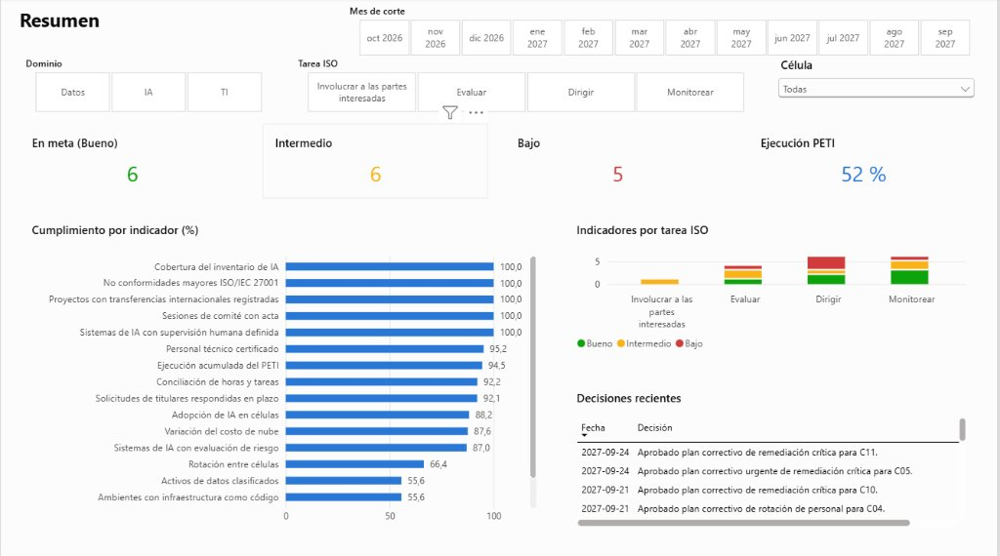
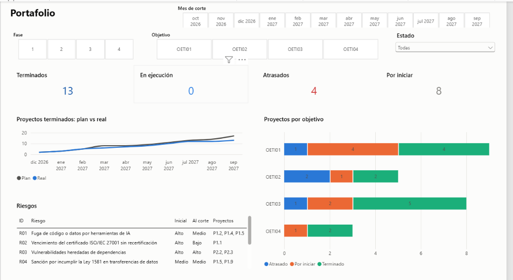
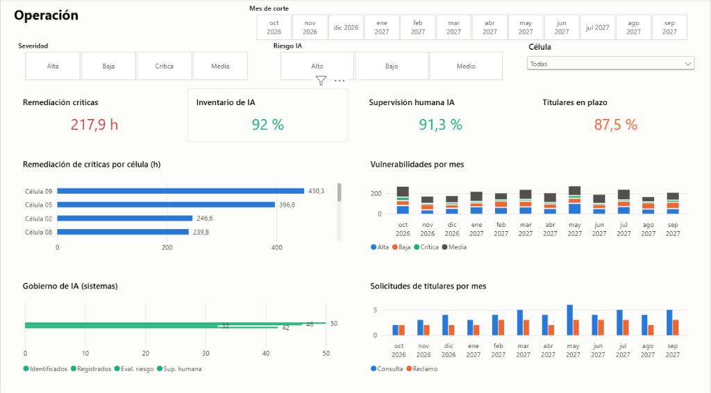

# Dashboard estratégico de gobierno de datos, IA y TI (ISO/IEC 38500:2024)

<!-- Fuente del Word Dashboard_Gobierno_TI_ISO38500_Perficient_Colombia.docx. Se genera con scripts/md_a_docx_simple.py. -->

**Organización:** Perficient Inc., operación en Colombia (PETI 2026-2028, trabajo académico). **Equipo:** Firmes por la Gobernanza. **Herramienta:** Power BI Desktop (modelo tabular en estrella con medidas DAX). **Fecha:** noviembre de 2026.

## 1. Para quién es y qué decide

El informe está dirigido al **Comité Directivo del PETI**, instancia propuesta en el §12 del PETI Colombia v1.0 para revisar cada trimestre el desempeño de los indicadores, aprobar ajustes al portafolio y aceptar o escalar los riesgos residuales. Como instancia operativa de apoyo, el **Comité Táctico de TI** (§12, también propuesto) utiliza la vista mensual por célula para preparar los planes correctivos que suben al Comité Directivo.

El tablero conecta la lectura ejecutiva con la operación por célula y con la bitácora de decisiones recomendada en la guía de gobierno de TI de Enterprise Information Services (PUB-027). Las decisiones registradas mantienen las siete columnas base de la bitácora del flujo automatizado en n8n de la misma semana, de manera que el seguimiento mensual automatizado y el tablero trimestral comparten el mismo modelo de datos sintéticos.

## 2. Por qué Power BI y qué cambió frente al 4 de noviembre

En la entrega del 4 de noviembre de 2026 se publicó un tablero en Grafana sobre datos sintéticos de MOSTLY AI. Para esta segunda iteración se migró a Power BI Desktop con un modelo en estrella, filtros sincronizados, selector de mes de corte e historial por indicador. El diseño pasó de una vista única de 22 paneles a una estructura acotada y gráfica: tres páginas visibles con botones de selección (**Resumen**, **Portafolio** y **Operación**) más una página oculta de detalle (**Hoja de vida**) accesible por clic derecho sobre cualquier indicador.

| Aspecto del tablero del 4 de noviembre | Qué cambia en Power BI (noviembre de 2026) |
|---|---|
| 22 paneles en una sola página con el mismo peso visual | Tres páginas enfocadas (**Resumen**, **Portafolio**, **Operación**) y una hoja de vida de detalle por indicador |
| Bloques de color saturados | Rojo reservado para estado Bajo, proyectos atrasados y riesgo Alto; un color fijo por dominio (TI azul, Datos naranja, IA verde) |
| Series rectas y metas planas | Ruido mensual, un mes sin reporte (célula C11 en el mes 8), frecuencias reales (mensual, trimestral, semestral, anual) y retrocesos |
| Paneles de tickets y tiempos operativos por prioridad | Solo los 13 indicadores vigentes del PETI (§10) y cinco complementarios de gobierno de datos e IA, todos trazados a la ISO/IEC 38500:2024 |
| Instantánea estática sin memoria de filtros | Selector de mes de corte sincronizado (octubre de 2026 a septiembre de 2027), filtros con botones por dominio, tarea, fase y célula |
| Metas del mes 12 supuestas con asterisco | Metas del año 1 tomadas del PETI §7 (METI); los cambios de estado frente al tablero anterior se documentan en la sección 7 |

## 3. Cómo entra la ISO/IEC 38500:2024

La norma ISO/IEC 38500:2024 orienta a los órganos de gobierno sobre el uso eficaz, eficiente y aceptable de la TI mediante tres herramientas: principios (§5), un modelo de tareas (§6) y un marco de elementos (§7) (PUB-026). No es una norma certificable ni prescribe pasos de implementación; Perficient Colombia la adopta como referencia metodológica voluntaria junto con la guía de EIS (PUB-027) y los criterios de evaluación de la edición 2008 (PUB-028). Debido a que el equipo dispone únicamente de la vista previa de la edición 2024 (PUB-026), de los capítulos §5 a §7 se citan únicamente los nombres oficiales del índice, mientras que las descripciones de apoyo provienen del resumen secundario de Garibay (PUB-029).

- **Tareas del modelo (§6.2):** a diferencia de la versión 2008 (que contemplaba evaluar, dirigir y monitorear), la edición 2024 incorpora cuatro tareas: **involucrar a las partes interesadas** (6.2.1), **evaluar** (6.2.2), **dirigir** (6.2.3) y **monitorear** (6.2.4) (PUB-026). Cada indicador del tablero está asignado a una de ellas y las páginas responden a evaluar, dirigir y monitorear e involucrar.
- **Principios (§5.2 a §5.12):** los 11 principios se cargan completos en la dimensión `dim_principio`. **Propósito (5.2)** y **Liderazgo (5.8)** permanecen sin indicador asociado de forma deliberada: el tablero cuantitativo no los mide directamente, por lo que su revisión corresponde a las actas del Comité y a la autoevaluación de madurez de gobierno de TI.
- **Elementos del marco (§7.2):** cada indicador se clasifica en uno de los seis elementos (Dirección, Capacidad, Política, Delegación, Desempeño o Rendición de cuentas).
- **Bitácora de decisiones:** siguiendo la guía de EIS (PUB-027), cada decisión registra fecha, ciclo, célula, foco (Priorización, Riesgo, Desempeño o Estrategia), justificación, decisión y responsable.

## 4. Modelo de datos en estrella

El generador determinista (`scripts/powerbi_iso38500_datos.py`, semilla `38500`) construye un libro Excel (`datos/modelo_gobierno_ti.xlsx`) con 14 tablas en estrella y un archivo de control (`datos/control_corte_mes12.csv`) para verificar la igualdad exacta entre el script en Python y las medidas DAX en Power BI. Las tablas se relacionan mediante 14 relaciones activas de varios a uno con dirección de filtro única; `dim_corte` y `dim_riesgo` permanecen desacopladas para controlar el parámetro de corte y evitar ambigüedades entre decisiones, proyectos e indicadores.

| Tabla | Tipo | Grano y función en el modelo |
|---|---|---|
| `dim_fecha` | Dimensión (fecha) | 24 meses del horizonte PETI (octubre de 2026 a septiembre de 2028), etiqueta, año, trimestre y fase |
| `dim_corte` | Dimensión suelta | Meses 1 a 12 para el selector "Mes de corte" (sin relación física; gobernada por la medida `Corte`) |
| `dim_principio` | Dimensión | Los 11 principios de la ISO/IEC 38500:2024 (§5.2 a §5.12) con nombre en español e inglés y fuente |
| `dim_tarea` | Dimensión | Las 4 tareas del modelo (§6.2.1 a §6.2.4): involucrar, evaluar, dirigir y monitorear |
| `dim_indicador` | Dimensión | Catálogo de 18 indicadores (13 del PETI §10 y 5 complementarios), metas, sentido, escala y nivel |
| `dim_celula` | Dimensión | 12 células de entrega (`C01` a `C12`) en 4 líneas de servicio más la marca `OPE` (toda la operación) |
| `dim_proyecto` | Dimensión | Los 25 proyectos del portafolio (§9) con fase, objetivo, brecha, responsable y meses planeado y real |
| `dim_riesgo` | Dimensión | Los 8 riesgos del PETI (§11) con nivel inicial, nivel al corte y motivo de cambio |
| `fact_medicion` | Hechos | Numerador, denominador y estado de reporte por mes, indicador y célula |
| `fact_proyecto_mes` | Hechos | Avance planeado, avance real y estado mensual (meses 1 a 12) de los 25 proyectos |
| `fact_vulnerabilidad` | Hechos | Registro de vulnerabilidades detectadas por célula, severidad, origen y tiempos de detección y remediación |
| `fact_sistema_ia` | Hechos | Inventario sintético de sistemas de IA por célula, tipo, origen, evaluación de riesgo y supervisión humana |
| `fact_solicitud_titular` | Hechos | Solicitudes simuladas de consultas y reclamos de titulares con plazos y cumplimiento |
| `fact_decision` | Hechos | Bitácora de 16 decisiones tácticas y directivas entre los meses 3 y 12 |
| `Medidas` | Tabla de cálculo | 35 medidas DAX que replican las reglas de agregación, corte, cumplimiento, estado y filtros visuales |

## 5. Catálogo de indicadores

Los 13 KPI conservan las fórmulas, líneas base, frecuencias y responsables del §10 del PETI Colombia. Los cinco indicadores complementarios (`DAT-01` a `DAT-03`, `IA-01`, `IA-02`) son supuestos internos del equipo (`INT-001`) formulados para cubrir el gobierno de datos personales y el control de sistemas de IA.

| ID | Indicador | Dominio | Principio | Tarea | Elemento | Meta año 1 | Meta año 2 | Nivel | Proyecto |
|---|---|---|---|---|---|---|---|---|---|
| KPI-01 | Ejecución acumulada del PETI | TI | 5.5 Supervisión | Monitorear | Desempeño | 55 % | 95 % | Operación | Todo el portafolio |
| KPI-02 | Variación del costo de nube | TI | 5.3 Generación de valor | Evaluar | Desempeño | −5 % | −15 % | Operación | P2.7 |
| KPI-03 | Casos de IA en producción | IA | 5.3 Generación de valor | Evaluar | Capacidad | 1 | 5 | Operación | P3.1, P3.3 |
| KPI-04 | Adopción de IA en células | IA | 5.4 Estrategia | Dirigir | Capacidad | 85 % | 95 % | Célula | P1.6, P1.8 |
| KPI-05 | Remediación de vulnerabilidades críticas (h) | TI | 5.10 Gobierno del riesgo | Monitorear | Desempeño | 72 h | 24 h | Célula | P2.2, P2.3 |
| KPI-06 | Conciliación de horas y tareas | TI | 5.9 Datos y decisiones | Monitorear | Desempeño | 90 % | 95 % | Operación | P2.4 |
| KPI-07 | No conformidades mayores ISO/IEC 27001 | TI | 5.12 Viabilidad y desempeño | Monitorear | Rendición de cuentas | 0 | 0 | Operación | P1.1 |
| KPI-08 | Cobertura del inventario de IA | IA | 5.10 Gobierno del riesgo | Evaluar | Política | 90 % | 100 % | Célula | P1.3 |
| KPI-09 | Personal técnico certificado | TI | 5.4 Estrategia | Dirigir | Capacidad | 70 % | 90 % | Célula | P1.7 |
| KPI-10 | Rotación entre células | TI | 5.10 Gobierno del riesgo | Dirigir | Capacidad | 50 % | 100 % | Célula | P2.1 (R06) |
| KPI-11 | Ambientes con infraestructura como código | TI | 5.12 Viabilidad y desempeño | Dirigir | Capacidad | 60 % | 100 % | Operación | P2.6 |
| KPI-13 | Informe SOC 2 sin salvedades | TI | 5.7 Partes interesadas | Involucrar | Rendición de cuentas | — | 1 | Operación | P4.1 |
| KPI-14 | Sesiones de comité con acta | TI | 5.6 Rendición de cuentas | Monitorear | Rendición de cuentas | 90 % | 90 % | Operación | P2.8 |
| DAT-01 | Solicitudes de titulares respondidas en plazo | Datos | 5.11 Responsabilidad social | Involucrar | Rendición de cuentas | 95 % | 98 % | Operación | P1.9 |
| DAT-02 | Activos de datos clasificados | Datos | 5.9 Datos y decisiones | Dirigir | Política | 60 % | 90 % | Operación | P3.5 |
| DAT-03 | Proyectos con transferencias internacionales registradas | Datos | 5.11 Responsabilidad social | Monitorear | Rendición de cuentas | 80 % | 100 % | Operación | P1.9 |
| IA-01 | Sistemas de IA con evaluación de riesgo | IA | 5.10 Gobierno del riesgo | Evaluar | Política | 80 % | 100 % | Célula | P1.2 |
| IA-02 | Sistemas de IA con supervisión humana definida | IA | 5.6 Rendición de cuentas | Dirigir | Delegación | 90 % | 100 % | Célula | P1.2, P1.4 |

Las reglas de cálculo garantizan agregación exacta sumando numeradores y denominadores antes de dividir, sin promediar porcentajes. Cuando no existe reporte en el mes de corte elegido, el tablero recupera automáticamente la última medición válida menor o igual al corte; si el corte antecede a la línea base (como `KPI-06` en el mes 4) o carece de meta al año 1 (`KPI-13`), el indicador pasa a estado **No evaluado** en lugar de mostrar 0 % o rojo.

## 6. Cómo usar el informe

El archivo de Power BI Desktop se organiza en tres pestañas visibles y una página oculta de detalle:

1. **Resumen:** muestra el conteo de indicadores por estado (Bueno, Intermedio, Bajo), la ejecución acumulada del PETI (`KPI-01`), el gráfico horizontal de cumplimiento porcentual de cada indicador, la distribución por tarea de la ISO/IEC 38500 y la tabla de decisiones recientes del Comité. Incluye botones superiores para filtrar por **Dominio**, **Tarea ISO** y desplegable de **Célula**.
2. **Portafolio:** presenta botones por **Fase**, **Objetivo** y **Estado**, las cuatro tarjetas de conteo del portafolio al corte, la curva acumulada de proyectos terminados (plan frente a real), la distribución por objetivo OETI y la tabla de riesgos (§11) con su evolución al mes de corte.
3. **Operación:** agrupa los indicadores de TI, datos e IA mediante botones de **Severidad**, **Riesgo IA** y **Célula**, cuatro tarjetas clave (`KPI-05`, `KPI-08`, `IA-02`, `DAT-01`) y cuatro gráficos: remediación de vulnerabilidades críticas por célula, vulnerabilidades detectadas por mes, seguimiento de sistemas de IA desde su identificación hasta la supervisión humana y solicitudes de titulares por mes.
4. **Hoja de vida (oculta):** al hacer clic derecho sobre cualquier barra o indicador y seleccionar **Obtener detalles → Hoja de vida**, despliega la ficha técnica completa del Anexo 1, su tendencia mensual frente a meta y el desglose por célula.

El selector **Mes de corte** en la banda superior se encuentra sincronizado en todas las páginas; sin selección explícita evalúa el mes 12 (septiembre de 2027) y al elegir cualquier mes entre octubre de 2026 y septiembre de 2027 recalcula indicadores, portafolio, sistemas de IA, vulnerabilidades y bitácora al corte correspondiente. Los indicadores de nivel **Operación** conservan su valor global cuando se filtra por célula y añaden la marca `toda la operación` en su etiqueta.

## 7. Lectura al corte de septiembre de 2027 (mes 12)

Al cierre del primer año simulado, de los 18 indicadores evaluados se obtienen **6 en estado Bueno** (`KPI-07`, `KPI-08`, `KPI-09`, `KPI-14`, `DAT-03`, `IA-02`), **6 en Intermedio** (`KPI-01`, `KPI-02`, `KPI-04`, `KPI-06`, `DAT-01`, `IA-01`), **5 en Bajo** (`KPI-03`, `KPI-05`, `KPI-10`, `KPI-11`, `DAT-02`) y **1 No evaluado** (`KPI-13`, cuya meta inicia en el año 2). En el portafolio, 13 de los 25 proyectos aparecen terminados (52,0 % frente a la meta de 55 %), 4 se encuentran atrasados (`P1.8`, `P2.2`, `P2.3` y `P2.6`), ninguno permanece en ejecución al cierre de la fase 2 y los 8 proyectos de fase 3 esperan inicio en el mes 13.

La remediación de vulnerabilidades críticas (`KPI-05`) promedia 217,9 h en el mes 12 frente a la meta de 72 h, lo que mantiene al riesgo **R03** en nivel **Alto** y concentra la mayoría de las acciones correctivas del Comité Táctico. De igual forma, la rotación entre células (`KPI-10`, 33,2 % frente a 50 %) eleva al riesgo **R06** de Medio a **Alto**. Por su parte, la cobertura del inventario de IA alcanza 92,0 % (46 de 50 sistemas identificados registrados), pero solo 32 cuentan con evaluación de riesgo (`IA-01`, 69,6 % en Intermedio), señalando la brecha pendiente antes de pasar nuevos sistemas a producción.

Frente al tablero del 4 de noviembre cambian tres estados y un valor de referencia por correcciones metodológicas trazables: `KPI-02` pasa de Bueno a Intermedio porque se aplica la meta oficial del año 1 del PETI (−5 % del `METI11`, en lugar de −3 %); `KPI-13` pasa de Bueno a No evaluado porque el PETI no fija meta al año 1; `KPI-05` pasa de 181 h a 217,9 h al medir el valor exacto del mes 12 y no el promedio trimestral; y **`KPI-03` (Casos de IA en producción)** pasa de Bueno a **Bajo** al revelar una inconsistencia del PETI Colombia v1.0: `METI03` exige un caso en producción en el año 1, pero los proyectos que lo habilitan (`P3.1` y `P3.3`) inician en el mes 13 (fase 3).

## 8. Datos sintéticos, límites y actualización de origen

- **Origen sintético:** las mediciones de vulnerabilidades y talento se derivan de los archivos sintéticos generados el 4 de noviembre con MOSTLY AI; las series de solicitudes de titulares (79 solicitudes hasta el mes 12, 15 fuera de plazo) y los 50 sistemas de IA se generaron mediante reglas deterministas en Python. Ningún dato corresponde a clientes reales ni a la operación productiva de Perficient.
- **Supuestos pendientes de verificación:** el resultado de `KPI-07` (0 no conformidades en el mes 5) supone que la recertificación ISO/IEC 27001:2022 (`P1.1`) cerró sin salvedades, aunque no existe evidencia pública reciente en el registro (`PUB-002`). Los plazos usados en `DAT-01` (10 días hábiles para consultas y 15 para reclamos) corresponden a un supuesto del escenario pendiente de validación jurídica frente a los artículos vigentes de la Ley 1581 de 2012.
- **Cambio de ruta al abrir en otro equipo:** todos los datos del modelo están importados dentro del `.pbix`, por lo que cualquier usuario puede explorar y filtrar el informe sin acceso al archivo Excel local. Si se requiere actualizar los datos tras regenerar `modelo_gobierno_ti.xlsx` en otro equipo, basta ir en Power BI Desktop a **Inicio → Transformar datos → Configuración de origen de datos → Cambiar origen** y apuntar al libro Excel local.

## 9. Referencias

- **PUB-026:** International Organization for Standardization (ISO). (2024). *ISO/IEC 38500:2024 Information technology — Governance of IT for the organization* (3.ª ed., vista previa).
- **PUB-027:** Enterprise Information Services (EIS), State of Oregon. (2024). *IT Governance Guide – Agency Modernization*.
- **PUB-028:** Material de curso. *Governance of Information Technology (IT)* (capítulo 10, versión 2008).
- **PUB-029:** Garibay Orozco, J. *ISO/IEC 38500 y su relación con la Inteligencia Artificial* (presentación de apoyo, fuente secundaria).
- **INT-001:** Equipo Firmes por la Gobernanza. (2026). *PETI Colombia v1.0 y supuestos internos del escenario de gobierno de datos, IA y TI* (`docs/perficient_peti_colombia_2026_2028.md`).

## 10. Capturas del tablero (corte septiembre de 2027)

