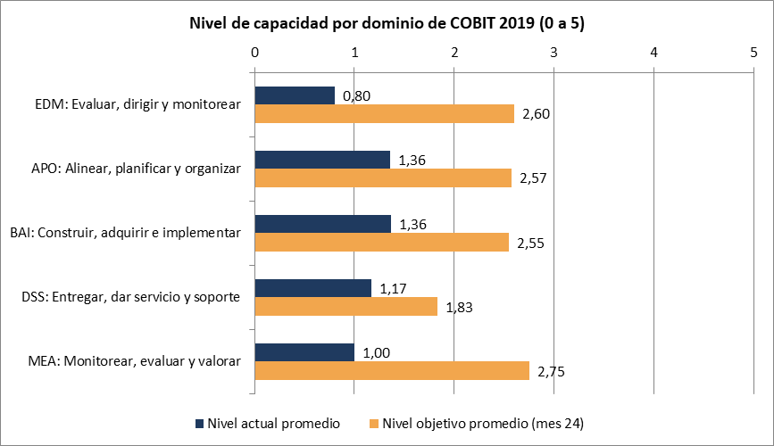
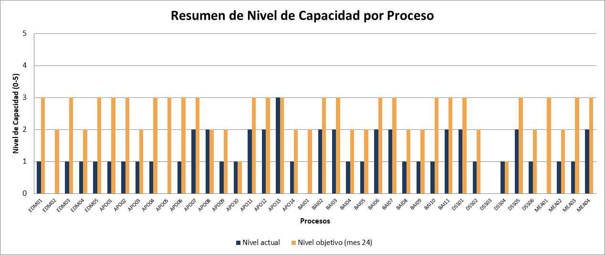

# Diagnóstico de sensibilización gerencial y diagnóstico de control en TI con COBIT 2019: Perficient, operación en Colombia

<!-- Fuente del Word Analisis_Diagnosticos_COBIT2019_Perficient_Colombia.docx y de los dos libros diligenciados. El script scripts/generar_diagnosticos_cobit.py lee las dos tablas de 40 objetivos (marcadores "sensibilizacion" y "control"), llena los formatos del docente por Excel y reescribe las tablas de los marcadores "resultado-sensibilizacion" y "resultado-control" con lo que calcula. Si cambias un valor, vuelve a correr el script y revisa la prosa de "Lectura", "Cruce" y "Comparación", que no se recalcula. -->

**Organización evaluada:** Perficient Inc., operación en Colombia. **Rol de quien evalúa:** equipo de arquitectura y gobernanza de TI del PETI 2026-2028 (trabajo académico). **Evaluadores:** Equipo Firmes por la Gobernanza. **Fecha:** 16 de noviembre de 2026. **Herramientas:** *COBIT 2019 Management Awareness Diagnostic* v1.0 y *Diagnóstico de Control en TI COBIT 2019*, entregadas por el docente.

## Objetivo

Evaluar el estado actual de la gestión de TI de la operación colombiana y la percepción de la dirección sobre la importancia de los controles de TI, con los 40 objetivos de gobierno y gestión de COBIT 2019. El primer diagnóstico pregunta qué tan importante es cada objetivo, qué tan bien se hace, quién lo hace, si está formalizado, si se audita y quién responde. El segundo asigna a cada objetivo un nivel de capacidad de 0 a 5 y anota la brecha. Cruzados, los dos señalan dónde la operación corre más riesgo y qué proyectos del PETI Colombia v1.0 lo atienden.

## De dónde vienen las herramientas

Las dos herramientas nacieron en el *Implementation Tool Set* de COBIT 3.ª edición (IT Governance Institute, 2000; PUB-030), que acompañaba el resumen ejecutivo para la alta dirección. En ese juego, el diagnóstico de sensibilización era una autoevaluación de gobierno de TI que pide a la dirección, para cada proceso, "qué tan importante es para los objetivos del negocio" y si "se desempeña bien", y aclara que **la combinación de importancia y desempeño es un indicador fuerte de riesgo**. Pregunta además quién hace el proceso y quién responde por él, si está formalizado (contrato, acuerdo de nivel de servicio o procedimiento documentado) y si se audita. Según la misma fuente, las respuestas "No se sabe" en procesos de riesgo alto son el mensaje más fuerte para la dirección.

El diagnóstico de control en TI original era un conjunto de formularios para la planeación de auditoría (formulario corto y largo de la entidad, trabajo de auditoría previa, evaluación de riesgos, parte responsable y contratos o SLA) sobre los 34 procesos de COBIT 3. El formato del docente lo reemplaza por una calificación de capacidad de 0 a 5 por objetivo, que es como se mide hoy el desempeño de los procesos en COBIT 2019.

COBIT 2019 tiene 40 objetivos en cinco dominios: uno de gobierno (EDM, evaluar, dirigir y monitorear) y cuatro de gestión (APO, alinear, planificar y organizar; BAI, construir, adquirir e implementar; DSS, entregar, dar servicio y soporte; MEA, monitorear, evaluar y valorar). Frente a COBIT 5 se agregaron APO14 (datos), BAI11 (proyectos) y MEA04 (aseguramiento), y la medición de capacidad pasó de la escala de la ISO/IEC 33000 a una basada en CMMI (PUB-031).

## Cómo se llenaron

### Diagnóstico de sensibilización gerencial

| Columna | Escala del formato | Cómo se usó |
|---|---|---|
| Importancia (*Importance*) | 1 (nada) a 5 (mucho) | Importancia del objetivo para los objetivos corporativos OC01 a OC04 y para los clientes |
| Desempeño (*Performance*) | 1 (muy bien) a 5 (no se sabe o mal) | Qué tan bien se hace hoy, según la evidencia del registro. Lo que no se pudo ver recibe 4 o 5 |
| Quién lo hace (*Who does it?*) | TI, otra área (*Other*), externo (*Outside*), no se sabe (*Do Not Know*) | TI incluye a los equipos técnicos de la operación; otra área, a la dirección, talento humano, operaciones, legal y los Product Managers; externo, al cliente y a los proveedores. Se marcan una o dos columnas |
| Auditado (*Audited*) | Yes, No o ? | Yes solo si una auditoría externa lo cubre (la del SGSI, PUB-002); ? si podría estar en el alcance del SGSI sin que se pueda comprobar |
| Formalidad (*Formality*) | Yes, No o ? | Yes si hay contrato, acuerdo de nivel de servicio o procedimiento documentado verificable |
| Responsable (*Who is accountable?*) | Nombre o "no se sabe" | Se escribe el **rol**, no el nombre de una persona. Los roles de proyecto vienen de la cuenta analizada (PRV-001) |

El formato agrupa importancia y desempeño bajo el título *Risk* sin dar una fórmula. Se calculó **riesgo = importancia × desempeño** (de 1 a 25), que funciona porque en este formato el desempeño crece cuando el proceso se hace peor: alto de 20 a 25 (importancia y desempeño de 4 o más, y al menos uno en 5), medio de 12 a 16 y bajo de 10 o menos.

### Diagnóstico de control en TI

El formato trae la escala de capacidad de la ISO/IEC 33000. COBIT 2019 usa su propia escala, con descripciones parecidas (figura 6.2 de *COBIT 2019 Framework: Introduction and Methodology*, PUB-032):

| Nivel | Formato del docente (ISO/IEC 33000) | COBIT 2019 (PUB-032) |
|---|---|---|
| 0 | Incompleto: el proceso no alcanza su propósito | Le falta capacidad básica; enfoque incompleto |
| 1 | Realizado inicialmente, no estandarizado | Cumple más o menos su propósito con un conjunto incompleto de actividades |
| 2 | Gestionado: se gestiona y se planifica | Cumple su propósito con un conjunto básico pero completo de actividades |
| 3 | Establecido: proceso estándar definido y documentado | Lo cumple de forma mucho más organizada, con activos de la organización |
| 4 | Predecible: opera dentro de límites definidos | Bien definido y con desempeño medido cuantitativamente |
| 5 | Optimizado: mejora continua | Desempeño medido para mejorar; mejora continua |

Se usó la regla de las entregas anteriores: lo que no se puede demostrar no recibe el nivel más alto. Un nivel 2 exige evidencia de que las actividades básicas se hacen completas, al menos en la cuenta analizada; un nivel 3, que la organización tiene un proceso estándar que se audita. COBIT 2019 califica cada actividad del objetivo como lograda por completo (más de 85 %), en gran medida (50 % a 85 %), parcialmente (15 % a 50 %) o no lograda (menos de 15 %) (PUB-032). Este diagnóstico no llegó a ese detalle: asignó el nivel por objetivo con la descripción de la figura 6.2.

La columna "Nivel objetivo" (mes 24) es el nivel al que llevaría el objetivo el PETI Colombia v1.0 si se ejecuta como está escrito. Es una estimación del equipo (INT-001). La guía de diseño de COBIT 2019 propone exigir nivel 4 a los objetivos más importantes, 3 a los siguientes y 2 al resto (PUB-032); el PETI apunta a 3 como máximo en 24 meses.

### Correcciones a los formatos

El formato de control en TI mezclaba nombres de COBIT 5 con códigos de COBIT 2019: llamaba APO09 a proveedores, APO10 a calidad, APO11 a riesgos y APO12 a seguridad (en COBIT 2019 son APO10, APO11, APO12 y APO13); no traía APO09 (acuerdos de servicio), APO13 ni APO14 (datos); llamaba "problemas" a BAI11, que es proyectos; tenía invertidos MEA02 y MEA03, y le faltaba MEA04. Se corrigieron los códigos y los nombres, y se agregaron las tres filas que faltaban, para que los dos diagnósticos tengan los mismos 40 objetivos y se puedan cruzar. El libro diligenciado lleva una nota con la corrección.

En el formato de sensibilización se corrigieron dos erratas: el dominio BAI se llamaba "Build, Acquire and Operate" (es *Implement*) y APO13 decía "Manage Security" (es *Managed Security*).

## 1. Diagnóstico de sensibilización gerencial

<!-- sensibilizacion -->

| Código | Objetivo de COBIT 2019 | Importancia | Desempeño | Quién lo hace | Formalidad | Auditado | Responsable |
|---|---|---|---|---|---|---|---|
| EDM01 | Asegurar el establecimiento y el mantenimiento del marco de gobierno | 5 | 5 | No se sabe | No | No | No se sabe |
| EDM02 | Asegurar la entrega de beneficios | 4 | 5 | No se sabe | No | No | No se sabe |
| EDM03 | Asegurar la optimización del riesgo | 5 | 4 | TI | ? | ? | No se sabe |
| EDM04 | Asegurar la optimización de los recursos | 4 | 4 | Otra área | No | No | No se sabe |
| EDM05 | Asegurar el compromiso de las partes interesadas | 4 | 4 | Otra área | No | No | Product Manager (por cuenta) |
| APO01 | Gestionar el marco de gestión de I&T | 5 | 4 | TI | ? | ? | No se sabe |
| APO02 | Gestionar la estrategia | 5 | 5 | No se sabe | No | No | No se sabe |
| APO03 | Gestionar la arquitectura empresarial | 3 | 4 | TI | No | No | Technical Lead (por proyecto) |
| APO04 | Gestionar la innovación | 4 | 3 | TI, Otra área | ? | No | No se sabe |
| APO05 | Gestionar el portafolio | 4 | 5 | No se sabe | No | No | No se sabe |
| APO06 | Gestionar el presupuesto y los costos | 4 | 5 | Otra área | ? | ? | No se sabe |
| APO07 | Gestionar los recursos humanos | 5 | 2 | Otra área | ? | ? | Line Manager |
| APO08 | Gestionar las relaciones | 5 | 2 | Otra área | ? | No | Product Manager |
| APO09 | Gestionar los acuerdos de servicio | 4 | 4 | Otra área, Externo | ? | ? | No se sabe |
| APO10 | Gestionar los proveedores | 4 | 4 | TI, Externo | ? | ? | No se sabe |
| APO11 | Gestionar la calidad | 4 | 3 | TI | ? | No | Technical Lead |
| APO12 | Gestionar el riesgo | 5 | 3 | TI | Yes | Yes | Responsable del SGSI (corporativo) |
| APO13 | Gestionar la seguridad | 5 | 2 | TI | Yes | Yes | Responsable del SGSI (corporativo) |
| APO14 | Gestionar los datos | 4 | 5 | No se sabe | No | No | No se sabe |
| BAI01 | Gestionar los programas | 3 | 4 | No se sabe | No | No | No se sabe |
| BAI02 | Gestionar la definición de requisitos | 4 | 2 | TI, Otra área | ? | No | Product Manager |
| BAI03 | Gestionar la identificación y construcción de soluciones | 5 | 2 | TI | ? | ? | Technical Lead |
| BAI04 | Gestionar la disponibilidad y la capacidad | 4 | 3 | TI, Externo | ? | ? | No se sabe |
| BAI05 | Gestionar el cambio organizativo | 4 | 4 | Otra área | No | No | No se sabe |
| BAI06 | Gestionar los cambios de TI | 4 | 3 | TI, Externo | ? | ? | Technical Lead, con aprobación del cliente |
| BAI07 | Gestionar la aceptación y la transición de los cambios de TI | 4 | 3 | TI, Externo | ? | No | Product Manager, con el cliente |
| BAI08 | Gestionar el conocimiento | 4 | 4 | TI | No | No | No se sabe |
| BAI09 | Gestionar los activos | 3 | 3 | TI | ? | ? | No se sabe |
| BAI10 | Gestionar la configuración | 3 | 4 | TI, Externo | No | No | No se sabe |
| BAI11 | Gestionar los proyectos | 5 | 2 | TI, Otra área | ? | No | Product Manager |
| DSS01 | Gestionar las operaciones | 4 | 3 | TI, Externo | ? | ? | Cliente (responsabilidad compartida) |
| DSS02 | Gestionar las solicitudes y los incidentes de servicio | 4 | 3 | TI | ? | ? | No se sabe |
| DSS03 | Gestionar los problemas | 3 | 4 | No se sabe | No | No | No se sabe |
| DSS04 | Gestionar la continuidad | 5 | 4 | TI, Externo | ? | ? | No se sabe |
| DSS05 | Gestionar los servicios de seguridad | 5 | 2 | TI, Externo | Yes | Yes | Responsable del SGSI (corporativo) |
| DSS06 | Gestionar los controles de los procesos de negocio | 3 | 3 | TI, Otra área | ? | No | Operaciones |
| MEA01 | Gestionar el monitoreo del desempeño y la conformidad | 5 | 5 | No se sabe | No | No | No se sabe |
| MEA02 | Gestionar el sistema de control interno | 4 | 4 | Otra área | ? | ? | No se sabe |
| MEA03 | Gestionar el cumplimiento de los requisitos externos | 5 | 4 | Otra área | No | No | No se sabe |
| MEA04 | Gestionar el aseguramiento | 5 | 3 | Externo | Yes | Yes | Responsable del SGSI (corporativo) |

<!-- fin-sensibilizacion -->

Los nombres en español son traducción del equipo; el libro conserva los nombres en inglés del formato.

### Resultado

<!-- resultado-sensibilizacion -->

| Dominio | Objetivos | Importancia promedio | Desempeño promedio | Riesgo alto | Riesgo medio | Riesgo bajo | Formalizados (Yes) | Auditados (Yes) | Responsable "No se sabe" |
|---|---|---|---|---|---|---|---|---|---|
| EDM: Evaluar, dirigir y monitorear | 5 | 4,4 | 4,4 | 3 | 2 | 0 | 0 | 0 | 4 |
| APO: Alinear, planificar y organizar | 14 | 4,4 | 3,6 | 5 | 6 | 3 | 2 | 2 | 8 |
| BAI: Construir, adquirir e implementar | 11 | 3,9 | 3,1 | 0 | 7 | 4 | 0 | 0 | 6 |
| DSS: Entregar, dar servicio y soporte | 6 | 4,0 | 3,2 | 1 | 3 | 2 | 1 | 1 | 3 |
| MEA: Monitorear, evaluar y valorar | 4 | 4,8 | 4,0 | 2 | 2 | 0 | 1 | 1 | 3 |
| **Total** | 40 | 4,2 | 3,5 | 11 | 20 | 9 | 4 | 4 | 24 |

Objetivos de riesgo alto (20 o más), de mayor a menor:

| Código | Objetivo | Importancia | Desempeño | Riesgo | Quién lo hace | Responsable | Nivel actual |
|---|---|---|---|---|---|---|---|
| EDM01 | Asegurar el establecimiento y el mantenimiento del marco de gobierno | 5 | 5 | 25 | No se sabe | No se sabe | 1 |
| APO02 | Gestionar la estrategia | 5 | 5 | 25 | No se sabe | No se sabe | 1 |
| MEA01 | Gestionar el monitoreo del desempeño y la conformidad | 5 | 5 | 25 | No se sabe | No se sabe | 0 |
| EDM02 | Asegurar la entrega de beneficios | 4 | 5 | 20 | No se sabe | No se sabe | 0 |
| EDM03 | Asegurar la optimización del riesgo | 5 | 4 | 20 | TI | No se sabe | 1 |
| APO01 | Gestionar el marco de gestión de I&T | 5 | 4 | 20 | TI | No se sabe | 1 |
| APO05 | Gestionar el portafolio | 4 | 5 | 20 | No se sabe | No se sabe | 0 |
| APO06 | Gestionar el presupuesto y los costos | 4 | 5 | 20 | Otra área | No se sabe | 1 |
| APO14 | Gestionar los datos | 4 | 5 | 20 | No se sabe | No se sabe | 1 |
| DSS04 | Gestionar la continuidad | 5 | 4 | 20 | TI, Externo | No se sabe | 1 |
| MEA03 | Gestionar el cumplimiento de los requisitos externos | 5 | 4 | 20 | Otra área | No se sabe | 1 |

<!-- fin-resultado-sensibilizacion -->

### Lectura

La importancia casi no separa a los objetivos: el promedio es 4,2 y ninguno baja de 3. En una consultora de tecnología todo lo que toca TI toca el producto, así que el diagnóstico se decide por el desempeño, que promedia 3,5 y va de 2 a 5.

Los once objetivos de riesgo alto tienen algo en común: **en los once el responsable es "No se sabe"**, y en seis de ellos tampoco se sabe quién hace el trabajo. Es la señal que el *Implementation Tool Set* describe como el mensaje más fuerte para la dirección: riesgo alto combinado con "No se sabe" (PUB-030). Los once están en el gobierno (EDM01 a EDM03), en la planeación (APO01, APO02, APO05, APO06), en los datos (APO14), en la continuidad (DSS04) y en el monitoreo y el cumplimiento (MEA01, MEA03). Ninguno es de construcción o entrega de software.

En total, 24 de los 40 objetivos no tienen un responsable conocido. Solo cuatro están formalizados y auditados (APO12, APO13, DSS05 y MEA04), y los cuatro por la misma razón: el SGSI certificado en ISO/IEC 27001 (PUB-002). Fuera de la seguridad de la información no hay un proceso de TI con procedimiento documentado verificable ni auditoría externa.

Los nueve objetivos de riesgo bajo son los de entrega y seguridad: personas (APO07), relación con el cliente (APO08), seguridad (APO13), requisitos, construcción y proyectos (BAI02, BAI03, BAI11), activos (BAI09), servicios de seguridad (DSS05) y controles del proceso de registro de tiempos (DSS06). Casi todos son prácticas que la cuenta analizada sigue porque el cliente las exige o el SGSI las audita (PRV-001, PUB-002).

Por dominio, EDM y MEA combinan la importancia más alta con el peor desempeño (4,4 y 4,4 en EDM; 4,8 y 4,0 en MEA). BAI tiene el mejor desempeño (3,1) y ningún objetivo de riesgo alto.

## 2. Diagnóstico de control en TI

<!-- control -->

| Código | Proceso | Nivel actual | Nivel objetivo (mes 24) | Observaciones y brechas |
|---|---|---|---|---|
| EDM01 | Asegurar el establecimiento y el mantenimiento del marco de gobierno | 1 | 3 | Roles de proyecto definidos en la cuenta analizada (PRV-001), pero sin comité de TI con actas, RACI ni política de gobierno de TI (§6.1). BRE-011; P2.8. |
| EDM02 | Asegurar la entrega de beneficios | 0 | 2 | No se encontró análisis de costo-beneficio ni evaluación posterior de inversiones de TI. El PETI exige caso de negocio antes de ejecutar (§9), sin evaluación posterior. |
| EDM03 | Asegurar la optimización del riesgo | 1 | 3 | El SGSI trata los riesgos de seguridad (PUB-002); no hay apetito de riesgo de TI ni matriz que cubra IA, costos y cumplimiento (§6.1). BRE-011; P2.8, P1.2. |
| EDM04 | Asegurar la optimización de los recursos | 1 | 2 | Personas asignadas por células y licencias justificadas caso por caso ante el cliente (PRV-001); sin guía de presupuesto ni control de costos de nube. BRE-011, BRE-013; P2.7, P2.8. |
| EDM05 | Asegurar el compromiso de las partes interesadas | 1 | 3 | El Product Manager es el interlocutor con el cliente (PRV-001); no hay informes de TI a la dirección ni plan de comunicaciones aprobado. §12 del PETI. |
| APO01 | Gestionar el marco de gestión de I&T | 1 | 3 | Scrum y roles claros en la cuenta analizada (PRV-001) y políticas del SGSI (PUB-002); no hay un marco de gestión de TI de la operación. P2.8. |
| APO02 | Gestionar la estrategia | 1 | 3 | La estrategia corporativa es pública (PUB-003), pero no hay misión, visión ni estrategia de TI documentadas para la operación; el PETI v1.0 no está aprobado. BRE-015; P2.8. |
| APO03 | Gestionar la arquitectura empresarial | 1 | 2 | La arquitectura la decide el Technical Lead de cada proyecto (PRV-001); no hay arquitectura de referencia de la operación. P2.1, P2.6, P4.3. |
| APO04 | Gestionar la innovación | 1 | 3 | Alianzas y evolución de la marca hacia IA (PUB-003, PUB-005 a PUB-010) y formación interna en datos (PUB-022); en Colombia no hay un equipo que evalúe herramientas nuevas. P1.8. |
| APO05 | Gestionar el portafolio | 0 | 3 | No existe un portafolio aprobado de inversiones de TI de la operación; el del PETI (25 proyectos, §9) es propuesta. P2.8, KPI-01. |
| APO06 | Gestionar el presupuesto y los costos | 1 | 3 | El registro de tiempos cubre la facturación (§5.3, PA02), pero no hay guía de presupuesto de TI ni control de costos de nube (§6.1). BRE-011, BRE-013; P2.7, P2.8. |
| APO07 | Gestionar los recursos humanos | 2 | 3 | Line Manager por persona, niveles por experiencia, patrocinio de certificaciones y rotación entre células en la cuenta analizada (PRV-001); sin plan de certificaciones por rol. BRE-009; P1.7, P3.4. |
| APO08 | Gestionar las relaciones | 2 | 2 | El Product Manager gestiona la relación con el cliente y las ceremonias Scrum (PRV-001); reseñas públicas de clientes (PUB-023). El PETI no tiene proyecto para este objetivo. |
| APO09 | Gestionar los acuerdos de servicio | 1 | 2 | No hay catálogo de servicios de TI (§6.1) ni objetivos de servicio medidos en tableros (BRE-013). BRE-015; P2.5. |
| APO10 | Gestionar los proveedores | 1 | 1 | Hay un servicio externo de pruebas de seguridad y nube del cliente o de un proveedor (PRV-001); el SGSI pide controlar a los proveedores (A.5.19 a A.5.22), pero no se mide su desempeño. Sin proyecto en el PETI. |
| APO11 | Gestionar la calidad | 2 | 3 | El Technical Lead responde por la calidad y hay pruebas de seguridad continuas (PRV-001); configuraciones distintas entre células. BRE-004; P2.1, P2.3. |
| APO12 | Gestionar el riesgo | 2 | 3 | Proceso de riesgos del SGSI certificado (PUB-002), limitado a seguridad de la información; sin matriz de riesgos de TI ni de IA. BRE-011; P1.2, P2.8. |
| APO13 | Gestionar la seguridad | 3 | 3 | SGSI certificado en ISO/IEC 27001:2022 (PUB-002), con auditoría externa. Lineamientos de uso de IA sin sistema de gestión (PRV-001). BRE-006; P1.1, P1.2. |
| APO14 | Gestionar los datos | 1 | 2 | Datos gestionados proyecto por proyecto, sin plataforma ni catálogo únicos ni inventario de IA; transferencias internacionales sin registro. BRE-002, BRE-010, BRE-016; P1.3, P1.9, P3.5. |
| BAI01 | Gestionar los programas | 0 | 2 | Las iniciativas de TI de la operación no se gestionan como programa; el PETI las agrupa en cuatro fases con seguimiento del Comité Táctico (§9, §12). |
| BAI02 | Gestionar la definición de requisitos | 2 | 3 | Los requisitos se gestionan en el backlog del cliente por sprints, en la plataforma ALM (PRV-001); plantillas distintas entre células. BRE-004; P2.1. |
| BAI03 | Gestionar la identificación y construcción de soluciones | 2 | 3 | Desarrollo con ALM y pruebas de seguridad externas en la cuenta analizada (PRV-001); sin pipeline estándar con SAST, DAST y SCA. BRE-003, BRE-007; P2.3. |
| BAI04 | Gestionar la disponibilidad y la capacidad | 1 | 2 | Hay plataforma de observabilidad (PRV-001), pero sin tableros estándar, objetivos de servicio ni alertas de costo (§6.1). BRE-013; P2.5, P2.7. |
| BAI05 | Gestionar el cambio organizativo | 1 | 2 | Capacitaciones obligatorias en la cuenta (PRV-001); el currículo de IA no llega a todo el personal y el canal de licencias de IA no es estándar. BRE-005, BRE-009; P1.5, P1.6. |
| BAI06 | Gestionar los cambios de TI | 2 | 3 | Los cambios en ambientes administrados por contrato requieren aprobación del cliente (§2.2); sin infraestructura como código. BRE-007; P2.3, P2.6. |
| BAI07 | Gestionar la aceptación y la transición de los cambios de TI | 2 | 3 | Ambientes de desarrollo, pruebas y producción separados (PRV-001); la aceptación sigue el proceso del cliente. P2.3. |
| BAI08 | Gestionar el conocimiento | 1 | 2 | Formación interna en datos (PUB-022) y rotación entre células (PRV-001); sin base de conocimiento estándar; riesgo de pérdida de conocimiento (R06). P2.1, KPI-10. |
| BAI09 | Gestionar los activos | 1 | 2 | El SGSI exige inventario de activos (A.5.9), pero no hay inventario de sistemas de IA ni plan de ciclo de vida de las aplicaciones. BRE-002; P1.3. |
| BAI10 | Gestionar la configuración | 1 | 3 | Configuraciones de ALM distintas entre células y ambientes sin aprovisionamiento automatizado (§6.1). BRE-004, BRE-007; P2.1, P2.6. |
| BAI11 | Gestionar los proyectos | 2 | 3 | Scrum, sprints y registro de tareas y tiempos en la ALM (PRV-001); conciliación manual de horas. BRE-012; P2.1, P2.4. |
| DSS01 | Gestionar las operaciones | 2 | 3 | Ambientes en nube pública, en responsabilidad compartida con el cliente, con observabilidad (PRV-001); sin tableros estándar. BRE-013; P2.5. |
| DSS02 | Gestionar las solicitudes y los incidentes de servicio | 1 | 2 | Las solicitudes de licencias de IA no tienen canal estándar (BRE-005); el SGSI exige gestionar incidentes de seguridad (A.5.24 a A.5.28), sin evidencia de un procedimiento de incidentes de servicio. P1.6. |
| DSS03 | Gestionar los problemas | 0 | 0 | No se encontró gestión de problemas (análisis de causa raíz de incidentes recurrentes). Sin brecha ni proyecto en el PETI. |
| DSS04 | Gestionar la continuidad | 1 | 1 | El SGSI pide preparación de las TIC para la continuidad (A.5.29, A.5.30) y la nube es del cliente; no se encontró plan de continuidad de la operación. Sin brecha ni proyecto en el PETI. |
| DSS05 | Gestionar los servicios de seguridad | 2 | 3 | Controles del SGSI y pruebas de seguridad externas (PUB-002, PRV-001); hallazgos pasados a mano a la ALM y agentes de IA sin permisos. BRE-003, BRE-008; P1.4, P2.2, P2.3. |
| DSS06 | Gestionar los controles de los procesos de negocio | 1 | 2 | El sistema corporativo de registro de tiempos cubre el proceso (§5.3), pero la conciliación de horas y tareas es manual. BRE-012; P2.4. |
| MEA01 | Gestionar el monitoreo del desempeño y la conformidad | 0 | 3 | No hay indicadores de TI en uso (§6.1); los 13 del PETI son propuestos y el tablero de CIO del curso usa datos sintéticos. P2.8, KPI-01, KPI-14. |
| MEA02 | Gestionar el sistema de control interno | 1 | 2 | El SGSI exige auditoría interna (cláusula 9.2 de la ISO/IEC 27001); el proceso de auditoría y cumplimiento no tiene soporte de TI (§5.3, PV01). P4.2. |
| MEA03 | Gestionar el cumplimiento de los requisitos externos | 1 | 3 | La Ley 1581 de 2012 aplica directamente; no hay registro de obligaciones ni de transferencias internacionales por proyecto, y SOX no se trata como obligación vigente porque la compañía dejó de cotizar en bolsa (PUB-001). BRE-016; P1.9. |
| MEA04 | Gestionar el aseguramiento | 2 | 3 | Auditoría externa de certificación del SGSI (PUB-002); sin evidencia pública de un informe SOC 2. BRE-014; P4.1, P4.2. |

<!-- fin-control -->

### Resultado

<!-- resultado-control -->

| Dominio | Objetivos | Nivel actual promedio | Nivel objetivo promedio (mes 24) | Nivel 0 | Nivel 1 | Nivel 2 | Nivel 3 o más |
|---|---|---|---|---|---|---|---|
| EDM: Evaluar, dirigir y monitorear | 5 | 0,80 | 2,60 | 1 | 4 | 0 | 0 |
| APO: Alinear, planificar y organizar | 14 | 1,36 | 2,57 | 1 | 8 | 4 | 1 |
| BAI: Construir, adquirir e implementar | 11 | 1,36 | 2,55 | 1 | 5 | 5 | 0 |
| DSS: Entregar, dar servicio y soporte | 6 | 1,17 | 1,83 | 1 | 3 | 2 | 0 |
| MEA: Monitorear, evaluar y valorar | 4 | 1,00 | 2,75 | 1 | 2 | 1 | 0 |
| **Total** | 40 | 1,23 | 2,48 | 5 | 22 | 12 | 1 |

<!-- fin-resultado-control -->

### Lectura

El nivel promedio es 1,23 de 5: 27 de los 40 objetivos están en 0 o 1, 12 en nivel 2 y solo APO13 (seguridad) llega a 3, por el SGSI certificado. EDM es el dominio más bajo (0,80) y MEA el siguiente (1,00); APO y BAI empatan en 1,36.

Los doce objetivos en nivel 2 son los que sostienen la entrega al cliente: personas, relaciones y calidad (APO07, APO08, APO11), requisitos, construcción, cambios, transición y proyectos (BAI02, BAI03, BAI06, BAI07, BAI11), operaciones (DSS01) y los tres que se apoyan en el SGSI (APO12, DSS05, MEA04). Todos cumplen su propósito con un conjunto básico de actividades, pero ninguno tiene un proceso estándar de la operación: lo que se ve es la práctica de una cuenta (PRV-001).

Los cinco objetivos en nivel 0 son beneficios (EDM02), portafolio (APO05), programas (BAI01), problemas (DSS03) y monitoreo del desempeño (MEA01). Cuatro de los cinco son justamente los que convierten la entrega en información para decidir: qué se invierte, qué beneficio dejó y cómo se mide.

Si el PETI se ejecuta como está escrito, el promedio sube a 2,48 al mes 24 y 23 objetivos llegan a nivel 3; ninguno llega a 4. La guía de diseño de COBIT 2019 pediría nivel 4 para los objetivos de mayor prioridad (PUB-032), pero para una operación que parte de 1,23 el nivel 3 en dos años es una meta razonable. Tres objetivos no suben porque el PETI no tiene proyecto para ellos: proveedores (APO10), problemas (DSS03) y continuidad (DSS04). Por eso DSS queda con el objetivo más bajo (1,83). APO08 tampoco sube, pero ya está en 2 y su riesgo es bajo.

Los cuatro objetivos que se apoyan en el SGSI pesan en el promedio. Sin el certificado ISO/IEC 27001 (PUB-002), APO13 bajaría a 2 y APO12, DSS05 y MEA04 a 1, y el promedio quedaría en 1,13: la seguridad es lo único que hoy sostiene la operación por encima del nivel 1.

## Cruce de los dos diagnósticos

Los once objetivos de riesgo alto del primer diagnóstico tienen nivel 0 o 1 en el segundo. Los dos instrumentos, uno de percepción y otro de capacidad, señalan los mismos objetivos. La tabla muestra qué proyecto del PETI Colombia v1.0 los atiende y cuándo.

| Objetivo | Riesgo | Nivel actual | Nivel objetivo | Proyecto del PETI | Meses |
|---|---|---|---|---|---|
| EDM01 Marco de gobierno | 25 | 1 | 3 | P2.8 (BRE-011) | 7 a 9 |
| APO02 Estrategia | 25 | 1 | 3 | P2.8 (BRE-015) | 7 a 9 |
| MEA01 Monitoreo del desempeño | 25 | 0 | 3 | P2.8, KPI-01, KPI-14 | 7 a 9 |
| EDM02 Entrega de beneficios | 20 | 0 | 2 | Caso de negocio antes de ejecutar (§9); sin evaluación posterior | — |
| EDM03 Optimización del riesgo | 20 | 1 | 3 | P1.2 (riesgos de IA) y P2.8 (matriz de riesgos) | 1 a 9 |
| APO01 Marco de gestión de I&T | 20 | 1 | 3 | P2.8 | 7 a 9 |
| APO05 Portafolio | 20 | 0 | 3 | P2.8 y seguimiento del portafolio (KPI-01) | 7 a 9 |
| APO06 Presupuesto y costos | 20 | 1 | 3 | P2.8 (guía de presupuesto) y P2.7 (costos de nube) | 7 a 9 |
| APO14 Datos | 20 | 1 | 2 | P1.3, P1.9 y P3.5 | 1 a 18 |
| DSS04 Continuidad | 20 | 1 | 1 | Ninguno | — |
| MEA03 Cumplimiento de requisitos externos | 20 | 1 | 3 | P1.9 (BRE-016) | 1 a 3 |

Siete de los once dependen total o parcialmente de un solo proyecto, P2.8 (formalización del gobierno y la estrategia de TI), que está en la fase 2. En la fase 1 solo se atienden el cumplimiento (P1.9), una parte de los datos (P1.3) y el riesgo de IA (P1.2). La continuidad no tiene proyecto. Es la misma conclusión del diagnóstico BSC, del modelo de madurez del MinTIC y de la autoevaluación de EIS: P2.8 debería pasar a la fase 1.

## Comparación con los diagnósticos anteriores

| Diagnóstico | Resultado | Lo más débil |
|---|---|---|
| Diagnóstico BSC de gestión y gobierno de TI | 182 de 400 (45,5 %), en construcción | Sincronización y despliegue (36 de 100) |
| Herramienta de madurez digital del MinTIC | 2,23, nivel 2 "Iniciando" (de 4) | Esquema organizacional y datos para decidir |
| Diagnóstico de madurez digital de CEIPA | Nivel 2, básico (de 5) | Dirección y evaluación digital (2,8 de 10) |
| Autoevaluación de gobierno de TI de EIS | 21 de 62 (33,9 %), nivel 1 "Inicial" (de 5) | Medición de la prestación del servicio (20 %) |
| Sensibilización gerencial (COBIT 2019) | 11 de 40 objetivos con riesgo alto; 24 sin responsable conocido | Gobierno (EDM) y monitoreo (MEA) |
| Control en TI (COBIT 2019) | Capacidad promedio 1,23 de 5 | EDM (0,80) |

Los seis instrumentos coinciden. La operación entrega bien en lo que el cliente exige y vigila (requisitos, construcción, proyectos, seguridad), y es débil en lo que la propia organización tendría que decidir y medir: el marco de gobierno, la estrategia, el portafolio, los costos y el monitoreo. COBIT agrega dos hallazgos que los otros no mostraban: la falta de responsables conocidos (24 de 40) y dos objetivos sin ningún proyecto en el PETI, continuidad y problemas.

## Recomendaciones para el PETI Colombia

Los dos diagnósticos llevan a siete recomendaciones, que refuerzan las del diagnóstico BSC, del modelo de madurez y de la autoevaluación de EIS:

1. Adelantar a la fase 1 la parte de P2.8 que constituye el Comité Directivo, aprueba el PETI, la matriz de riesgos y la guía de presupuesto. Atiende siete de los once objetivos de riesgo alto.
2. Asignar en la matriz RACI de P2.8 un rol responsable a cada uno de los 40 objetivos de COBIT 2019, empezando por los 24 que hoy tienen "No se sabe".
3. Agregar una brecha y un proyecto de continuidad (DSS04): plan de continuidad de la operación acordado con los clientes y probado una vez al año, apoyado en los controles 5.29 y 5.30 del Anexo A de la ISO/IEC 27001:2022.
4. Incluir la gestión de problemas (DSS03), con análisis de causa raíz de los incidentes y hallazgos de seguridad recurrentes, en P2.2 o P2.5.
5. Agregar a §10 un indicador de evaluación de proveedores de TI (APO10), propuesto también en el diagnóstico BSC y en la autoevaluación de EIS.
6. Usar la tabla del diagnóstico de control en TI, con su columna de proyectos, como anexo de correspondencia del PETI con COBIT 2019, que §3 anuncia como "mapeo (anexo)".
7. Repetir los dos diagnósticos cada año en el Comité Directivo, con la meta de llegar a un nivel promedio de 2 al mes 12 y de 2,5 al mes 24.

## Observaciones sobre las herramientas

- **La escala de desempeño está invertida frente al original.** En el *Implementation Tool Set* de 2000 el desempeño iba de 1 ("no se sabe o mal") a 5 ("muy bien") (PUB-030). El formato del docente va de 1 ("muy bien") a 5 ("no se sabe o mal"). Se respetó el formato, lo que permite calcular el riesgo como producto directo; al comparar con otra aplicación hay que invertir la escala.
- En las dos versiones, "no se sabe" y "mal" tienen el mismo valor. Un objetivo que se hace mal y uno del que nadie sabe nada quedan iguales; por eso la columna "Do Not Know" y el responsable "No se sabe" son los que permiten distinguirlos.
- El título *Risk* agrupa importancia y desempeño, pero el formato no dice cómo se calcula. El producto y los cortes (alto, medio, bajo) son del equipo.
- El formato de control cita la ISO/IEC 33000, que era la escala de COBIT 5. COBIT 2019 usa una escala propia basada en CMMI (PUB-031); los niveles se parecen, pero sus nombres y descripciones no son los mismos (tabla de la sección "Cómo se llenaron").
- El formato de control traía 37 filas con códigos corridos (ver "Correcciones a los formatos"). Su hoja Resultados tenía un gráfico que leía la columna de niveles con los encabezados de dominio incluidos; se conservó y se apuntó a los 40 objetivos con el nivel actual y el objetivo.
- Ninguno de los dos formatos evalúa las actividades de cada objetivo. Una evaluación formal de COBIT 2019 califica cada actividad por nivel (lograda por completo, en gran medida, parcialmente o no lograda) y con esas calificaciones decide el nivel alcanzado (PUB-032).
- El formato pide el nombre del responsable. Se escribió el rol, porque los nombres de una cuenta de cliente son información restringida y porque los roles del PETI son propuestos.
- La sensibilización está pensada para que la llenen varios directivos por separado y se comparen las respuestas (PUB-030). Aquí la llenó el equipo en el rol de la dirección.

## Límites

- Las valoraciones son del equipo (INT-001). En una aplicación real, el diagnóstico de sensibilización lo llena la dirección (idealmente varios directivos por separado, para comparar percepciones, como sugiere PUB-030) y el de control lo hace un auditor con los documentos de soporte.
- Lo que viene de PRV-001 describe una cuenta de cliente, no la operación completa ni una política de Perficient.
- Un nivel bajo significa "no se pudo demostrar con la evidencia disponible". Perficient puede tener a nivel corporativo procesos de presupuesto, continuidad, proveedores o control interno que este trabajo no ve.
- Los niveles se asignaron por objetivo con la descripción de la figura 6.2 de COBIT 2019, no evaluando una por una las actividades de cada objetivo, como lo haría una evaluación formal.
