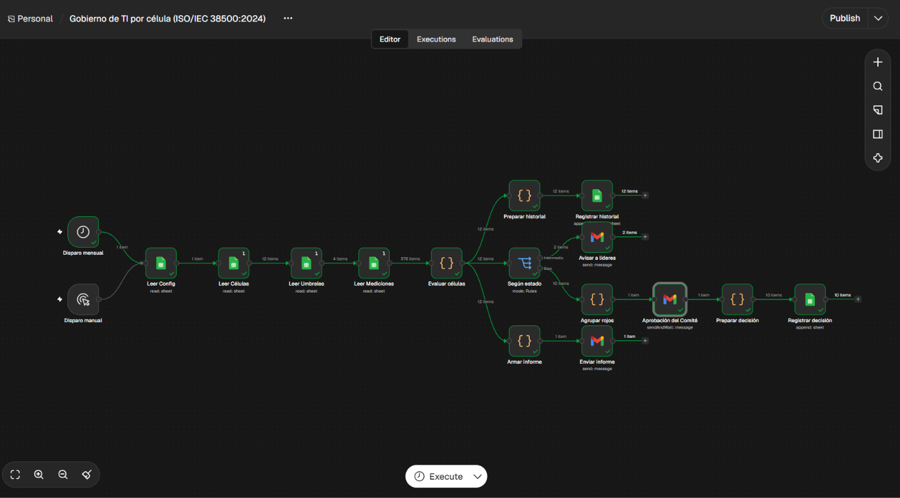
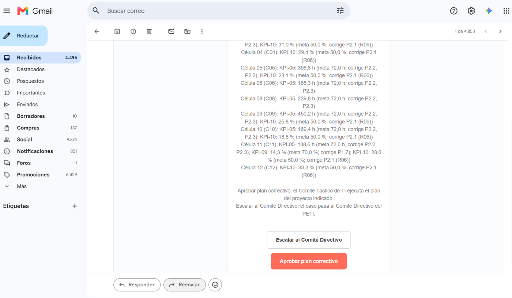
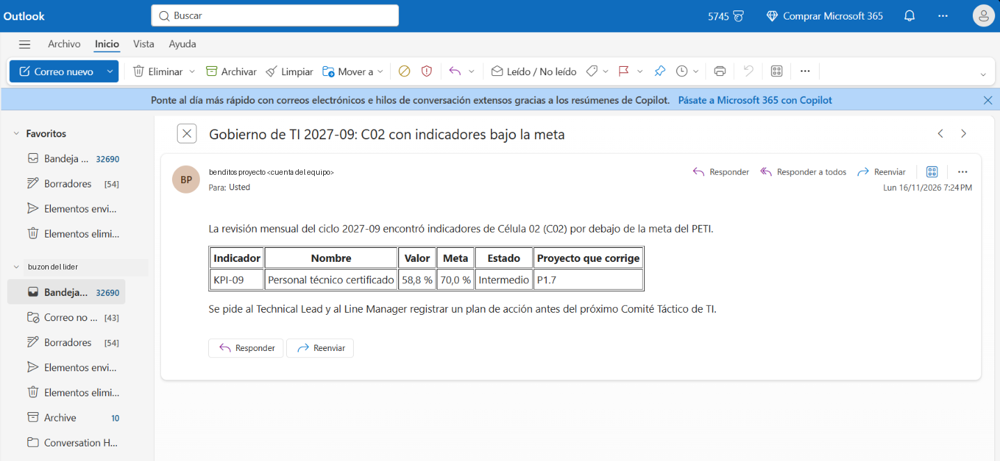
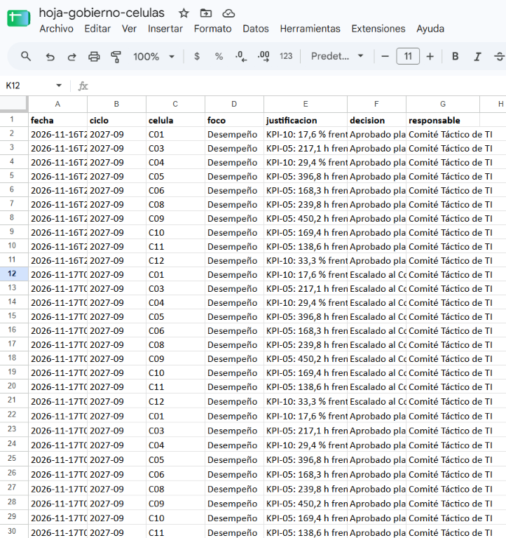
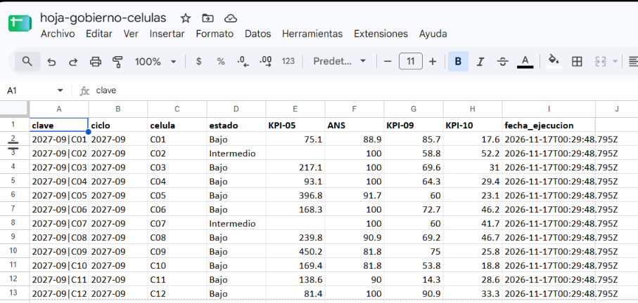

# Flujo automatizado de gobierno de TI por célula con ISO/IEC 38500:2024

<!-- Fuente del Word Flujo_Gobierno_TI_ISO38500_Perficient_Colombia.docx. Se genera con scripts/md_a_docx_simple.py. -->

**Organización:** Perficient Inc., operación en Colombia (PETI 2026-2028, trabajo académico). **Equipo:** Firmes por la Gobernanza. **Herramienta:** n8n 2.47.7 instalado en local, con Google Sheets y Gmail. **Fecha:** noviembre de 2026.

## Qué hace el flujo

Cada mes, el primer día a las 7:00, el flujo revisa las doce células de entrega de la operación colombiana contra las metas del PETI y actúa según el resultado:

1. Lee de una hoja de Google la configuración, las células, las metas de cada indicador y las mediciones del mes.
2. Evalúa cada célula con cuatro indicadores y le asigna un estado con los rangos del PETI (§10): bueno, intermedio o bajo.
3. Guarda el resultado de cada célula en la pestaña Historial. Si el mes ya se había evaluado, actualiza la fila en vez de duplicarla.
4. A las células en estado intermedio les manda un correo a sus líderes (Technical Lead y Line Manager) con los indicadores bajo la meta y les pide un plan de acción.
5. Si hay células en estado bajo, junta todas en un solo correo al Comité con dos botones: aprobar el plan correctivo o escalar al Comité Directivo. El flujo espera la respuesta hasta tres días.
6. Registra la decisión de cada célula en la pestaña Decisiones: fecha, ciclo, célula, tema, justificación, decisión y responsable.
7. Manda al Comité el informe mensual con las células ordenadas de peor a mejor y su estado del mes anterior.

## Por qué es distinto del flujo de ejemplo

El ejemplo de la tarea junta métricas de tres redes sociales, las escribe en una hoja y manda un informe. Es un flujo de reporte: nadie decide nada. Este flujo aplica el modelo de la ISO/IEC 38500:2024: evalúa, dirige según el resultado, deja que una persona del Comité tome la decisión cuando el caso es grave y guarda la decisión con su justificación para poder rendir cuentas. Además trabaja por célula, que es como está organizada la entrega de software en la operación, y no por fuente de datos.

## Correspondencia con la ISO/IEC 38500:2024

La norma da tres herramientas: principios, un modelo de tareas de gobierno y un marco de elementos (PUB-026). La tabla muestra qué parte del flujo cumple cada una. Los nombres de las tareas, principios y elementos vienen del índice de la norma (PUB-026); su descripción, del resumen de Garibay (PUB-029), porque el equipo solo tiene la vista previa de la norma.

| Parte del flujo | Tarea del modelo (§6.2) | Principio (§5) | Elemento del marco (§7.2) |
|---|---|---|---|
| Disparo mensual y lectura de la hoja | Monitorear | Supervisión (5.5); Datos y decisiones (5.9) | Desempeño |
| Evaluar células contra las metas del PETI | Evaluar | Viabilidad y desempeño en el tiempo (5.12); Generación de valor (5.3) | Desempeño |
| Aviso a los líderes de las células en amarillo | Dirigir | Liderazgo (5.8); Rendición de cuentas (5.6) | Delegación |
| Aprobación del Comité para las células en rojo | Dirigir | Gobierno del riesgo (5.10); Rendición de cuentas (5.6) | Dirección; Rendición de cuentas |
| Historial y bitácora de decisiones | Monitorear | Rendición de cuentas (5.6) | Rendición de cuentas |
| Informe mensual al Comité | Involucrar a las partes interesadas | Participación de las partes interesadas (5.7); Estrategia (5.4) | Política |

La bitácora sigue la guía de gobierno de TI de Enterprise Information Services de Oregón, que pide registrar de cada decisión el tema, la justificación, el responsable y la fecha, y la presenta como evidencia de la madurez del gobierno (PUB-027). La misma guía propone revisar el gobierno cada mes o cada trimestre; el flujo usa la cadencia mensual del Comité Táctico de TI del PETI (§12).

## Indicadores y reglas

| Indicador | Cómo se calcula por célula | Meta | Proyecto del PETI que lo corrige |
|---|---|---|---|
| KPI-05 Remediación de vulnerabilidades críticas | Promedio de horas entre la detección y el cierre de las vulnerabilidades críticas detectadas en el mes | 72 h o menos | P2.2, P2.3 |
| ANS de soporte | Porcentaje de tickets resueltos dentro del acuerdo de nivel de servicio en el mes | 90 % (supuesto del equipo, INT-001) | P2.5 |
| KPI-09 Personal técnico certificado | Personas con más de 6 meses y al menos una certificación, sobre las personas con más de 6 meses | 70 % | P1.7 |
| KPI-10 Rotación entre células | Personas rotadas en el último año, sobre el total de la célula | 50 % (meta intermedia supuesta, INT-001) | P2.1 (riesgo R06) |

El cumplimiento se calcula igual que en el dashboard de CIO del 4 de noviembre: si mayor es mejor, valor sobre meta; si menor es mejor, meta sobre valor; con tope de 100 %. Estado: 95 % o más, bueno; más de 70 %, intermedio; 70 % o menos, bajo. El estado de la célula es el de su peor indicador. Un indicador sin datos en el mes (por ejemplo, una célula sin vulnerabilidades críticas) no cuenta como bueno: se deja fuera. Una célula sin mediciones queda "Sin datos" y no genera avisos.

Los datos son los sintéticos del dashboard del 4 de noviembre, generados con MOSTLY AI para doce células entre octubre de 2026 y septiembre de 2027. KPI-09 y KPI-10 salen de una foto del personal y son iguales todos los meses.

## Resultado de la ejecución

El flujo se ejecutó tres veces con el disparo manual el 16 de noviembre de 2026, entre las 6:50 p. m. y las 7:30 p. m. (hora de Colombia). Las tres terminaron con éxito. La primera tardó 2 minutos y 16 segundos porque esperó la respuesta del Comité; las otras, unos 20 segundos. Después se activó para que corra solo el primer día de cada mes.

Resultado del ciclo 2027-09 (mes 12 del escenario sintético):

| Estado | Células | Qué hizo el flujo |
|---|---|---|
| Bajo | 10: C01, C03, C04, C05, C06, C08, C09, C10, C11 y C12 | Una sola solicitud de aprobación al Comité con las diez células y sus indicadores en rojo |
| Intermedio | 2: C02 y C07 | Un correo a los líderes de cada una |
| Bueno | 0 | — |

El resultado coincide con el dashboard de CIO del 4 de noviembre, que ya mostraba en estado bajo la remediación de vulnerabilidades críticas (KPI-05) y la rotación entre células (KPI-10). Por célula, el rojo viene sobre todo de esos dos indicadores. C11 suma además una certificación muy baja (14,3 % frente a 70 %).

La solicitud de aprobación llega como texto con las diez células, cada indicador en rojo, su meta y el proyecto del PETI que lo corrige, y dos botones:

Los líderes de las células en amarillo reciben la tabla de sus indicadores bajo la meta:

En la primera y la tercera ejecución el Comité aprobó el plan correctivo; en la segunda lo escaló al Comité Directivo, para probar las dos ramas. La bitácora quedó con 30 filas, diez por ejecución, cada una con la fecha, el ciclo, la célula, el tema, la justificación con el indicador y su meta, la decisión y el responsable:

El historial quedó con 12 filas, una por célula, aunque el flujo corrió tres veces sobre el mismo ciclo: cada ejecución actualiza la fila de su clave (ciclo y célula) en lugar de agregar otra. La fecha de ejecución muestra la última:

El informe mensual llegó en las tres ejecuciones con el asunto "Informe mensual de gobierno de TI por célula, ciclo 2027-09", al correo del Comité y en copia al de los líderes.

## Cómo se instala y se ejecuta

1. Arrancar n8n con `scripts/n8n/iniciar_n8n.ps1` y abrir `http://localhost:5678`.
2. Crear en Google Cloud un cliente OAuth web con la URI de redirección `http://localhost:5678/rest/oauth2-credential/callback`, activar las API de Gmail, Sheets y Drive, y crear en n8n las credenciales de Google Sheets y Gmail.
3. Subir `hoja-gobierno-celulas.xlsx` a Google Drive, abrirla como hoja de Google y escribir los correos reales en las pestañas Config y Celulas. Si quedan correos de ejemplo, el flujo se detiene con un mensaje que lo dice.
4. Importar `flujo-gobierno-celulas.json`, elegir la hoja y las credenciales en los nodos de Google y ejecutar con el disparo manual. Activarlo deja programado el disparo mensual.

## Límites

- Los datos son sintéticos. El flujo sirve igual con datos reales si la pestaña Mediciones se llena desde las herramientas de la operación.
- La conexión con Google está en modo de prueba y vence a los siete días; después hay que volver a iniciar sesión en la credencial.
- Los botones de aprobación apuntan a la instalación local de n8n, así que se aprueba desde el equipo donde corre. En producción, n8n iría en un servidor con dirección pública.
- La correspondencia con la ISO usa los nombres de la norma y un resumen secundario; el equipo no tiene el texto completo de los §5 a §7.
- El Comité Táctico de TI y el Comité Directivo son instancias propuestas en el PETI (§12); hoy no existen.
