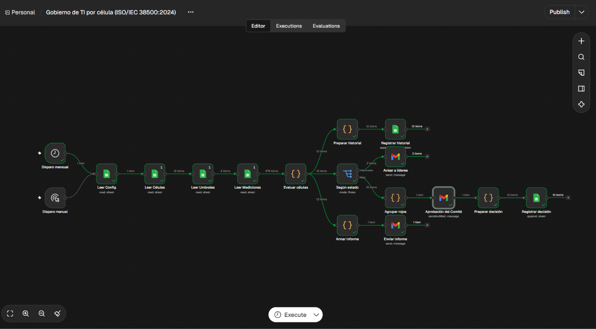

# Qué hace el flujo

El flujo "Gobierno de TI por célula (ISO/IEC 38500:2024)" corre en n8n el primer día de cada mes a las 7:00 (hora de Colombia). Revisa las doce células de entrega de la operación colombiana contra las metas del PETI y actúa según el resultado:

1. **Lee** de una hoja de Google la configuración, las células, las metas de cada indicador y las mediciones del mes.
2. **Evalúa** cada célula con cuatro indicadores y le asigna un estado con los rangos del PETI: bueno, intermedio o bajo.
3. **Guarda** el resultado de cada célula en la pestaña Historial. Si el mes ya se había evaluado, actualiza la fila en lugar de duplicarla.
4. **Avisa** a los líderes de las células en estado intermedio (Technical Lead y Line Manager): les manda los indicadores bajo la meta y les pide un plan de acción.
5. **Pide una decisión** al Comité si hay células en estado bajo. Las junta todas en un solo correo con dos botones: aprobar el plan correctivo o escalar al Comité Directivo. Espera la respuesta hasta tres días.
6. **Registra la decisión** de cada célula en la pestaña Decisiones: fecha, ciclo, célula, tema, justificación, decisión y responsable.
7. **Informa** al Comité cada mes, con las células ordenadas de peor a mejor y su estado del mes anterior.

## Por qué es distinto de un flujo de reporte

Un flujo de reporte junta datos, los guarda y manda un resumen: nadie decide nada. Este aplica el modelo de la ISO/IEC 38500:2024:

* **evalúa** cada célula contra metas que el PETI ya fijó;
* **dirige** según el resultado: un aviso cuando el desvío es moderado y una decisión del Comité cuando es grave;
* **monitorea** con un historial que se actualiza cada mes;
* **deja rendición de cuentas**, porque cada decisión queda con su justificación y su responsable.

Trabaja por célula y no por fuente de datos, porque así está organizada la entrega de software en la operación.

## Correspondencia con la norma

| Parte del flujo | Tarea del modelo (§6.2) | Principio (§5) | Elemento del marco (§7.2) |
|---|---|---|---|
| Disparo mensual y lectura de la hoja | Monitorear | Supervisión (5.5); Datos y decisiones (5.9) | Desempeño |
| Evaluación de las células | Evaluar | Viabilidad y desempeño en el tiempo (5.12); Generación de valor (5.3) | Desempeño |
| Aviso a los líderes de las células en amarillo | Dirigir | Liderazgo (5.8); Rendición de cuentas (5.6) | Delegación |
| Aprobación del Comité para las células en rojo | Dirigir | Gobierno del riesgo (5.10); Rendición de cuentas (5.6) | Dirección; Rendición de cuentas |
| Historial y bitácora de decisiones | Monitorear | Rendición de cuentas (5.6) | Rendición de cuentas |
| Informe mensual al Comité | Involucrar a las partes interesadas | Participación de las partes interesadas (5.7); Estrategia (5.4) | Política |

## Qué se entrega

| Archivo | Qué es |
|---|---|
| `flujo-gobierno-celulas.json` | El flujo para importar en n8n, sin credenciales ni identificadores reales |
| `hoja-gobierno-celulas.xlsx` | La hoja de Google en Excel, con correos de ejemplo |
| Documento Word | La misma explicación con las capturas |

Los archivos están en el repositorio del proyecto, carpeta `docs/entregas-2026-11-16/flujo-iso38500/`.
