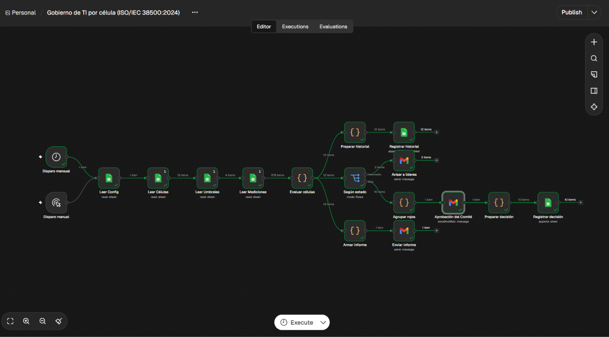
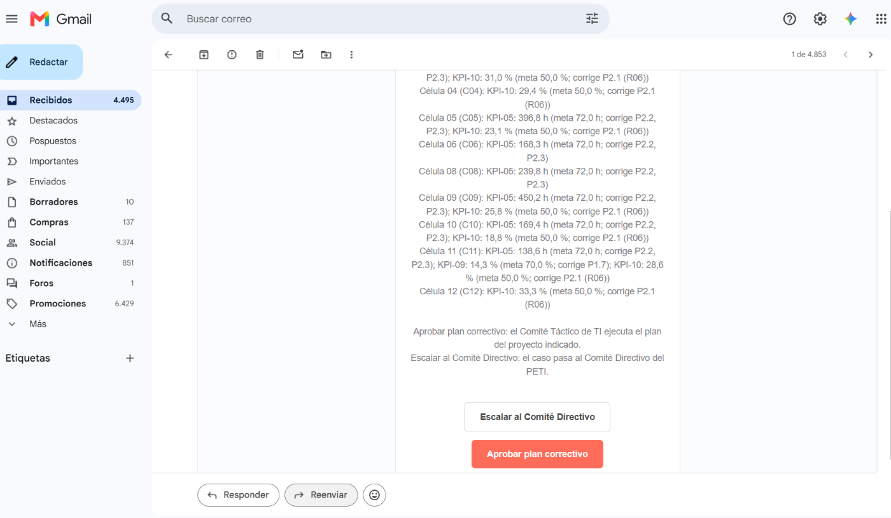
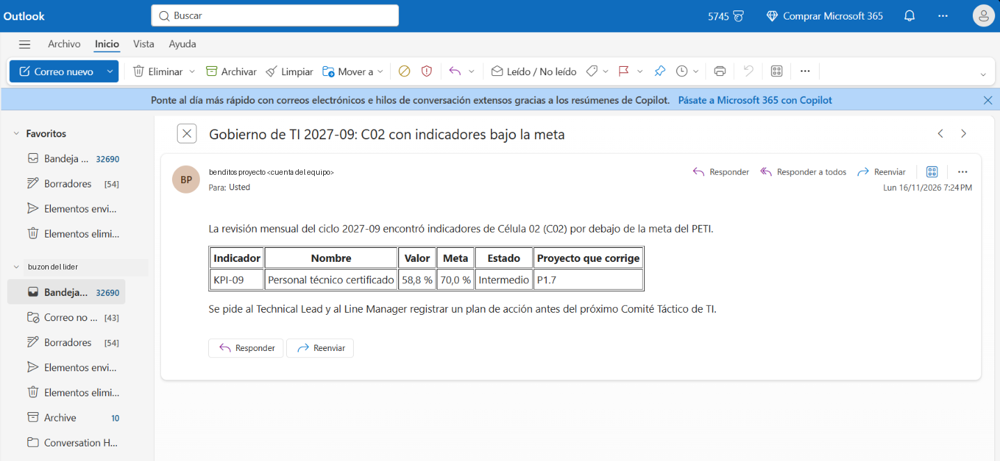
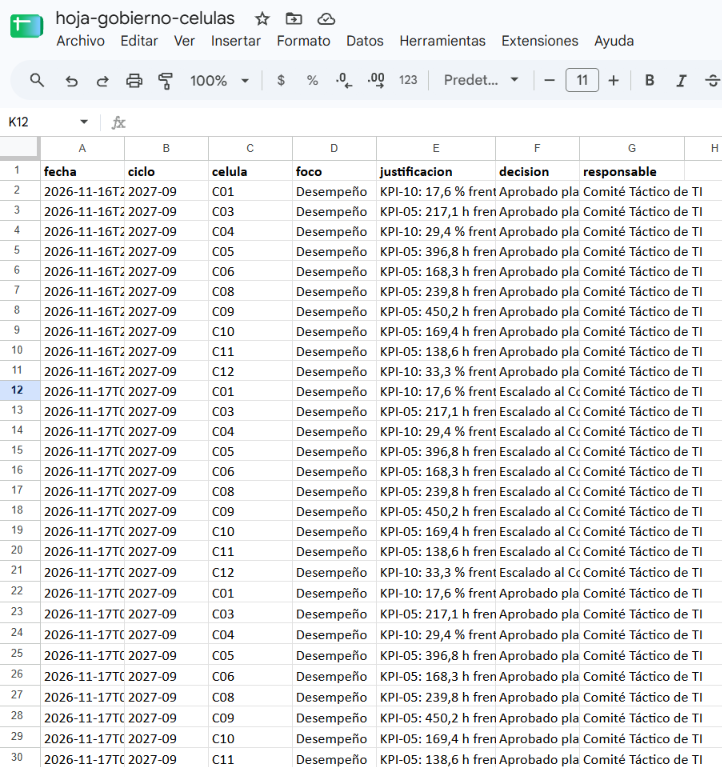
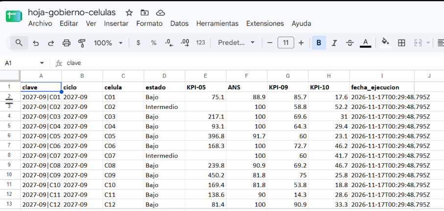

# Ejecución y evidencias

El flujo se ejecutó tres veces con el disparo manual el 16 de noviembre de 2026, entre las 6:50 p. m. y las 7:30 p. m. (hora de Colombia). Las tres terminaron con éxito. La primera tardó 2 minutos y 16 segundos porque esperó la respuesta del Comité; las otras, unos 20 segundos. Después se activó para que corra solo el primer día de cada mes.

## Resultado del ciclo 2027-09

El ciclo evaluado es septiembre de 2027, el mes 12 del escenario sintético.

| Estado | Células | Qué hizo el flujo |
|---|---|---|
| Bajo | 10: C01, C03, C04, C05, C06, C08, C09, C10, C11 y C12 | Una sola solicitud de aprobación al Comité con las diez células |
| Intermedio | 2: C02 y C07 | Un correo a los líderes de cada una |
| Bueno | 0 | — |

El resultado coincide con el dashboard de CIO del 4 de noviembre, donde la remediación de vulnerabilidades críticas (KPI-05) y la rotación entre células (KPI-10) ya estaban en estado bajo. Por célula, el rojo viene sobre todo de esos dos indicadores. C11 suma una certificación muy baja (14,3 % frente a una meta de 70 %).

## Evidencias

**Ejecución completa.** Los números sobre las conexiones son los ítems que pasaron: 576 mediciones, 12 células, 2 avisos, 10 células en rojo, 1 aprobación y 10 decisiones.

**Solicitud de aprobación al Comité.** Lista cada célula en rojo con el indicador, la meta y el proyecto que lo corrige, y trae los dos botones.

**Aviso a los líderes de una célula en amarillo.** Los correos de remitente y destinatario se taparon en la captura.

**Bitácora de decisiones.** En la primera y la tercera ejecución el Comité aprobó el plan correctivo; en la segunda lo escaló al Comité Directivo, para probar las dos ramas. Quedaron 30 filas, diez por ejecución.

**Historial.** Tiene 12 filas, una por célula, aunque el flujo corrió tres veces sobre el mismo ciclo: cada ejecución actualiza la fila de su clave. La fecha de ejecución muestra la última.

El informe mensual llegó en las tres ejecuciones con el asunto "Informe mensual de gobierno de TI por célula, ciclo 2027-09".

## Pruebas automáticas

| Qué se prueba | Herramienta | Resultado |
|---|---|---|
| Lógica de evaluación: cumplimiento, estados, casos especiales, solicitud, informe, decisiones | `node --test` | 15 de 15 |
| Hoja de datos y JSON del flujo: pestañas, mediciones, correos de ejemplo, nodos, conexiones, marcadores; además corre el código del nodo de evaluación con los datos de la hoja | `pytest` | 8 de 8 |
