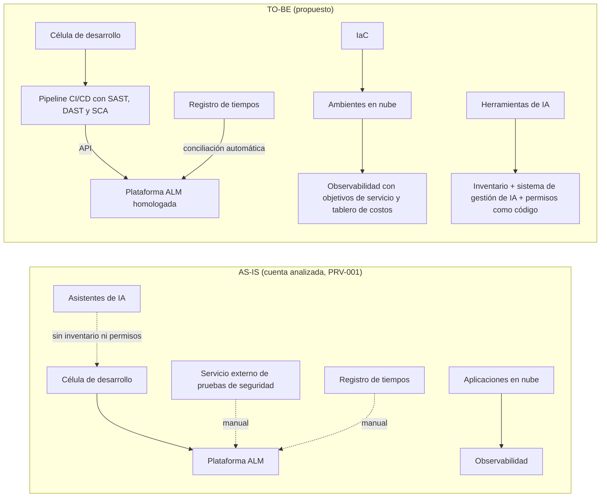

# Preparación de la sustentación: PETI Perficient Colombia 2026-2028

Documento de estudio para el equipo. Explica, numeral por numeral, qué dice el PETI final (`docs/PETI_Perficient_Colombia_2026-2028_v1.0.docx`), por qué está ahí según la norma del MinTIC, de dónde salió cada contenido y qué preguntas puede hacer el profesor, con una respuesta sugerida. No es parte del PETI ni se entrega.

Orden de lectura: **A** explica cómo funciona Perficient; **B** responde las preguntas que el profesor ya hizo a otro grupo (AS-IS, brechas, TO-BE y arquitectura); **C** reúne lo que hay que saberse de memoria; después viene cada numeral del PETI y, al final, los puntos débiles y lo que no se debe decir.

Las páginas de la guía son las del número impreso en el PDF `MGGTI.GE.ES.01 - Guia de construccion PETI - Gobierno Digital-v. 3.0.pdf`. Recuerden que **dentro del PDF el código es MGGTI.GE.ES.03**; así se cita.

---

## A. Perficient explicado fácil

Antes de defender un plan de TI hay que entender de qué vive la empresa. Esta es la versión corta. Lo que tiene ID es verificable; lo que dice "así funciona una consultora" es explicación general, no un dato de Perficient.

### Qué es

Perficient es una **empresa estadounidense de consultoría en tecnología e IA** (PUB-009: "global AI and technology consulting firm", más de 7.000 asesores, ingenieros y diseñadores). **No vende un producto propio** como Microsoft o SAP: vende el trabajo de sus equipos, que diseñan, construyen, mantienen y aseguran software para otras empresas grandes.

**Analogía:** es como una empresa contratista de construcción. El cliente es dueño del edificio (sus sistemas, sus datos, su nube). Perficient pone las cuadrillas: equipos de ingenieros que trabajan dentro de la obra del cliente, con las reglas y los permisos del cliente.

### Qué es "nearshore" y por qué Colombia

Los clientes están sobre todo en Norteamérica. En vez de contratar ingenieros en EE. UU. (caro) o en Asia (con 10 o 12 horas de diferencia), Perficient arma equipos en Latinoamérica, que trabajan **en el mismo horario o casi** que el cliente. Eso es *nearshore* (cercano), frente a *offshore* (lejano). Colombia es uno de esos países (§1 del PETI).

### Cómo se organiza el trabajo (lo que vimos en la cuenta analizada, PRV-001)

- Una **cuenta** es un cliente. Dentro de la cuenta hay proyectos, y cada proyecto tiene **células**: equipos pequeños y especializados.
- Roles de cada proyecto:
  - **Product Manager (PM):** habla con el cliente y justifica lo que el equipo necesita, incluidas las licencias.
  - **Line Manager:** se ocupa de la carrera de cada persona, sus aprobaciones y sus certificaciones.
  - **Technical Lead:** responde por la calidad del código y la arquitectura.
  - **Desarrolladores senior, intermedios y junior.**
- El día a día:
  - se trabaja con **Scrum** (sprints);
  - las tareas viven en una **plataforma ALM** (tableros, tickets, wiki);
  - un **servicio externo** hace pruebas de seguridad a las aplicaciones;
  - una **plataforma de observabilidad** monitorea las aplicaciones;
  - cada persona registra sus horas en un **sistema corporativo de registro de tiempos**.

  Las herramientas se nombran por su tipo y no por su marca, por confidencialidad.

### Cómo gana plata (así funciona una consultora)

Una consultora factura por el trabajo de su gente: por horas, por equipo asignado o por proyecto. De ahí salen tres cosas que el PETI toma en serio:

1. **Las horas son dinero.** Si las horas registradas no cuadran con las tareas del ALM, se factura mal o no se puede justificar ante el cliente → BRE-012 y KPI-06.
2. **La confianza es el producto.** Un cliente solo deja que un equipo externo toque su código y sus datos si ese equipo demuestra controles de seguridad. Por eso pesan tanto el certificado ISO/IEC 27001 (PUB-002) y el informe SOC 2.
3. **El talento certificado es el inventario.** Las alianzas con Microsoft, Databricks, Snowflake y otras (PUB-005 a PUB-010) exigen personal certificado. Si la gente no se certifica, se pierden alianzas y proyectos → OETI04.

### Tres hechos recientes que cambian todo

| Hecho | Qué significa en simple | Fuente |
|---|---|---|
| El 2 de octubre de 2024 la compró la firma de inversión EQT | Dejó de estar en la bolsa (NASDAQ). Ya no reporta a la SEC y SOX deja de ser su obligación | PUB-001, PUB-004 |
| En marzo de 2026 se presentó como empresa "AI-native" | Su discurso comercial es "hacemos todo con IA". Si los equipos usan IA con código y datos de clientes, hay que gobernar esa IA | PUB-003 |
| Su certificado ISO 27001 tiene fecha publicada "10/11/2026" | Puede vencer en octubre o noviembre de 2026, justo al empezar el plan | PUB-002 |

### La distinción que más confunde (y que el profesor puede usar para pillarnos)

- **TI de Perficient:** plataformas, herramientas, controles y procesos que usa la operación para trabajar (ALM, pipelines, registro de tiempos, gobierno de IA, formación). **Esto es lo que planea el PETI.**
- **TI del cliente:** los sistemas que Perficient construye o mantiene para el cliente. Son del cliente y **están fuera del alcance** (§2.2), salvo los ambientes que la operación administra por contrato, y aun ahí cualquier cambio necesita la aprobación del cliente (R08).

En una frase: **el PETI no planea el software que Perficient le vende al cliente, sino la TI con la que Perficient lo produce.**

---

## B. Lo que el profesor ya preguntó a otro grupo: AS-IS, brechas, TO-BE y arquitectura

Estas cuatro preguntas son las más probables. Hay que poder señalar el numeral de memoria y explicar el método, no solo el resultado.

### B.1 "¿Dónde está el AS-IS?"

**AS-IS** es la situación actual; la plantilla la llama "Situación actual" (capítulo 6). En nuestro PETI está en tres lugares:

| Dónde | Qué muestra | Evidencia |
|---|---|---|
| §5.3 Estructura y procesos | Roles, mapa de procesos (estratégicos, misionales, de apoyo y de evaluación), la herramienta que soporta cada proceso y su cubrimiento (total, parcial, sin cobertura) | PRV-001, INT-001 |
| §6.1 Diagnóstico por dominio | Cómo está cada uno de los 7 dominios del MRAE: qué existe y qué no | PRV-001, PUB-002, PUB-006 a PUB-008, INT-001 |
| §6.2 y §6.3 | DOFA y tendencias | INT-001 |

**De dónde lo sacamos:**
- Entrevistas a personas de una cuenta de cliente (PRV-001), anonimizadas.
- Fuentes públicas de Perficient (PUB-): certificado, alianzas, adquisición.
- Nuestro análisis (INT-001). Cuando algo "no existe", significa "no se encontró en la evidencia revisada".

Seguimos la regla de la plantilla: si algo no existe, se dice que no existe; no se inventa.

**Pregunta de seguimiento probable:** *"¿Una sola cuenta es representativa de toda la operación?"*
**Respuesta:** No, y por eso lo decimos en §2.2. Todo lo que viene de PRV-001 se escribe como "observado en la cuenta analizada", no como política de Perficient. El plan lo compensa de dos formas:
- varias líneas base se miden al inicio en toda la operación ("por medir", mes 3 o mes 6);
- los proyectos de estandarización (P2.1, P2.8) empiezan verificando cómo trabajan las demás células.

### B.2 "¿Dónde están las brechas y cómo las sacaron?"

Están en **§8** (16 brechas, BRE-001 a BRE-016) y cada una llega a un proyecto en §9.

**Método** (guía, Actividad 11): una brecha es la diferencia entre la situación actual y la objetivo. Pusimos lado a lado la misma fila del dominio en §6.1 (AS-IS) y en §7 (TO-BE). Donde no coincidían, anotamos:
- el **elemento** que falta o que hay que cambiar;
- la **acción**: crear si no existe, modificar si existe pero no sirve así;
- el **tiempo** y el **costo** estimados.

Después revisamos otras dos fuentes para no dejar nada por fuera:
- las debilidades y amenazas de la DOFA;
- los motivadores con plazo (certificado ISO, Ley 1581).

**De dónde sale cada brecha:**

| Brecha | AS-IS: lo que encontramos (§6.1 o §5) | TO-BE: lo que queremos (§7) | Acción |
|---|---|---|---|
| BRE-001 Sistema de gestión de IA | Hay lineamientos de uso de IA, pero no un sistema de gestión (Seguridad; PRV-001) | Sistema de gestión de IA según ISO/IEC 42001 | Crear |
| BRE-002 Inventario de IA | No hay inventario de los sistemas de IA en uso (Información; INT-001) | Inventario de sistemas de IA | Crear |
| BRE-003 Hallazgos de seguridad → ALM | Los hallazgos se pasan a mano entre herramientas (Sistemas de información; PRV-001) | Paso automático de hallazgos a tickets | Crear |
| BRE-004 Plantillas ALM | Configuraciones distintas entre células (justificación de §8; en el PETI regional figura como "por verificar") | Plantillas ALM homologadas | Modificar |
| BRE-005 Licencias de IA | El canal para pedir licencias de IA no está estandarizado (Uso y apropiación; PRV-001) | Procedimiento de licencias de IA | Modificar |
| BRE-006 Recertificación ISO 27001 | SGSI certificado, fecha publicada "10/11/2026" (Seguridad; PUB-002) | ISO/IEC 27001 recertificado | Modificar |
| BRE-007 Infraestructura como código | No hay IaC (Infraestructura; INT-001) | Ambientes aprovisionados con IaC | Crear |
| BRE-008 Permisos de agentes | No hay permisos para agentes de IA (Seguridad) | Permisos definidos para agentes | Crear |
| BRE-009 Formación en IA | Hay formación en línea y certificaciones (PRV-001), pero no un currículo de IA para todos | Currículo de IA y plan de certificaciones por rol | Modificar |
| BRE-010 Plataforma de datos | Alianzas con Databricks y Snowflake (PUB-006 a PUB-008), pero sin plataforma unificada | Plataforma y catálogo de datos únicos | Crear |
| BRE-011 Gobierno de TI | No hay comité con actas, RACI, matriz de riesgos ni guía de presupuesto (Gobierno) | Tres comités, RACI, matriz de riesgos, guía de presupuesto (COBIT APO06) | Crear |
| BRE-012 Conciliación de tiempos | La conciliación de horas se hace a mano (Sistemas de información; PRV-001) | Conciliación automática | Crear |
| BRE-013 Observabilidad y costos | No hay control de costos de nube (Infraestructura) | Observabilidad con objetivos de servicio y control de costos | Crear |
| BRE-014 SOC 2 con IA | No hay evidencia pública del alcance de un informe SOC 2 (Seguridad) | Informe SOC 2 con controles de IA | Modificar |
| BRE-015 Estrategia de TI | No hay misión, visión, catálogo ni tablero de TI (Estrategia) | Misión, visión, catálogo y tablero | Crear |
| BRE-016 Ley 1581 | Transferencias internacionales de datos sin registro por proyecto (motivador §5.1 y amenaza de la DOFA) | Cumplimiento de la Ley 1581 y registro de obligaciones | Modificar |

**Ojo:** BRE-004 y BRE-016 son las que tienen el ancla más débil en el AS-IS del documento de Colombia. BRE-004 porque la uniformidad de plantillas no se verificó. BRE-016 porque sale del motivador legal y de la DOFA, no de una fila de §6.1. Si preguntan por ellas, se dice así.

**Pregunta de seguimiento probable:** *"¿Por qué el tiempo y el costo de cada brecha?"*
**Respuesta:**
- **Tiempo:** es nuestra estimación del esfuerzo. Un procedimiento (BRE-005) toma unas semanas. Un sistema de gestión con política, roles, evaluación de riesgos y controles (BRE-001) toma unos seis meses. Un informe SOC 2 tipo II (BRE-014) toma un año, porque necesita un periodo de observación.
- **Costo:** usa tres rangos con umbrales declarados (INT-001), como explica §8 en este documento.

### B.3 "¿Dónde está el TO-BE?"

**TO-BE** es la situación objetivo; la plantilla la llama "Situación objetivo" (capítulo 7). En nuestro PETI está en **§7**:
- misión y visión de TI;
- 4 objetivos de TI con 13 metas para el año 1 y el año 2;
- la tabla "situación objetivo por dominio".

Todo el numeral está marcado como **propuesto**.

**Cómo lo construimos:**
1. **Invertimos cada problema del AS-IS.** Donde no había comité, un comité; donde había paso manual, una integración.
2. **Buscamos en los marcos cómo se hace bien.**
   - ISO/IEC 42001 y NIST AI RMF, para gobernar la IA.
   - COBIT 2019 APO06, para el presupuesto.
   - DevSecOps con SAST, DAST y SCA, para el pipeline.
   - ISO/IEC 27001 y SOC 2, para la seguridad.
3. **Lo llevamos a metas medibles** (guía, Actividad 8: verbo en infinitivo, SMART, perspectivas del Balanced Scorecard).
4. **Cada meta quedó con un indicador en §10.**

**Pregunta de seguimiento probable:** *"¿El TO-BE es realista en 24 meses?"*
**Respuesta:** Está escalonado para que lo sea:
- **Año 1:** lo que depende de nosotros: gobierno, procedimientos, recertificación y estandarización.
- **Año 2:** lo que depende de terceros o de madurez previa: casos de IA en producción con clientes, la plataforma de datos y el informe SOC 2 tipo II.

Las metas del año 1 son intermedias (por ejemplo, 60 % de ambientes con IaC y 100 % en el año 2).

### B.4 "¿Y la arquitectura?"

Hay que responder en dos niveles. El primero es el que el profesor espera oír.

**1. La arquitectura en la que se apoya el PETI.** La guía del MinTIC es parte del **Marco de Referencia de Arquitectura Empresarial (MRAE v3.0)**. La plantilla describe el AS-IS como "arquitectura actual de gestión de TI" y el TO-BE como "arquitectura destino". Los 7 dominios (Estrategia, Gobierno, Información, Sistemas de información, Infraestructura, Uso y apropiación, Seguridad) son las capas de esa arquitectura. Por eso §6.1 y §7 están organizados por dominio: **el AS-IS y el TO-BE por dominio son la arquitectura actual y la objetivo.** Si piden la vista TOGAF, es la misma información reordenada:

| Capa TOGAF | Arquitectura actual (AS-IS) | Arquitectura objetivo (TO-BE) | Proyectos |
|---|---|---|---|
| Negocio (procesos, roles, gobierno) | Roles claros y Scrum por célula; sin comité de TI, RACI, matriz de riesgos ni presupuesto de TI; licencias de IA sin procedimiento | Comité Directivo, Táctico y por célula; RACI; matriz de riesgos; guía de presupuesto; procedimiento de licencias | P1.6, P1.9, P2.8 |
| Datos | Datos dispersos por proyecto; sin plataforma unificada ni inventario de IA | Plataforma y catálogo de datos únicos; inventario de sistemas de IA | P1.3, P3.5 |
| Aplicaciones | ALM, servicio externo de pruebas de seguridad, observabilidad y registro de tiempos **sin integración**: los hallazgos y las horas pasan a mano | Plantillas ALM homologadas; hallazgos a tickets por API; pipeline CI/CD con SAST, DAST y SCA; conciliación automática de horas | P2.1 a P2.4 |
| Tecnología | Ambientes de desarrollo, pruebas y producción separados en nube pública, con responsabilidad compartida con el cliente; sin IaC ni control de costos | IaC, observabilidad con objetivos de servicio, tablero de costos de nube | P2.5 a P2.7 |
| Seguridad (transversal) | SGSI ISO 27001 con fecha por confirmar; lineamientos de IA sin sistema de gestión ni permisos para agentes | ISO 27001 recertificado; sistema de gestión de IA (ISO 42001); permisos como código; SOC 2 con controles de IA | P1.1, P1.2, P1.4, P4.1 |

Diagrama de las integraciones, con las herramientas por categoría:

Si el visor no muestra el diagrama, la tabla anterior dice lo mismo. El mapa de integraciones (origen, destino, mecanismo actual y objetivo) está en §6.4 del PETI regional v2.1.

**2. La arquitectura del sistema del cliente.** Analizamos un resumen anonimizado de la arquitectura de un sistema de cliente (PRV-002), que sirvió para entender riesgos técnicos. **No va en el PETI a propósito**, por dos razones:
- el PETI planea la TI de la operación, no el producto del cliente (§2.2, fuera de alcance);
- describir ese sistema permitiría identificar al cliente.

En la presentación **no se describe ese sistema**; basta con decir que existe como evidencia restringida y por qué no se usa.

**Preguntas probables sobre arquitectura**

1. **P: No veo un diagrama de arquitectura en el PETI. ¿Dónde está?**
   **R:** El PETI de Colombia presenta la arquitectura en tablas por dominio, que es como la pide la plantilla del MinTIC (§6.1 actual y §7 objetivo), y en el mapa de procesos con su soporte de TI (§5.3). El diagrama de integraciones y la vista por capas TOGAF están en el PETI regional v2.1 (§6.4 y §7.2 a §7.5). Reconocemos que un diagrama en el documento de Colombia ayudaría y se puede agregar como anexo.

2. **P: ¿Por qué la arquitectura objetivo no propone cambiar herramientas, por ejemplo otra ALM?**
   **R:** Porque el problema que encontramos no son las herramientas: es que no están **integradas ni estandarizadas**. Además, en muchas cuentas las herramientas las define o las paga el cliente, y cambiarlas no depende de Perficient (R08). Por eso la arquitectura objetivo conecta lo que existe (API, conciliación automática, pipeline) y estandariza su uso (plantillas, IaC). Así se mantiene el costo bajo y no se choca con el contrato.

---

## C. Lo que hay que tener claro antes de empezar

### Las tres normas y los dos referentes

| Documento | Qué nos da | Cómo lo usamos |
|---|---|---|
| Guía MGGTI.GE.ES.03 v3.0 (MinTIC, noviembre de 2023) | La **metodología**: 4 fases (Planear, Analizar, Construir, Socializar) y 17 actividades | §4 del PETI declara que se siguieron |
| Anexo 2, Plantilla PETI | La **estructura** del documento y el contenido mínimo por capítulo | Los numerales del PETI siguen sus capítulos |
| Anexo 1, Herramientas (Excel, 19 hojas) | Los **formatos**: DOFA, tendencias, estrategia de TI, catálogo de brechas, catálogo de proyectos, hoja de vida de indicadores, plan de comunicación | Las tablas de §6 a §12 toman sus columnas |
| PETI de MinCiencias 2023-2026 | Referente del profesor | De ahí sale la **ficha de proyecto** con "¿Para qué? / ¿Cómo? / Meta" (§9) y el orden de capítulos |
| PETI del MinTIC | Referente del profesor | Idea de portafolio agrupado por objetivo de TI y tabla de indicadores |

**Frase clave para defender todo el documento** (guía §2.2, p. 15): la guía "debe tomarse como una orientación o buena práctica más no como una obligatoriedad", y la metodología "puede ser complementada o modificada de acuerdo con las necesidades, madurez tecnológica y capacidades de cada Entidad". Por eso podemos aplicarla a una empresa privada y adaptar lo que es solo para entidades públicas.

### Cifras que hay que saberse de memoria

| Elemento | Cantidad | IDs |
|---|---|---|
| Objetivos corporativos | 4 | OC01 a OC04 |
| Objetivos de TI | 4 | OETI01 a OETI04 |
| Metas de TI | 13 | METI01 a METI13 |
| Brechas | 16 | BRE-001 a BRE-016 |
| Proyectos | 25 (9 + 8 + 5 + 3) | P1.1 a P4.3 |
| Indicadores | 13 (KPI-12 no se usa) | KPI-01 a KPI-14 |
| Riesgos | 8 | R01 a R08 |
| Fases | 4 semestrales, 24 meses | Octubre de 2026 a septiembre de 2028 |
| Presupuesto total estimado | Entre USD 1,4 y 6,65 millones | Suma de los rangos por fase de §9 |

### La cadena de trazabilidad (el profesor casi seguro la pide)

Objetivo corporativo → objetivo de TI → meta → indicador, y en paralelo: hallazgo del diagnóstico → brecha → proyecto → indicador → riesgo que mitiga.

Ejemplo completo para decirlo en voz alta:

> OC02 "Mantener la confianza de clientes regulados" → OETI02 "Mantener la certificación de seguridad y cumplir la Ley 1581" → METI04 "0 no conformidades mayores" → KPI-07. El diagnóstico de seguridad (§6.1) dice que la fecha publicada del certificado cae al inicio del plan → BRE-006 "Recertificación ISO/IEC 27001", acción modificar, 1 a 6 meses, costo medio → P1.1, responsable CISO, meses 0-5 → mide KPI-07 → mitiga R02 "Vencimiento del certificado sin recertificación".

Segundo ejemplo, de IA: OC01 → OETI01 "Gobernar el uso de la IA" → METI01 → KPI-08. Diagnóstico: hay lineamientos de uso de IA (PRV-001) pero no un sistema de gestión → BRE-001 → P1.2 (sistema de gestión de IA según ISO/IEC 42001 y NIST AI RMF) → KPI-08 → mitiga R01 (fuga de código o datos) y R05 (inyección de instrucciones).

### Los tipos de fuente (cómo leer los paréntesis del PETI)

| Prefijo | Significa | Ejemplo |
|---|---|---|
| PUB- | Fuente pública verificada, con URL y fecha de consulta | PUB-001 adquisición por EQT; PUB-002 certificado ISO |
| PRV- | Evidencia restringida: entrevistas anonimizadas de **una** cuenta de cliente | PRV-001 |
| INT- | Análisis propio del equipo (DOFA, objetivos corporativos, supuestos de costo) | INT-001 |

Todas están en `docs/registro-de-evidencias.md`. Si preguntan "¿de dónde sacaron esto?", la respuesta siempre empieza por el ID.

---

## Encabezado y portada

**Qué dice.** Título, "Perficient Inc. — Operación en Colombia", equipo "Firmes por la Gobernanza", versión 2.1 del 19 de septiembre de 2026, y una nota que aclara que es un documento académico, no oficial de Perficient, y que los paréntesis remiten al registro de evidencias.

**Por qué está.** La plantilla abre con portada, periodo y entidad. La nota de "documento académico" se agregó después de la auditoría de la v2.0 (hallazgo AUD-08): la versión anterior podía leerse como un documento oficial de Perficient.

**De dónde salió.** Decisión del equipo; la versión 2.1 continúa la numeración del PETI regional (la v2.0 era la versión LATAM reestructurada según la plantilla).

**Preguntas probables**

1. **P: El archivo se llama v1.0 pero el documento dice versión 2.1. ¿Cuál es?**
   **R:** El contenido es la versión 2.1. Este PETI de Colombia se derivó del PETI regional v2.0 y conserva su numeración de versiones para que la trazabilidad con el regional no se pierda; el control de cambios (§15) lo dice. El "v1.0" del nombre del archivo indica que es la primera entrega del documento enfocado en Colombia. Si el profesor prefiere una sola numeración, se renombra el archivo a v2.1.

2. **P: ¿Por qué ponen que no es un documento oficial? ¿No le quita valor?**
   **R:** Porque es la verdad y es una regla de manejo de información: somos estudiantes que asumimos el rol del equipo de arquitectura y gobernanza de TI. Presentarlo como oficial sería atribuirle a Perficient decisiones que no ha tomado. El valor está en aplicar la metodología del MinTIC con evidencia verificable, no en hacerlo pasar por un documento de la empresa.

---

## §1. Introducción

**Qué dice.** Quién es Perficient (firma global de consultoría en IA y tecnología, más de 7.000 personas, PUB-009), que es privada desde el 2 de octubre de 2024 por la adquisición de EQT (PUB-001, PUB-004), que en marzo de 2026 anunció su evolución de marca "AI-native" (PUB-003), y que el PETI se centra en la operación nearshore de Colombia. Declara la metodología (guía MGGTI.GE.ES.03 v3.0, plantilla y herramientas, adaptadas a empresa privada) y tres beneficios: no perder la certificación de seguridad, poder demostrar cómo se gobierna la IA y medir la entrega de software y su costo.

**Por qué está.** La plantilla (capítulo "Introducción") pide: el marco en que se hace el PETI, el periodo, qué contiene el documento y los **beneficios esperados**. La plantilla trae cinco beneficios genéricos (transformación digital, fortalecer la oficina de TI, información para decidir, buenas prácticas, tecnología disruptiva); nosotros los concretamos en tres que salen del diagnóstico.

**De dónde salió.** Datos corporativos: PUB-001, PUB-003, PUB-004, PUB-009. Los tres beneficios salen de las tres brechas más críticas del diagnóstico: certificación (BRE-006), gobierno de IA (BRE-001, BRE-002, BRE-008) y medición (BRE-011, BRE-013, BRE-015).

**Adaptación.** La plantilla abre citando el Decreto 767 de 2022 y la Política de Gobierno Digital porque obligan a entidades públicas. Aquí esas normas pasan a §3 como referencia, porque no obligan a Perficient.

**Preguntas probables**

1. **P: ¿Por qué dicen "más de 7.000" personas y no dan la cifra de Colombia?**
   **R:** Porque 7.000+ es la autodescripción pública de Perficient en un comunicado de 2026 (PUB-009) y no encontramos una fuente pública verificable con el número de empleados en Colombia. Preferimos no inventar una cifra. Es un dato que habría que pedir a la dirección de la operación si el PETI fuera real.

2. **P: ¿Por qué esos tres beneficios y no otros?**
   **R:** Porque cada uno responde a un riesgo o brecha concreta del diagnóstico: el certificado ISO/IEC 27001 tiene fecha publicada al inicio del plan (PUB-002, R02); la marca "AI-native" implica uso sistemático de IA sin un sistema de gestión (BRE-001, R01); y no existen indicadores ni tablero de TI (BRE-015). Los beneficios genéricos de la plantilla ("apoyar la transformación digital") no se pueden medir; estos sí tienen metas en §7.

---

## §2. Objetivo y alcance

**Qué dice.** Objetivo: formular la estrategia de TI de la operación colombiana 2026-2028, alineada con los objetivos corporativos, para cerrar brechas de gobierno de IA, seguridad, estandarización de la ingeniería y apropiación, con un portafolio priorizado y medible. Alcance en cinco dimensiones: geográfico (Colombia; LATAM y global como contexto), temporal (octubre de 2026 a septiembre de 2028, cuatro fases semestrales, con P1.1 en el mes 0), funcional (células de entrega y sus herramientas), dominios (los siete del MRAE) y fuera de alcance (sistemas corporativos globales y sistemas propios de los clientes, salvo lo que la operación administra por contrato). Cierra con la nota de que las prácticas vienen de una cuenta analizada (PRV-001) y que las herramientas se nombran por categoría.

**Por qué está.** La plantilla pide "Objetivo del documento" con el periodo y "Alcance del documento" con las fases de la guía y **los siete dominios del modelo de gestión**: Estrategia, Gobierno, Información, Sistemas de Información, Infraestructura de TI, Uso y Apropiación y Seguridad. La fila "Dominios" responde exactamente a eso.

**De dónde salió.** El periodo: el PETI inicia cuando lo aprueba el Comité Directivo (octubre de 2026) y dura 24 meses. El "fuera de alcance" salió de la auditoría v2.0 (AUD-09): la versión anterior prometía cambiar infraestructura que en realidad es del cliente. La nota de PRV-001 es una regla del registro de evidencias: lo observado en una cuenta no se presenta como política de Perficient.

**Preguntas probables**

1. **P: Si el PETI empieza en octubre de 2026, ¿cómo un proyecto (P1.1) empieza en septiembre, antes de aprobar el plan?**
   **R:** Porque la recertificación ISO/IEC 27001 no es una iniciativa nueva, es una obligación del SGSI que ya existe y tiene fecha. El Anexo 1 lo prevé: el catálogo de brechas tiene la columna "Proyecto en ejecución [SI/NO]", y la guía dice que "las brechas asociadas a iniciativas o proyectos en curso no se deben consolidar, estas serán incluidas directamente en la hoja de ruta" (Actividad 13, p. 38). P1.1 es eso: un proyecto en curso que el PETI incorpora y al que le pone indicador (KPI-07). Por eso lo marcamos como "mes 0".

2. **P: ¿Por qué 24 meses y no 4 años, como los PETI públicos?**
   **R:** Los PETI públicos suelen coincidir con el periodo de gobierno. Una empresa de consultoría en IA cambia de tecnología mucho más rápido: un plan a cuatro años quedaría desactualizado antes de la mitad. Con 24 meses y cuatro fases semestrales, cada fase cierra con un hito revisable, y P4.3 deja preparada la arquitectura 2028-2030. Por la misma razón las metas tienen año 1 y año 2, y la columna "año 3" del Anexo 1 (hoja Actividad 8) no se usa.

---

## §3. Marco normativo

**Qué dice.** Aclara que la guía del MinTIC obliga a entidades públicas y para Perficient es referencia metodológica, y que las obligaciones reales vienen de la ley de datos y de los compromisos con clientes. Tabla con tres columnas: norma, **relación con la operación** (obligación legal, compromiso certificado, compromiso propuesto, referencia, antecedente) y **aplicación en el PETI** (en qué proyecto se usa). Normas: Ley 1581 de 2012 y Decreto 1377 de 2013; guía, plantilla y herramientas del MinTIC; MRAE v3.0 y Decreto 767 de 2022; ISO/IEC 27001:2022; SOC 2; ISO/IEC 42001:2023 y NIST AI RMF 1.0; COBIT 2019, TOGAF 10.ª ed., ITIL 4; SOX como antecedente. Cierra con las leyes de datos de Argentina, Chile, México y Uruguay (PUB-012 a PUB-015).

**Por qué está.** Capítulo "Normatividad" de la plantilla y hoja "Actividad 4D" del Anexo 1 (ID, norma, descripción, tipo). La plantilla advierte que hay que **revisar la aplicación real** de cada norma a la entidad; nuestra columna de "relación" es justamente esa revisión.

**De dónde salió.** Ley 1581: aplica porque la operación está en Colombia y trata datos de colaboradores y clientes; autoridad, la Superintendencia de Industria y Comercio. ISO 27001: certificado ISMS-PE-101123 de A-Lign (PUB-002). SOX: Perficient presentó el Form 15-12G el 15 de octubre de 2024 y terminó su registro ante la SEC (PUB-004). Leyes de otros países: fuentes oficiales (PUB-012 a PUB-015).

**Preguntas probables**

1. **P: ¿Por qué SOX aparece si ya no aplica?**
   **R:** Porque hasta 2024 Perficient cotizaba en NASDAQ y SOX le aplicaba, y muchos documentos sobre la empresa todavía lo mencionan. Lo dejamos como **antecedente**, no como obligación: con el Form 15-12G del 15 de octubre de 2024 terminó el registro ante la SEC (PUB-004). Lo que no sabemos es si quedan obligaciones residuales, por ejemplo por deuda o por contratos; por eso P1.9 pide un concepto de Legal antes de fijar controles. Poner SOX como vigente sería un error; borrarlo sin explicarlo también.

2. **P: ¿Cuál es la diferencia entre ISO 27001, SOC 2 y NIST AI RMF, si los tres son "de seguridad"?**
   **R:** ISO/IEC 27001 es un sistema de gestión que se **certifica** (Perficient lo tiene, PUB-002). SOC 2 no es certificación: es un **informe de atestación** de un auditor independiente sobre controles, según los criterios de servicios de confianza del AICPA; el tipo II evalúa la eficacia durante un periodo. NIST AI RMF es un marco voluntario que se **adopta**, no se certifica. ISO/IEC 42001 es el equivalente certificable para IA. Por eso el PETI propone ISO 42001 más NIST AI RMF para gobernar la IA (P1.2) y un informe SOC 2 tipo II con controles de IA (P4.1).

---

## §4. Metodología

**Qué dice.** Tabla con las cuatro fases de la guía, las actividades que cubre cada una, el producto y dónde está en el PETI. Planear (actividades 1 a 3): equipo, presupuesto de elaboración (equipo académico, sin desembolso) y cronograma. Analizar (4 a 7): contexto, procesos, diagnóstico, DOFA y tendencias. Construir (8 a 15): estrategia, brechas, portafolio, indicadores y documento. Socializar (16 y 17): aprobación y comunicaciones. Luego, cuatro adaptaciones a empresa privada: Comité Directivo del PETI en lugar del Comité Institucional de Gestión y Desempeño; trámites, OPA, MIPG y FURAG no aplican; publicación interna en lugar del sitio web; costos en órdenes de magnitud (INT-001).

**Por qué está.** La plantilla tiene una sección que dice textualmente "se debe describir la metodología utilizada para construir el PETI". La guía define las 4 fases y 17 actividades y exige ejecutarlas en orden. Las adaptaciones se apoyan en la guía §2.2 (p. 15), que permite modificar la metodología según las capacidades de la entidad.

**De dónde salió.** De la propia guía. Las adaptaciones las decidió el equipo porque Perficient no tiene esas instancias públicas: no tiene Comité Institucional de Gestión y Desempeño, no reporta al FURAG, no tiene trámites ni OPA inscritos en el SUIT.

**Preguntas probables**

1. **P: La guía dice que el PETI lo aprueba el Comité Institucional de Gestión y Desempeño. ¿Quién lo aprueba aquí?**
   **R:** Un Comité Directivo del PETI (CTO, CISO, dirección de operaciones y de entrega) que cumple la misma función: aprobar el plan, el presupuesto y el riesgo residual. La guía (Actividad 16, p. 41) pide presentar el PETI en esa instancia y aprobarlo mediante acta. Como el comité todavía no existe, el PETI dice que primero se constituye con acta en octubre de 2026 y después aprueba el plan en esa misma sesión. Por eso la firma dice "Aprobó: Comité Directivo del PETI (pendiente de constitución)". Antes de la auditoría decíamos que lo aprobaba un comité inexistente (AUD-04); lo corregimos.

2. **P: ¿Cómo cubrieron las actividades 1 a 3 (equipo, presupuesto y cronograma de elaboración)?**
   **R:** El equipo de elaboración somos nosotros, en el rol de equipo de arquitectura y gobernanza de TI; el presupuesto de elaboración es cero porque es un trabajo académico, y así lo declaramos en §4. Los stakeholders que toman decisiones están en §12 (Comité Directivo, Comité Táctico, comités por célula). Reconocemos que la versión de Colombia no incluye el cronograma de elaboración con el formato de la hoja "Actividad 3"; en el PETI regional está el detalle del equipo y las partes interesadas (§13.1).

---

## §5. Contexto y modelo operativo

### §5.1 Motivadores estratégicos

**Qué dice.** Tabla motivador → fuente → consecuencia para TI en Colombia: marca "AI-native" (PUB-003) → hay que gobernar la IA; compañía privada (PUB-001, PUB-004) → validar qué controles siguen vigentes; recertificación ISO (PUB-002) → la fecha cae al inicio del plan; alianzas con Microsoft, Databricks, Snowflake, Gradial y Lovable (PUB-005 a PUB-010) → exigen personal certificado; Ley 1581 → datos personales y transferencias al exterior.

**Por qué está.** La plantilla pide la tabla "Fuentes motivadores estratégicos" (motivador y fuente), organizada en estrategia nacional, sectorial, institucional y lineamientos. También cubre la Actividad 5 de la guía (planes externos y compromisos): en una empresa privada, los "compromisos externos" son las certificaciones, las alianzas y la ley.

**De dónde salió.** Todo de fuentes públicas registradas. La columna "consecuencia para TI" es análisis del equipo.

### §5.2 Objetivos corporativos

**Qué dice.** Cuatro objetivos formulados por el equipo a partir del posicionamiento público (INT-001): OC01 entregar ingeniería digital e IA a escala de producción; OC02 mantener la confianza de clientes regulados con controles certificados; OC03 operar con eficiencia y trazabilidad en la entrega nearshore; OC04 desarrollar y retener talento certificado en Colombia.

**Por qué está.** La plantilla pide el contexto institucional con misión, visión y objetivos estratégicos (hoja "Actividad 4A": ficha de la entidad). Los objetivos de TI de §7 tienen que alinearse con algo; sin objetivos corporativos no hay alineación que mostrar.

### §5.3 Estructura y procesos

**Qué dice.** La estructura de roles observada en la cuenta analizada (PRV-001): Product Manager, Line Manager, Technical Lead y desarrolladores por nivel en células especializadas. Luego el mapa de procesos en las cuatro categorías de la plantilla (estratégico PE01, misionales PM01 a PM03, apoyo PA01 a PA03, evaluación PV01), cada uno con el sistema de TI que lo soporta y su cubrimiento: total, parcial o sin cobertura.

**Por qué está.** La plantilla pide, en el modelo operativo, los procesos estratégicos, misionales, de apoyo y de evaluación y control (5.1.1 a 5.1.4) y la "alineación de TI con los procesos" (5.1.5) con proceso, categoría, sistema que lo soporta y cubrimiento. El Anexo 1, hoja "Actividad 4B", marca T (totalmente) o P (parcialmente).

**De dónde salió.** Roles y herramientas: PRV-001, nombrando las herramientas **por categoría** (plataforma ALM, servicio externo de pruebas de seguridad, sistema de registro de tiempos) para no reidentificar al cliente. La valoración del cubrimiento es del equipo (INT-001).

**Adaptación.** Servicios, trámites y OPA de la plantilla (5.1.6 a 5.1.8) no aplican a una empresa privada (declarado en §4). El servicio de negocio de Perficient es la entrega de ingeniería (PM01).

**Preguntas probables**

1. **P: Los objetivos corporativos los inventaron ustedes. ¿Con qué autoridad?**
   **R:** No son inventados sin base: los derivamos del posicionamiento público de Perficient (su marca "AI-native", sus certificaciones, su modelo nearshore y sus alianzas), y lo declaramos con el ID INT-001, que dice "elaboración propia, por validar con la dirección". Perficient es privada y no publica un plan estratégico como una entidad pública, así que no había una fuente primaria. La plantilla pide objetivos con su fuente; la nuestra es honesta: análisis del equipo. Si el PETI fuera real, el primer paso sería validarlos con la dirección.

2. **P: ¿Por qué "Planeación estratégica" y "Auditoría" aparecen "sin cobertura"? ¿Perficient no audita?**
   **R:** "Sin cobertura" se refiere a **soporte de TI** del proceso, no a que el proceso no exista. En la evidencia revisada no encontramos un sistema de información que soporte la planeación de TI (tablero, catálogo de servicios) ni uno que soporte auditoría y cumplimiento en la operación colombiana (registro de obligaciones, gestión de hallazgos). Perficient sí se audita (tiene ISO 27001), pero ese proceso no tiene una herramienta de TI propia en la operación. Esos vacíos originan BRE-011, BRE-015 y BRE-016.

---

## §6. Situación actual

### §6.1 Diagnóstico por dominio

**Qué dice.** Una fila por cada uno de los siete dominios. Resumen: no hay misión, visión, catálogo ni tablero de TI (Estrategia); roles claros y Scrum, pero sin comité, RACI, matriz de riesgos ni guía de presupuesto (Gobierno); alianzas con Databricks y Snowflake sin plataforma unificada ni inventario de IA (Información); hallazgos de seguridad y conciliación de horas pasados a mano entre herramientas (Sistemas de información); ambientes separados en nube con responsabilidad compartida, sin IaC ni control de costos (Infraestructura); formación y certificaciones, pero sin canal estándar de licencias de IA (Uso y apropiación); SGSI certificado con fecha "10/11/2026", lineamientos de IA sin sistema de gestión, sin evidencia pública del alcance de SOC 2 (Seguridad).

**Por qué está.** Capítulo 6 de la plantilla (6.1 a 6.7, un subcapítulo por dominio) y Actividad 6 de la guía: diagnosticar la gestión de TI contra el MRAE v3.0. La plantilla insiste en que, si algo no existe, **se dice que no existe** y no se inventa; por eso hay tantas frases "No hay…".

**De dónde salió.** PRV-001 para lo observado en la cuenta; PUB-002, PUB-006 a PUB-008 para lo corporativo; las afirmaciones de ausencia son INT-001 ("no se encontró en la evidencia revisada").

### §6.2 DOFA

**Qué dice.** Una DOFA consolidada (INT-001). Fortalezas: SGSI certificado, roles claros, pruebas de seguridad continuas, certificaciones, talento integrado a proyectos internacionales. Debilidades: sin gobierno de TI ni de IA, flujos manuales, sin IaC ni control de costos, sin indicadores. Oportunidades: demanda de IA gobernada, alianzas, ISO/IEC 42001 como diferenciador. Amenazas: vencimiento del certificado, fuga de código o datos por IA, rotación de personal, incumplimiento de la Ley 1581.

**Por qué está.** Guía, Actividad 6 (p. 30): "se recomienda realizar una matriz DOFA por cada dominio de gestión de TI"; formato en la hoja "Actividad 6" del Anexo 1 (interno: fortalezas y debilidades; externo: oportunidades y amenazas).

### §6.3 Tendencias tecnológicas

**Qué dice.** Cuatro tendencias cruzadas con procesos y con los proyectos que las aprovechan: IA generativa y asistentes de código (PM01, PM02 → P1.2 a P1.4); RAG y agentes (PM01, PM03 → P3.1 a P3.3); DevSecOps e IaC (PM01, PM02 → P2.3, P2.6); plataformas de datos en nube y observabilidad (PM01, PM03 → P2.5, P3.5).

**Por qué está.** Actividad 7 de la guía y hoja "Actividad 7" del Anexo 1, que pide cruzar cada tendencia con servicios, trámites y **procesos**. La lista base del Anexo trae cloud, IA/ML, IoT, big data, blockchain, microservicios, DevOps, ciberseguridad, realidad aumentada, robótica, impresión 3D, metaverso, entre otras.

**Preguntas probables**

1. **P: La guía pide una DOFA por dominio. ¿Por qué ustedes tienen una sola?**
   **R:** La guía lo pone como recomendación ("se recomienda", p. 30). En la versión de Colombia la consolidamos para que el documento se pueda leer completo, pero cada elemento de la DOFA corresponde a un dominio del diagnóstico: por ejemplo, "sin infraestructura como código" es Infraestructura y "vencimiento del certificado" es Seguridad. La DOFA por dominio completa está en el PETI regional (§6.8). Si el profesor la exige en este documento, se agrega como anexo sin cambiar las conclusiones.

2. **P: ¿Por qué solo cuatro tendencias? ¿Y blockchain, IoT o metaverso?**
   **R:** Porque el Anexo 1 pide cruzar cada tendencia con un proceso, y solo dejamos las que tocan un proceso real de la operación y tienen un proyecto que las aprovecha. Blockchain, IoT o metaverso no se conectan con la entrega de ingeniería, la gestión de vulnerabilidades ni la analítica que se hacen en Colombia; incluirlas habría sido relleno sin brecha ni proyecto asociado.

**Pregunta adicional probable en §6.1:** *"¿Cómo saben que no hay comité de TI? ¿No será que no lo vieron?"* Respuesta: exactamente por eso lo registramos como "no se encontró en la evidencia revisada" (INT-001) y lo limitamos a la operación analizada. Si existe un comité que no vimos, la brecha BRE-011 se reduce a formalizarlo; P2.8 empieza justamente verificando lo que existe.

---

## §7. Situación objetivo y estrategia de TI

**Qué dice.** Aclara que todo el numeral es **propuesto** y depende del Comité Directivo. Misión de TI (proveer y gobernar plataformas, herramientas y controles para entregar software e IA de forma segura, medible y conforme con la ley). Visión a septiembre de 2028 (gestionar la IA con un sistema certificable, entregar con pipelines y ambientes estandarizados, medir cada trimestre). Cuatro objetivos de TI con 13 metas y valores para año 1 (septiembre de 2027) y año 2 (septiembre de 2028). Luego, estado deseado por dominio.

**Por qué está.** Plantilla 7.1 (misión, visión, objetivos de TI, indicadores) y 7.2 a 7.5 (estado objetivo por dominio). Guía, Actividad 8 (p. 33): objetivos que empiecen con **verbo en infinitivo**, que digan el qué y no el cómo, medibles con enfoque **SMART**, y que pueden agruparse en las cuatro perspectivas del **Balanced Scorecard** (cliente, procesos, financiera, aprendizaje). Formato: hoja "Actividad 8" del Anexo 1 (OETI, objetivo institucional asociado, METI, línea base, año 1, año 2, año 3).

**De dónde salió.** Cada objetivo de TI responde a un objetivo corporativo y a un grupo de brechas:

| Objetivo de TI | Objetivo corporativo | Perspectiva BSC | Brechas que atiende |
|---|---|---|---|
| OETI01 Gobernar el uso de la IA | OC01 | Cliente y procesos | BRE-001, 002, 005, 008 |
| OETI02 Mantener la certificación y cumplir la Ley 1581 | OC02 | Cliente | BRE-003, 006, 014, 016 |
| OETI03 Estandarizar la entrega, su gobierno y su costo | OC03 | Procesos y financiera | BRE-004, 007, 010 a 013, 015 |
| OETI04 Desarrollar las capacidades del talento | OC04 | Aprendizaje y crecimiento | BRE-009 |

Las líneas base de cada meta están en §10 (columna "Línea base" del KPI correspondiente).

**Preguntas probables**

1. **P: ¿Dónde está la alineación de cada OETI con los objetivos corporativos? El Anexo 1 tiene una columna para eso.**
   **R:** La relación es uno a uno: OETI01 con OC01, OETI02 con OC02, OETI03 con OC03 y OETI04 con OC04 (se lee en el mismo orden y en el contenido de cada uno). Reconocemos que la tabla de §7 no muestra esa columna explícita del Anexo 1; se puede agregar sin cambiar nada más. También cubren las cuatro perspectivas del BSC que sugiere la guía.

2. **P: La meta METI03 pide un caso de IA en producción en el año 1, pero los proyectos de RAG y agentes (P3.1, P3.3) empiezan en el mes 13. ¿Cómo se cumple?**
   **R:** El caso del año 1 tendría que salir de las pruebas de concepto del Centro de Excelencia de IA (P1.8, meses 3 a 6), que pasa una con un cliente a producción antes del mes 12; P3.1 y P3.3 escalan de 1 a 5 casos en el año 2. Es una observación válida: la ficha de P1.8 habla de pruebas de concepto y no dice explícitamente que una llega a producción. La corrección sería agregarlo a la meta de P1.8 o dejar METI03 en 0 para el año 1.

---

## §8. Brechas

**Qué dice.** Escala de costo (INT-001): bajo, menos de USD 50.000; medio, entre 50.000 y 250.000; alto, más de 250.000. Catálogo de 16 brechas con ID, elemento, dominio, acción (crear o modificar), justificación, tiempo y costo. Hay brechas en los siete dominios: 5 de Seguridad, 3 de Sistemas de información, 2 de Información, 2 de Infraestructura, 2 de Uso y apropiación, 1 de Gobierno y 1 de Estrategia.

**Por qué está.** Actividad 11 de la guía (p. 35) y hoja "Actividad 11" del Anexo 1: catálogo de brechas con elemento, **acción [crear, eliminar, modificar]**, descripción y justificación, **tiempo estimado total** y **costo estimado de inversión**. El ejemplo de la guía es exactamente ese nivel de detalle: "el elemento aplicación móvil tendrá la acción crear, el tiempo estimado […] es de seis meses, el costo estimado […] es de $100.000.000".

**De dónde salió.** Cada brecha es la diferencia entre una fila del diagnóstico (§6.1) y la misma fila del estado objetivo (§7). Ejemplo: §6.1 Sistemas de información dice "los hallazgos de seguridad se pasan a mano" y §7 dice "paso automático de hallazgos a tickets" → BRE-003. Tiempos y costos: estimación del equipo (INT-001) según el tamaño del trabajo.

**Preguntas probables**

1. **P: ¿De dónde salen los costos? ¿No son inventados?**
   **R:** Son órdenes de magnitud con supuestos declarados (INT-001), no cifras de Perficient, que no publica presupuestos. En lugar de dar un número falso como "USD 137.500", usamos tres rangos con umbrales explícitos en el mismo documento; es lo que admite una estimación académica y lo que declaramos en §4. Un procedimiento de licencias (BRE-005) es trabajo interno de semanas: bajo. Un informe SOC 2 tipo II con auditor externo y un periodo de observación (BRE-014) o una plataforma de datos (BRE-010): alto. El Comité Directivo valida esos rangos con Finanzas en el caso de negocio de cada proyecto.

2. **P: ¿Por qué ninguna brecha tiene la acción "eliminar"?**
   **R:** Porque en el diagnóstico no encontramos un elemento que sobre o que haya que retirar. Los problemas son de ausencia (no hay sistema de gestión de IA, no hay IaC) o de práctica inconsistente (plantillas ALM distintas, canal de licencias no estándar). Forzar un "eliminar" solo para usar las tres acciones del Anexo 1 habría sido artificial. Los flujos manuales entre herramientas se tratan como "crear integración", no como eliminar la herramienta.

**Pregunta adicional probable:** *"El Anexo 1 pide la columna 'proceso afectado' y 'proyecto en ejecución'."* Respuesta: el proceso se puede leer por el dominio y por el proyecto; la única brecha con proyecto en ejecución es BRE-006 (P1.1, mes 0). Ambas columnas están en el PETI regional y se pueden añadir.

---

## §9. Hoja de ruta y portafolio de proyectos

**Qué dice.** Regla de entrada: ningún proyecto se ejecuta sin patrocinador, caso de negocio, costo y criterio de aceptación; los responsables son roles propuestos. Criterio de prioridad: (1) riesgo crítico y plazos externos, (2) lo que otros proyectos necesitan, (3) estandarización, (4) escalamiento de IA y datos. Catálogo de 25 proyectos con objetivo, brecha, indicador, responsable, meses y costo. Fichas de los 9 proyectos de la fase 1 con "¿Para qué?", "¿Cómo?" y "Meta". Tabla de fases con periodo, hito y rango de costo. Dependencias entre proyectos.

**Por qué está.** Plantilla, capítulo de hoja de ruta: "el mapa de ruta de proyectos priorizados con presupuesto, responsables, alcance". Guía, Actividad 13 (p. 37): agrupar brechas en iniciativas, priorizarlas "teniendo en cuenta que los recursos del área de TI no son ilimitados", estimar presupuesto y construir la hoja de ruta. Formato: hoja "Actividad 13" del Anexo 1. La ficha con "¿Para qué? / ¿Cómo?" viene del PETI de MinCiencias.

**De dónde salió.**

- Las cuatro fases siguen el criterio de prioridad: fase 1, lo urgente y lo que habilita (certificación, gobierno de IA, concepto legal); fase 2, estandarizar la entrega; fase 3, escalar IA y datos sobre bases ya gobernadas; fase 4, madurez y evaluación.
- Los rangos de cada fase son la suma de los mínimos y máximos de sus proyectos. Ejemplo, fase 1: 4 proyectos medios × USD 50.000 = 200.000 (mínimo); 4 × 250.000 + 5 bajos × 50.000 = 1.250.000 (máximo). Para "alto" se usa un tope de USD 1.000.000 por proyecto (INT-001). Total del plan: entre USD 1,4 y 6,65 millones.
- Dependencias: P1.9 (qué obligaciones aplican) antes de los controles de P1.2; sin sistema de gestión (P1.2) ni inventario (P1.3) no se pueden dar permisos a agentes (P1.4) ni poner un agente en producción (P3.3); las plantillas ALM (P2.1) antes de integrar hallazgos (P2.2) y conciliar horas (P2.4); la auditoría interna de IA (P4.2) antes del informe SOC 2 (P4.1).

**Preguntas probables**

1. **P: ¿Por qué la gobernanza de IA va antes que los casos de IA con clientes? ¿No sería mejor mostrar resultados rápido?**
   **R:** Porque el riesgo más alto que encontramos es R01, fuga de código o datos por herramientas de IA (impacto crítico), y poner agentes o RAG en producción con datos de clientes sin inventario, sin sistema de gestión y sin permisos para agentes lo aumenta. Nuestro criterio de prioridad pone primero el riesgo crítico y los plazos externos, después lo que otros proyectos necesitan. Eso sí, no se frena el uso de IA en la fase 1: P1.6 ordena las licencias y P1.8 crea el Centro de Excelencia con pruebas de concepto desde el mes 3.

2. **P: P4.1 (SOC 2) está en la fase 4, pero va de los meses 13 a 24. ¿Por qué?**
   **R:** Porque un informe SOC 2 tipo II evalúa la eficacia de los controles durante un **periodo de observación**, normalmente de varios meses; si empezara en el mes 19, el informe no alcanzaría a salir en el mes 24. Empieza en la fase 3 (preparación y periodo de observación) y se clasifica en la fase 4 porque su entregable, el informe, es el hito de cierre de esa fase. Además, depende de la auditoría interna de IA (P4.2, meses 19 a 21).

**Pregunta adicional probable:** *"¿Qué pasa si el cliente no deja cambiar su infraestructura?"* Respuesta: está previsto como R08. El alcance (§2.2) excluye los sistemas del cliente salvo los ambientes que administramos por contrato, y los estándares de P2.1, P2.6 y P2.7 se presentan al cliente como propuesta con acuerdo previo.

---

## §10. Indicadores

**Qué dice.** Rangos comunes: bueno, 95 % o más de la meta; intermedio, 71 % a 94 %; bajo, 70 % o menos. Trece indicadores con fórmula, línea base, meta, frecuencia y responsable. Varias líneas base están "por medir" con el mes en que se toman. KPI-12 no se usa para conservar la equivalencia de numeración con el PETI regional.

**Por qué está.** Guía, Actividad 14 (p. 38): "Un plan que no tenga indicadores ni metas no es un plan." Formato: hojas "Actividad 14A" (indicadores por dominio) y "Actividad 14B" (hoja de vida: fórmula, frecuencia, origen de los datos, responsable, meta, rangos).

**De dónde salió.** KPI-01 es el indicador que el propio Anexo 1 pone de ejemplo, "Nivel de ejecución del PETI" (EP = iniciativas ejecutadas / planeadas × 100), adaptado a 25 proyectos. **Los rangos están copiados del ejemplo del Anexo 1 (hoja 14B): ≥ 95 %, entre 94 % y 71 %, ≤ 70 %.** El resto de indicadores sale de las metas de §7: cada METI tiene exactamente un KPI.

**Preguntas probables**

1. **P: Muchas líneas base dicen "por medir". ¿Cómo ponen una meta sin línea base?**
   **R:** Porque es la situación real: hoy no se miden, y esa ausencia es parte del diagnóstico (no hay tablero de indicadores de TI). Inventar una línea base sería peor. Lo que hicimos fue fijar **cuándo** y **con qué proyecto** se toma: por ejemplo, KPI-05 se mide en el mes 3 y KPI-02 cuando P2.7 construye el tablero de costos. Las metas en porcentaje o en horas (95 %, < 24 h) son objetivos absolutos que no dependen de la línea base; la de KPI-02 (−15 %) es relativa y se calcula contra el costo base que mida P2.7.

2. **P: ¿Esto es una hoja de vida completa como pide el Anexo 1 (hoja 14B)?**
   **R:** Tiene los campos principales: fórmula, frecuencia, responsable, meta, línea base y rangos (comunes a todos). Faltan en la tabla "origen de los datos" y "tipo de indicador". El origen se deduce del responsable y del proyecto (por ejemplo, KPI-06 sale de la plataforma ALM y del sistema de registro de tiempos; KPI-02, del tablero de costos de P2.7), pero no está escrito. Es una mejora que vale la pena admitir antes de que la señalen.

**Pregunta adicional probable:** *"KPI-01 pide 55 % en el mes 12, pero las fases 1 y 2 suman 17 de 25 proyectos (68 %)."* Respuesta: la meta es conservadora a propósito; deja un margen de tres proyectos de retraso en el primer año, que es cuando más incertidumbre hay (comité recién creado, líneas base por medir). Si se quiere coherencia exacta con el calendario, la meta sería 68 %.

---

## §11. Riesgos de TI

**Qué dice.** Ocho riesgos con probabilidad, impacto, nivel, tratamiento y proyecto que lo mitiga. Los dos de nivel alto: R01 fuga de código o datos por IA (media × crítico) y R02 vencimiento del certificado ISO sin recertificación (alta × crítico). Los demás: vulnerabilidades en dependencias (R03), sanción por la Ley 1581 (R04), inyección de instrucciones o sesgos en modelos (R05), rotación de personal (R06), sobrecosto de nube (R07) y que el cliente no autorice cambios (R08).

**Por qué está.** La plantilla pide la **matriz de riesgos de TI** dentro del gobierno de TI, tanto en la situación actual (6.2.1) como en la objetivo (7.2), y el diagnóstico dice que hoy no existe. La guía pide que la hoja de ruta considere los riesgos. La separamos en un numeral propio, como hace el PETI regional, porque cada riesgo se amarra a un proyecto. Referencia de gestión de riesgos: COBIT 2019 APO12 (*Managed Risk*).

**De dónde salió.** Las amenazas de la DOFA (§6.2) se convirtieron en riesgos: vencimiento del certificado → R02; fuga por IA → R01; rotación → R06; Ley 1581 → R04. R05 sale de los riesgos típicos de aplicaciones con modelos de lenguaje (OWASP Top 10 para LLM y NIST AI RMF). R08 salió de la auditoría v2.0 (AUD-09).

**Preguntas probables**

1. **P: ¿Por qué R02 tiene probabilidad "alta"? Perficient ya está certificada.**
   **R:** Porque la fecha que publica Perficient para el certificado es "10/11/2026" (PUB-002) y no dice en qué formato está. En formato de EE. UU. es el 11 de octubre de 2026; en formato colombiano, el 10 de noviembre. Las dos caen en las primeras semanas del plan. Estar certificado hoy no evita que el certificado venza si la auditoría de recertificación no se completa a tiempo. Por eso el plan asume la lectura más temprana (11 de octubre), marca P1.1 en el mes 0 y la probabilidad alta. Si A-Lign confirma la fecha y la auditoría ya está programada, la probabilidad baja.

2. **P: ¿Con qué metodología calcularon el nivel del riesgo?**
   **R:** Con una matriz cualitativa de probabilidad por impacto: impacto crítico con probabilidad media o alta da nivel alto; impacto alto con probabilidad media, medio. Es la valoración del equipo (INT-001). No incluimos la tabla de la matriz en el documento; si la piden, la explicamos así. En un PETI real se usaría la metodología de riesgos de la empresa o la del SGSI de ISO 27001, que ya existe.

---

## §12. Comunicación y gobierno del PETI

**Qué dice.** Plan de comunicación con seis actividades: presentación del PETI aprobado a todo el personal (una vez, noviembre de 2026), informe trimestral de indicadores al Comité Directivo, avance mensual en el Comité Táctico, manual de IA y protección de datos en cada versión, resultados de auditoría a los clientes (anual) e inducción al PETI para nuevos ingresos. Tres instancias propuestas: Comité Directivo (trimestral, aprueba plan, presupuesto y riesgo residual), Comité Táctico de TI (mensual, seguimiento) y comités por célula (semanal, ejecución). El Comité Directivo se constituye con acta en octubre de 2026, aprueba el PETI y lo revisa cada trimestre y lo actualiza al menos una vez al año.

**Por qué está.** Guía, Actividades 16 (presentar para aprobación y publicar) y 17 (socializar el PETI). Formato: hoja "Actividad 17" del Anexo 1, con grupos de interés y plan de comunicación (actividad, grupo de interés, canal, formato, responsable, frecuencia). La plantilla pide además, en gobierno de TI, la "instancia de gobierno de TI" y su periodicidad (6.2.1 y 7.2). Los tres niveles de comités siguen la lógica de COBIT 2019 (dirigir, planear, ejecutar).

**De dónde salió.** Los canales se nombran por categoría (plataforma de colaboración, intranet, wiki). Los roles (PM, Line Manager, Technical Lead) vienen de la estructura observada (PRV-001). Las frecuencias las propuso el equipo.

**Preguntas probables**

1. **P: ¿Por qué tres comités? ¿No es demasiada burocracia para una consultora?**
   **R:** Cada comité existe porque toma decisiones distintas. El Directivo aprueba presupuesto y riesgo, y se reúne solo cuatro veces al año. El Táctico resuelve bloqueos entre proyectos cada mes. El de célula ya existe en la práctica: son las ceremonias de Scrum con el PM, el Line Manager y el Technical Lead (PRV-001); solo se le da el rol de reportar avance del PETI. El diagnóstico mostró que el problema es la falta de un comité con actas (BRE-011), no que haya demasiados, y KPI-14 mide que las sesiones tengan acta.

2. **P: ¿Por qué no publican el PETI en la página web, como pide la guía?**
   **R:** La guía pide publicarlo porque las entidades públicas tienen deberes de transparencia. Perficient es privada y el PETI contiene decisiones de seguridad, riesgos y costos que no deberían ser públicos. Por eso la adaptación (§4) es publicarlo internamente y comunicar a los clientes solo lo que les corresponde: los resultados de auditoría, en reunión anual con el CISO.

**Pregunta adicional probable:** *"El Anexo 1 pide la columna 'formato'."* Respuesta: el formato está implícito en el canal (sesión presencial, correo con documento, módulo de inducción en línea); se puede separar en su propia columna sin cambiar el plan.

---

## §13. Glosario

**Qué dice.** Diez términos: AIMS, ALM, atestación, brecha, CI/CD, DAST/SAST/SCA, IaC, nearshore, RAG y SGSI.

**Por qué está.** La plantilla tiene capítulo "Glosario". Los referentes también lo tienen (MinCiencias, "abreviaturas y definiciones").

**De dónde salió.** Términos técnicos que aparecen en el documento y que un lector del Comité Directivo no técnico podría no conocer. "Atestación" está a propósito, para que nadie diga "certificación SOC 2".

**Preguntas probables**

1. **P: ¿Por qué definen "atestación"?**
   **R:** Porque es el error más común al hablar de SOC 2: SOC 2 no es una certificación, es un informe de un auditor independiente sobre los controles. La diferencia importa porque el PETI propone un informe SOC 2 tipo II (P4.1) y una certificación ISO/IEC 42001 (P1.2): son cosas distintas con procesos distintos.

2. **P: ¿Qué diferencia hay entre SAST, DAST y SCA, y por qué están los tres en el pipeline?**
   **R:** SAST analiza el código fuente sin ejecutarlo; DAST prueba la aplicación en ejecución, como un atacante; SCA revisa las librerías de terceros y sus vulnerabilidades conocidas. Cubren riesgos distintos: el código propio, el comportamiento en ejecución y las dependencias (R03, que tiene probabilidad alta). Por eso P2.3 los incluye en el pipeline estándar.

---

## §14. Referencias

**Qué dice.** Doce referencias en formato APA: Ley 1581, ISO/IEC 27001:2022, ISO/IEC 42001:2023, COBIT 2019, la guía del MinTIC con su plantilla y herramientas, NIST AI RMF 1.0, cinco publicaciones de Perficient (Microsoft Inner Circle, marca evolucionada, Lovable, Databricks, declaración de seguridad para clientes) y SEC EDGAR.

**Por qué está.** La plantilla tiene capítulo "Referencias bibliográficas". La auditoría v2.0 marcó referencias incompletas (AUD-12).

**De dónde salió.** Del registro de evidencias (URL y fecha de consulta de cada fuente PUB-).

**Preguntas probables**

1. **P: ¿Por qué citan Yahoo Finance para una alianza de Perficient?**
   **R:** No es una nota de Yahoo: es el comunicado oficial distribuido por Business Wire, que Yahoo Finance republica. Lo usamos porque el sitio de Perficient respondió con error HTTP 429 (demasiadas solicitudes) el 19 de septiembre de 2026 cuando intentamos verificar, y el registro lo documenta. La cita dice "[Comunicado, Business Wire]" para que se vea que la fuente es la empresa.

2. **P: En el texto citan fuentes que no están en las referencias, como la adquisición de EQT, Snowflake o las leyes de otros países.**
   **R:** Es correcto y conviene admitirlo: todas están registradas con URL y fecha en el registro de evidencias (PUB-001, PUB-007, PUB-008, PUB-010, PUB-012 a PUB-015), pero la lista de §14 no las recoge todas, ni tampoco TOGAF, ITIL, SOC 2, el MRAE o el Decreto 767. Es un pendiente de edición que se corrige copiando esas filas del registro. Ver la sección de puntos débiles.

---

## §15. Control de cambios

**Qué dice.** Una entrada: versión 2.1 del 19 de septiembre de 2026, versión enfocada en Colombia derivada del PETI regional v2.0; se simplifica a 25 proyectos, 16 brechas y 13 indicadores; se incorporan la Ley 1581 como obligación directa, el riesgo de transferencias internacionales (R04) y el proyecto de registro de obligaciones (P1.9). Firmas: elaboró el equipo académico; aprobó el Comité Directivo (pendiente de constitución).

**Por qué está.** Patrón de los PETI de referencia (MinCiencias termina con tabla de control de cambios: versión, fecha, descripción) y regla del proyecto: todo cambio de contenido se registra.

**De dónde salió.** Historia del documento en el repositorio: v1.1 regional → v2.0 regional (reestructurada con la plantilla) → auditoría del 19 de septiembre de 2026 → v2.1 regional y esta versión para Colombia.

**Preguntas probables**

1. **P: ¿Qué cambió entre el PETI regional y el de Colombia?**
   **R:** Se acotó el alcance geográfico a Colombia; la Ley 1581 pasó de ser una ley más de la región a ser la obligación legal directa; se agregaron R04 (sanción por transferencias internacionales) y P1.9 (concepto legal y registro de obligaciones); y se simplificó el portafolio para que fuera ejecutable por una operación nacional: 25 proyectos, 16 brechas y 13 indicadores. Los IDs se conservaron para mantener la equivalencia con el regional; por eso falta KPI-12.

2. **P: ¿Por qué la aprobación está "pendiente"? ¿Entonces el PETI no está aprobado?**
   **R:** Correcto, y lo decimos a propósito. Según la guía (Actividad 16), el PETI se aprueba mediante acta en la instancia de gobierno, y esa instancia (el Comité Directivo del PETI) se constituye en octubre de 2026. Decir que está aprobado sería afirmar algo falso. El PETI está completo como propuesta; la aprobación es el primer hito de la fase de socialización.

---

## Puntos débiles conocidos (mejor decirlos antes de que los encuentren)

| # | Punto | Dónde | Respuesta corta | Corrección posible |
|---|---|---|---|---|
| 1 | La fecha del certificado ISO es ambigua ("10/11/2026") | §6.1, P1.1, R02 | El plan asume la lectura más temprana (11 de octubre de 2026) y lo trata como riesgo alto | Confirmar con A-Lign (formulario o certificado PDF) |
| 2 | No hay evidencia pública de un informe SOC 2 vigente | §6.1, P4.1, KPI-13 | Por eso la línea base de KPI-13 es "por confirmar" y P1.1 incluye confirmarlo | Pedirlo a la dirección de seguridad |
| 3 | DOFA consolidada, no por dominio | §6.2 | La guía lo recomienda, no lo exige; la versión por dominio está en el PETI regional | Añadirla como anexo |
| 4 | Falta la columna OC en la tabla de objetivos de TI | §7 | La relación es 1 a 1 (OETI01-OC01 … OETI04-OC04) | Añadir la columna |
| 5 | METI03 pide 1 caso de IA en producción en el año 1, pero P3.1 y P3.3 empiezan en el mes 13 | §7, §9 | El caso del año 1 sale de las pruebas de concepto del CoE (P1.8) | Decirlo en la ficha de P1.8 o poner 0 en el año 1 |
| 6 | KPI-01 al mes 12 (55 %) es menor que lo que el calendario da (17/25 = 68 %) | §10 | Meta conservadora que tolera retrasos | Ajustar a 68 % |
| 7 | KPI-10 (rotación entre células) no está asociado a ningún proyecto | §9, §10 | Se mide con la rotación planificada que trata R06 (P2.1) | Asociarlo a P2.1 o P3.4 en el catálogo |
| 8 | La hoja de vida de los indicadores no trae "origen de los datos" ni "tipo" | §10 | El origen se deduce del responsable y del proyecto | Añadir las dos columnas |
| 9 | Referencias incompletas frente a lo citado en el texto | §14 | Todo está en el registro de evidencias con URL y fecha | Copiar al §14 las fuentes que faltan |
| 10 | No hay lienzo estratégico, catálogo de servicios de TI, capacidades de TI ni calificación MSPI de seguridad | §6 | La plantilla dice que el lienzo "no debe ser visto como un requisito"; la calificación MSPI se hace en P1.1; lo demás está en el PETI regional | Anexos desde el PETI regional |
| 11 | En §4, la fila Socializar remite a "§11, §12", pero §11 es Riesgos | §4 | Error de referencia; lo de socializar está en §12 | Cambiar a "§12" |
| 12 | Actividad 12 (iniciativas de otros planes de Gobierno Digital) no aparece | §4 | No aplica a una empresa privada; el equivalente (compromisos con clientes y alianzas) está en los motivadores | Declararlo en las adaptaciones de §4 |
| 13 | Los objetivos corporativos y los costos son del equipo, no de Perficient | §5.2, §8, §9 | Declarado con INT-001: por validar con la dirección y Finanzas | Ninguna: es la limitación de un trabajo académico |
| 14 | El PETI de Colombia no tiene un diagrama de arquitectura | §6, §7 | La arquitectura está en tablas por dominio, como la pide la plantilla; el diagrama y la vista TOGAF están en el PETI regional (ver B.4) | Anexo con el diagrama de B.4 |
| 15 | BRE-004 y BRE-016 no tienen una fila explícita en el diagnóstico §6.1 | §6.1, §8 | BRE-004 sale de la justificación de §8 (uniformidad por verificar); BRE-016, del motivador legal y la DOFA | Agregar ambos hallazgos a §6.1 (Sistemas de información y Seguridad) |

## Lo que no se debe decir en la presentación

- Nada que identifique al cliente de la cuenta analizada: ni nombres de herramientas, ni proveedor, ni región, ni el sector. Se dice "una cuenta de cliente analizada (PRV-001)" y las herramientas por categoría.
- No decir que una práctica de esa cuenta es "lo que hace Perficient" o "lo que se hace en LATAM".
- No decir "certificación SOC 2", "certificación NIST" ni que SOX está vigente.
- No decir que el PETI "cumple MIPG" ni que lo aprobó un Comité Institucional de Gestión y Desempeño.
- No dar la fecha del certificado como "10/11/2026" sin explicar la ambigüedad.
- No presentar los proyectos como aprobados: todos son propuestos hasta que tengan patrocinador, caso de negocio y aprobación del Comité Directivo.
